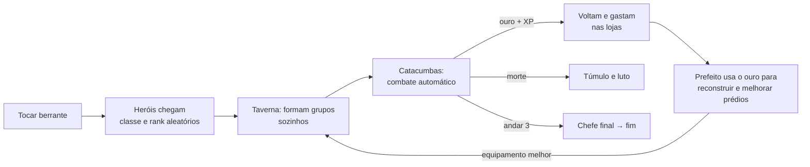
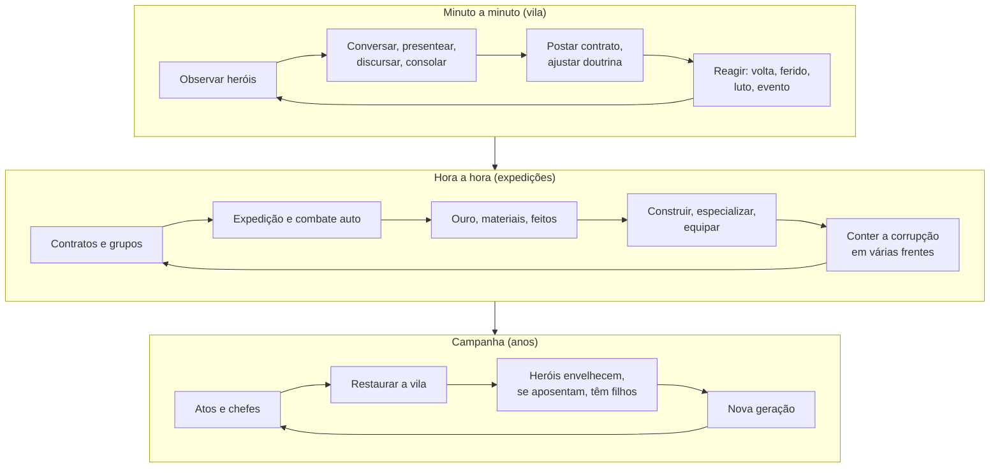

# Vigília — Game Design Document v0.1

> Codinome provisório. Versão expandida e **original** inspirada na proposta de *Tristram* (Bippinbits, Ludum Dare 55).
> Status: decidido **fantasia sombria original + web/TypeScript**. M0 (núcleo), M1 (fatia vertical) e M2 (pessoas) concluídos; a Fase A de polimento entrou (rótulos, celular, tensão, fim de campanha e sumidouros de ouro), faltando playtest; ver [README.md](README.md).

---

## 0. Resumo em uma tela

**Fantasia:** você não é o herói, você é a cidade. O prefeito de uma vila arrasada, à beira de um abismo, convoca aventureiros que **agem sozinhos**: escolhem com quem descer, quanto arriscar, o que comprar e de quem sentir falta. Você só pode influenciar.

**O que o jam acertou:** a perspectiva invertida, heróis com nome que geram histórias (luto, vingança, visita ao túmulo), o crescimento visível da vila e a tensão da morte permanente.

**Por que acaba em 30–60 min:** pouco conteúdo (3 andares, 1 chefe), poucas alavancas (berrante, expulsar/trocar, construir), economia linear (depois de comprar tudo o ouro não serve para nada), heróis rasos (rank e classe, sem traços com efeito real) e nenhuma pressão sobre a vila nem progressão entre partidas.

**A proposta:** manter o núcleo intacto e ampliar quatro eixos:
1. **Pessoas:** traços, vínculos, envelhecimento, aposentadoria, filhos, legado.
2. **Influência:** contratos, doutrinas, sino de retirada, decretos, impostos, conversas e presentes.
3. **Cidade viva:** lotes, cidadãos, impostos passivos e incursões noturnas quando o abismo não é contido.
4. **Abismo com forma:** 6 atos com biomas e chefes, andares procedurais, eventos e profundezas infinitas.

**Meta de duração:** campanha de 20–30 h, mais o modo infinito e as Eras (NG+) para jogar centenas de horas.

---

## 1. Estudo do original

### 1.1 Ficha

| Item | Valor |
|---|---|
| Evento | Ludum Dare 55 (abr/2024), 72 h |
| Engine | Godot 4 (web + Windows) |
| Equipe | René Habermann (Bippinbits), Raffaele Picca, Luca Martinelli, Anne Hecker, Cameron Paxton e outros |
| Recepção | 4,7/5 com ~580 avaliações e ~285 comentários |
| Duração | 10 min a 1 h; relatos de fim no "ano 7", "ano 11" e "ano 12" |
| Save | Não tem ("it's only a jam game") |
| Futuro | A Bippinbits está fazendo a versão completa, com € 335 mil de fomento do governo alemão (out/2025 a mai/2027). O dev respondeu "maybe 2027" |

### 1.2 O que observei e o que os jogadores relatam

**Vila (hub):** taverna com mesas, berrante numa torre de madeira à esquerda, baú/poço no centro (a pilha de ouro cresce ali), ruínas para reconstruir, quadro de avisos à direita, ponte ao sul (caminho para a catedral) e lago. Prefeito com WASD/E. Velocidade 1×/2×/3×.

**Heróis:**
- O berrante traz uma leva (~7 por toque).
- Cada herói tem nome e um estado visível no hover ("Waiting around").
- Classes: guerreiro/cavaleiro, tanque, curandeira, mago/piromante, valquíria e *wildling* (selvagem).
- Ranks de E a S.
- Barra de **confiança** (roxa/azul) que deveria decidir a fuga.
- Conversam entre si, visitam o túmulo de amigos e entram em "fúria vingativa" quando um aliado morre.

**Expedição:**
- Os grupos (até 4 a 5) se formam sozinhos, com 3 frentes.
- O combate é automático, e cada leva derrotada revela mais do mapa (indicador de progresso elogiado).
- O grupo volta com ouro e XP e gasta nas lojas.
- Há resumo da expedição.

**Alavancas:** *Hire* (dá 8 de ouro ao herói), *Sponsor* (ouro inicial extra), impostos que devolvem parte do ouro, expulsar/trocar membros (limite de 3 movimentos), upgrades de prédios e "o ancião".

**Fim:** chefe do 3º andar (demônio). O tempo passa em anos e os heróis não envelhecem.

### 1.3 Loop original



### 1.4 Por que funciona (preservar a todo custo)

1. **Perspectiva invertida:** "como se sentia o prefeito de Tristram?" é um gancho fortíssimo.
2. **Apego emergente:** os jogadores contam histórias como "o selvagem rank B, o mais fraco, matou o demônio sozinho depois que o grupo caiu".
3. **Morte que importa:** um comentário pede *para não* adicionar retirada porque "a tensão de perder quem você ama faz o jogo ficar muito melhor".
4. **Crescimento visível:** a pilha de ouro, a vila reconstruída e o "estouro" de ouro na volta.
5. **Atmosfera:** pixel art, música e o contraste entre a vila acolhedora e o abismo.
6. **Ritmo idle:** dá para deixar rodando e observar.

### 1.5 Por que acaba cedo (causas, não sintomas)

| Sintoma relatado | Causa de design |
|---|---|
| "Termina rápido", "pouca coisa pra fazer" | Conteúdo finito e linear: 3 andares e 1 chefe, sem nada depois do fim |
| Ouro acumulado (10k, 19k) sem uso | Economia sem sumidouros permanentes; os upgrades são um checklist que acaba |
| Pouco ouro no começo | Nenhuma renda passiva; tudo depende de expedição |
| Frustração por não poder recuar ou escolher | Poucas alavancas e todas grosseiras (trocar é "hit/miss") |
| Curandeira em loop infinito (soft-lock) | Combate sem regra anti-impasse; a confiança não força a fuga |
| Heróis parecem iguais depois de um tempo | Personalidade só no texto, sem traços com efeito mecânico |
| Nada a perder entre expedições | A vila nunca é ameaçada e o tempo não pressiona |
| Sem motivo para rejogar | Sem save, sem variação de mapa, sem meta-progressão |
| Barra de confiança confusa, ouro sem HUD | Informação ilegível na hora de decidir |

### 1.6 O que os jogadores pediram (por frequência)

1. **Versão completa / Steam / save**, de longe o mais pedido.
2. **Retirada ou recall** (com o contraponto de manter a tensão).
3. **Vínculos entre heróis** (amizade com bônus, rivalidade, favoritos juntos), renomear e dar presentes.
4. **Mais prédios e lojas**: campo de treino, estalagem, cervejaria, arena, lojas de equipamento.
5. **Mais biomas, monstros e andares**, desafios de fim de jogo e ranking.
6. **Decisões indiretas**: impostos, decretos, IA configurável (defensivo × egoísta).
7. **Estresse e lesões**, ressuscitar (raro), envelhecimento e sistema geracional (no estilo *Rogue Legacy*).
8. **Eventos na vila**, missões com prazo e pedidos de mercadores.
9. **Celular** (toque, clicar para mover) e acessibilidade.
10. **Escolher classe** ao convocar (pagando mais).

---

## 2. Ponto de partida legal e de mercado

- **Ideia e mecânicas são livres; expressão não é.** "Prefeito que gerencia heróis autônomos" pode ser usado à vontade. **Não** podemos usar nomes, arte, música, código ou textos do jam, nem nada de *Diablo* (Tristram, Catedral, Deckard Cain e afins são marcas da Blizzard).
- **A Bippinbits vai lançar a versão oficial (~2027).** Se a ideia for publicar, precisamos de identidade própria forte para não parecer clone. Esse é o motivo da proposta de ambientação na seção 10.
- **Diferenciais que o jam nem tocou:** gerações e legado, defesa da vila e cidade com cidadãos. São o nosso espaço.

---

## 3. Visão da versão completa

### 3.1 Pilares

| # | Pilar | Teste de design: toda feature nova precisa… |
|---|---|---|
| 1 | **Você é a cidade, não o herói** | …ser influência, nunca controle direto em combate |
| 2 | **Toda história é de alguém** | …gerar ou alimentar uma memória de um herói específico |
| 3 | **A vila cresce e sangra** | …ter custo, manutenção ou risco, e não ser só um "+10%" |
| 4 | **O abismo tem forma** | …criar uma escolha de composição, rota ou timing |
| 5 | **Lenda longa** | …continuar valendo após 20 h (sem upgrades "mortos") |

### 3.2 Loops em três escalas



**Regra de ouro do ritmo:** o jogador deve ter sempre **pelo menos 3 objetivos abertos de horizontes diferentes**, por exemplo o próximo prédio (minutos), o próximo chefe (hora) e a filha do herói favorito chegando à idade de lutar (campanha).

---

## 4. Sistemas

### 4.1 Heróis

**Classes:** 6 na fatia vertical e 12 na v1.

| Classe | Papel | Identidade |
|---|---|---|
| Guardião | Tanque | Provoca e protege o mais ferido |
| Clériga | Cura | Prioriza quem tem vínculo com ela (fica emocional quando ele morre) |
| Selvagem | Corpo a corpo | Fica mais forte com pouca vida; o "azarão" do jam |
| Lanceira | Bruiser | Alcance de 2 e investida |
| Piromante | Dano em área | Forte contra hordas, frágil |
| Arqueiro | Alvo único | Prioriza elites |
| Ladina *(v1)* | Utilidade | Desarma armadilhas, abre baús, mais saque |
| Bardo *(v1)* | Suporte | Ânimo do grupo; conta as histórias na taverna |
| Necromante *(v1)* | Invocador | Levanta inimigos caídos; os cidadãos desconfiam (−felicidade) |
| Monge *(v1)* | Controle | Atordoa e esquiva |
| Caçadora *(v1)* | Pet | Companheiro animal que também pode morrer |
| Alquimista *(v1)* | Debuff | Bombas e poções; reduz o custo do templo |

**Rank (E → S) = potencial**, ou seja, o teto de nível e o ganho por nível. **Novidade:** o rank pode **subir por feitos** e não só por XP. Matar um chefe, sobreviver sozinho ou salvar o grupo gera um *Feito* que promove o herói. Isso responde à pergunta de um jogador: "o feito faz o herói ou o herói faz o feito?".

**Traços:** cada herói tem 2 visíveis e 1 oculto, revelado num momento-chave. Também podem ser **adquiridos**.

| Traço | Efeito mecânico |
|---|---|
| Covarde | Foge com 50% de ânimo; −lealdade se o prefeito o forçar |
| Vingativo | +dano após a morte de um aliado; ignora o sino de retirada |
| Ganancioso | Aceita contratos mais fundos e pega uma parte maior do saque |
| Leal | Aceita a formação sugerida pelo prefeito |
| Curioso | Explora salas laterais: mais saque e mais risco |
| Beberrão | Recupera ânimo na taverna, mas gasta tudo |
| Devoto | Recupera ânimo na capela; resiste a maldições |
| Supersticioso | Recusa andares onde um amigo morreu |
| Veterano *(adquirido)* | Recebido após 20 expedições; +ânimo para o grupo |
| Traumatizado *(adquirido)* | Recebido após um massacre; −ânimo em andares de mesmo bioma |
| Fobia de X *(adquirido)* | Recebido ao quase morrer para um tipo de monstro |
| Tocado pela morte *(adquirido)* | Recebido ao ressuscitar; mais forte, mas mórbido |

**Ânimo** (substitui a "confiança" do jam): uma barra com **marcas visíveis** dos limiares de fuga de cada herói. Sobe com vitórias, bardo, discurso e amigos no grupo. Desce com feridas, mortes e escuridão. Decide a fuga de verdade.

**Necessidades na vila:** descanso (fadiga), diversão, fé e equipamento. A **fadiga** impede o mesmo grupo de descer sem parar. Isso obriga a ter **rotação de elenco**, e mais heróis significam mais gestão e mais histórias.

**Vínculos:** cada par de heróis tem uma afinidade de −100 a +100. Ela se constrói em expedições juntos, em salvamentos e em conversas na taverna.
- **Amigos** dão bônus de ânimo e uma *habilidade combinada* por par de classes.
- **Rivais** dão mais dano, mas brigam por saque e podem abandonar o grupo.
- **Mentor/aprendiz** dão XP extra (aposentados podem ser mentores).
- **Casal:** com casa, gera filhos que viram recrutas anos depois e **herdam traço, afinidade de classe e um item**.

**Tempo de vida:**
- Idade e pico entre 25 e 40 anos, com declínio depois dos 45.
- **Aposentadoria** voluntária (por traço ou idade) ou incentivada.
- **Aposentados viram moradores com função:** mentor no campo de treino, ferreiro, guarda da muralha, contador de histórias. Ninguém some de vez.
- **Lesões graves** deixam cicatrizes permanentes (−atributo, +traço). A casa de cura atenua.
- **Ressurreição** existe só no fim de jogo: é um ritual caro e raro, com preço (traço *Tocado pela morte*). Assim a morte continua pesando.

**Legado:**
- Cemitério e memorial com **epitáfio gerado** a partir da vida do herói.
- Itens nomeados herdáveis ("Lâmina de Bram").
- Salão das Lendas com bônus permanentes.
- Renomear heróis.

### 4.2 Influência indireta (as alavancas do prefeito)

Cada alavanca tem custo (ouro, reputação ou energia do prefeito) para que importe:

| Alavanca | O que faz | Custo / limite |
|---|---|---|
| Berrante | Convoca uma leva; o **chamado direcionado** pede uma classe | Ouro; o direcionado custa mais e tem recarga |
| Quadro de contratos | O prefeito posta um objetivo e uma recompensa; os heróis se candidatam conforme traços | A recompensa sai do tesouro |
| Contratar / Patrocinar | Do jam, expandido: patrocinar um herói específico aumenta a **lealdade** | Ouro |
| Formação sugerida | O prefeito monta o grupo ideal e cada herói aceita conforme a lealdade | Recusar custa ânimo |
| Doutrina da guilda | Postura (cautelosa / equilibrada / agressiva), limiar de retirada e prioridade de alvo | Desbloqueio no prédio da guilda |
| Sino de retirada | Chama um grupo de volta no meio da masmorra | Recarga longa e −reputação; os vingativos ignoram |
| Conversar / presentear / discursar | O prefeito anda até o herói (mantém o charme do avatar) | **Energia diária limitada** |
| Decretos | Políticas com dilema: imposto sobre saque, toque de recolher, funeral com honras, proibir necromancia, recrutamento forçado | Afetam felicidade e lealdade |
| Preços e impostos | Ajuste por loja | Imposto alto aumenta o tesouro, mas os heróis vão embora |
| Defesa | Posicionar guardas e torres antes das noites de incursão | Salários |

### 4.3 Expedições e combate

- Combate **automático em tempo real**, como no jam, sobre uma simulação de *tick* fixo e determinística por semente (permite repetir e balancear).
- Cada classe tem 3–4 habilidades, mais uma passiva de traço e as combinadas de vínculo.
- **Regra anti-impasse:** depois de N segundos, os inimigos entram em fúria e o ânimo drena até alguém ceder. Isso mata o soft-lock da curandeira.
- **Várias frentes:** começa com 1 grupo e chega a 3–4 grupos simultâneos em atos diferentes.
- **Resumo da expedição:** saque, XP, abates e **momentos marcantes** ("Mira salvou Aldric de um golpe fatal"). Rolável e sem cortar botões.
- **Itens:** raridade de comum a lendário, com afixos. Os heróis compram nas lojas **com o próprio ouro**, e o prefeito pode presentear. Artefatos únicos têm história (o "Um Anel" do jam vira uma família de relíquias).

### 4.4 O abismo

**Estrutura:** 6 atos × 4 andares, mais um chefe por ato e as **Profundezas infinitas** no pós-jogo.

| Ato | Bioma | Material | Chefe (mecânica que pede composição) |
|---|---|---|---|
| I | Catacumbas | Ossos | Invoca hordas: pede dano em área |
| II | Minas inundadas | Ferro-negro | Couraçado: pede perfuração (arqueiro/lança) |
| III | Jardim de fungos | Esporos | Envenena: pede cura e alquimia |
| IV | Cidade afogada | Pérolas negras | Amaldiçoa: pede clériga/devoto |
| V | Forja abissal | Brasas | Fases com troca de alvo: pede tanque forte |
| VI | Coração do abismo | Fragmentos de alma | Final: usa os **mortos da sua campanha** contra você |

**Andares procedurais** (por semente) com névoa revelada sala a sala, como no jam. Tipos de sala:
- Matilha, ou elite com afixos (veloz, vampírico, explosivo…).
- Armadilha (a ladina resolve).
- Santuário com bênção ou maldição; a escolha depende do traço de quem toca.
- Baú.
- **Prisioneiro** (vira um recruta).
- **Restos de um herói perdido seu** (recupera o item e fecha o luto).
- Mercador errante e eventos de história.

**Corrupção:**
- Cada ato tem um medidor que **sobe com o tempo** e cai quando os andares são limpos.
- Acima do limiar, os monstros ficam mais fortes e há **incursões noturnas na vila**.
- Isso cria a pressão de "pratos girando" que sustenta horas de jogo, e dá motivo para manter grupos em atos antigos.

### 4.5 A vila

- **Começa em ruínas** (mantém a fantasia de reconstruir). O mapa **expande** quando o prefeito limpa a floresta, constrói a ponte ou abre a colina.
- **Lotes:** o jogador escolhe onde construir, com adjacências simples (por exemplo, taverna perto da estalagem dá +ânimo).
- **Cidadãos:** a população cresce com moradia, comida e segurança. Eles pagam **impostos passivos** (resolve o começo sem ouro), trabalham nos prédios e têm humor. A morte de um herói querido entristece a vila.
- **Noites de incursão:** um mini-loop de defesa com torres, guardas, aposentados e heróis que estão na vila. Pode fazer o jogador perder prédios, mas nunca a campanha.

| Prédio | Função | Especialização (nível 3) |
|---|---|---|
| Taverna | Recrutas, ânimo, conversas | Cervejaria (ânimo) × Casa de apostas (ouro) |
| Estalagem | Capacidade de heróis, descanso | Quartos de luxo × Dormitório |
| Ferreiro | Armas e armaduras | Lâminas × Couraças |
| Alquimista | Poções, antídotos | Cura × Bombas |
| Templo | Cura, bênçãos, ressurreição (tardia) | Luz × Penitência |
| Casa de cura | Trata lesões e trauma | Cirurgia × Ervas |
| Guilda | Contratos, doutrinas | Mercenária × Ordem |
| Campo de treino | XP passiva, mentores | Disciplina × Arena (luta entre heróis) |
| Cartógrafo | Mapas persistentes e rotas | Atalhos × Previsão de elites |
| Biblioteca arcana | Magias, identificação | Fogo × Proteção |
| Cemitério/Memorial | Luto mais curto, legado | Mausoléu × Ossuário (necro) |
| Mercado | Comércio, caravanas | Rota de luxo × Mercado negro |
| Tesouraria | Juros, empréstimos | Banco × Cofre |
| Fazenda/Moinho | Comida → população | — |
| Muralha e torres | Defesa noturna | Balistas × Sinos |
| Escola | Filhos de heróis viram recrutas | — |
| Prefeitura | Decretos e energia do prefeito | — |
| Joalheiro | Encantar, engastar | — |

### 4.6 Economia

- **Duas carteiras:** o **ouro dos heróis** (gasto em lojas, taverna e templo) e o **tesouro da vila** (impostos sobre vendas e saque, cidadãos e contratos). O imposto é a ponte entre as duas, e o prefeito a regula.
- **Materiais por bioma** são necessários para os níveis de prédio e para a fabricação, o que dá motivo para revisitar atos.
- **Sumidouros permanentes:** manutenção de prédios, salários de guardas, festivais, contratos, ritual de ressurreição, decretos e decoração. **O ouro nunca vira número morto.**
- **HUD:** tesouro, renda por dia e um gráfico simples (pedido explícito dos jogadores).

### 4.7 Tempo e calendário

- Dia → estação → ano, com pausa e velocidades 1×/2×/4×.
- **Envelhecimento anual.** Uma campanha cobre de 40 a 60 anos de jogo, o que permite 2–3 gerações.
- **Eventos sazonais:**
  - Festival da colheita (ânimo).
  - Caravana (itens raros).
  - Peste (doença).
  - Eclipse (surto de corrupção).
  - Visita de um herói lendário.
  - Cobrador do rei (imposto externo).
  - Vila rival tentando recrutar os seus heróis.

### 4.8 Motor de histórias

- **Tudo vira evento estruturado** (quem, o quê, onde, quando), que alimenta:
  - A **Crônica da Vila**, um livro navegável com a história da campanha.
  - **Falas contextuais** dos heróis que lembram fatos reais ("Desde que o Bram caiu no andar 3 eu não desço sem tocha extra").
  - **Epitáfios** e feitos para a promoção de rank.
- **Arcos emergentes por templates:** rivalidade que vira amizade, último sobrevivente, traição (ganancioso foge com o saque), redenção (covarde que fica para salvar o amigo).

### 4.9 Continuidade de longo prazo

| Camada | Duração | Gancho |
|---|---|---|
| Campanha (6 atos) | 20–30 h | Restaurar a vila e descobrir o que dorme no abismo |
| Gerações | Dentro da campanha | Filhos, herança, dinastias, rivalidades de família |
| Profundezas infinitas | Ilimitado | Andares escalonados, recordes por herói |
| Eras (NG+) | Ilimitado | Séculos depois a vila é ruína de novo, mas o **Salão das Lendas** e as relíquias permanecem. *Pactos* opcionais aumentam a dificuldade em troca de recompensas (estilo *Hades*) |
| Desafio semanal | Opcional | Semente fixa com modificadores e ranking |
| Modo Ferro | Opcional | Um save só, sem recarregar |

---

## 5. Correções de base (lições do jam)

- **Save automático e slots**, com export/import de JSON.
- **Sem soft-lock:** regra anti-impasse e a fuga forçada pelo ânimo.
- **Informação legível:** ouro no HUD, limiares de ânimo, tooltips de equipamento e atributos, resumo rolável e notificações ("Mira morreu no andar 3").
- **Desempenho com mais de 100 aldeões:** simulação separada da renderização, com animação simplificada fora da tela.
- **Celular:** toque, clicar para mover e UI escalável.
- **Acessibilidade:** fonte maior, alto contraste, menus navegáveis por teclado e leitor de tela nos menus.

---

## 6. Escopo de conteúdo

| Item | Jam | Fatia vertical (M1) | v1.0 |
|---|---|---|---|
| Classes | ~6 | 6 | 12 |
| Traços | — (só texto) | 12 | 40+ |
| Andares / chefes | 3 / 1 | 4 / 1 | 24 / 6 + infinito |
| Inimigos | poucos | 12 | 60+ com afixos |
| Prédios | ~6 | 6 | 18+ com especializações |
| Eventos de vila | 0 | 3 | 30+ |
| Duração | 30–60 min | 2–3 h | 20–30 h + infinito |
| Save | não | sim | sim + Eras |

---

## 7. Tecnologia (recomendação)

**TypeScript + Vite + Phaser 3 (ou PixiJS)**, mesma família do *Rolê do Popinho*:
- Roda no navegador (itch.io) e depois vai para desktop (Tauri/Electron → Steam) e celular (Capacitor).
- Eu consigo testar tudo pelo navegador e por **simulação headless**.

**Arquitetura-chave:** um **núcleo de simulação puro e determinístico**, separado da renderização.

```
vigilia/
  src/sim/      # regras puras: heróis (IA de utilidade), combate, masmorra, economia, calendário, crônica
  src/data/     # classes, traços, inimigos, itens, prédios, eventos (dados, não código)
  src/render/   # cenas Phaser: Vila, Masmorra
  src/ui/       # HUD, painéis, crônica
  tools/        # balanceador headless: simula 50 anos em segundos, Monte Carlo de mortalidade e ouro
```

- **IA de utilidade** para a vida na vila: cada herói pontua ações (descansar, beber, comprar, aceitar contrato, visitar túmulo, treinar) por necessidade × traço. É o motor da "personalidade autônoma".
- **Save** é o estado da simulação serializado em JSON, versionado.
- **O balanceamento por script** é o que torna viável um jogo de 20 h feito por uma equipe pequena.

**Alternativa:** Godot 4, a mesma engine do original. É o melhor ferramental 2D e facilita console, mas o ciclo de teste daqui fica mais lento.

---

## 8. Arte e áudio

- Pixel art top-down em 3/4, com sprites de 16–32 px e paleta escura com luzes quentes (vila acolhedora × abismo).
- **Protótipo com asset packs licenciados** (uso comercial) para validar o loop; artista dedicado para a identidade final.
- Música e efeitos licenciados no começo e encomendados depois. O tema da vila muda conforme o estado (paz, luto, incursão).

---

## 9. Roadmap por marcos

| Marco | Entrega | Critério de pronto |
|---|---|---|
| **M0: Núcleo** ✅ | Simulação headless com heróis, necessidades, traços, expedição, combate, economia, save e balanceador | Simula 10 anos sem soft-lock; relatório de mortalidade e ouro coerente |
| **M1: Fatia vertical** ✅ | Vila jogável com 6 prédios, berrante, quadro de contratos, 6 classes, ranks, 12 traços, ânimo, sino de retirada, Ato I e HUD | Paridade com o jam, mais correções, 2–3 h divertidas |
| **M2: Pessoas** | Vínculos, luto/vingança, lesões, envelhecimento, aposentadoria, crônica, memorial, conversas e presentes | Os playtesters contam histórias dos heróis sem você perguntar |
| **M3: Vila viva** | Lotes e expansão, cidadãos, impostos e decretos, incursões noturnas, eventos sazonais | O ouro nunca fica parado; existe tensão fora da masmorra |
| **M4: Profundidade** | Atos II–IV, materiais, fabricação, especializações, itens nomeados, chefes com mecânica | 12+ h sem repetir decisões |
| **M5: Lenda** | Atos V–VI, gerações, Eras e Pactos, profundezas infinitas, celular, polimento, PT/EN | Campanha completa e motivo para recomeçar |

### 9.1 Especificação do M2: Pessoas

Vínculos, luto, vingança, envelhecimento e crônica já existem desde o M0. O M2 acrescenta cinco sistemas.

**Energia do prefeito.** O prefeito tem 4 pontos por dia, que recarregam à meia-noite. As ações custam energia e só valem com o herói na vila:

| Ação | Energia | Efeito |
|---|---|---|
| Conversar | 1 | +lealdade e +ânimo; 1 vez por dia por herói; às vezes revela o traço oculto |
| Presentear | 1 + ouro | Bebida (Beberrão adora), relíquia (Devoto adora) ou arma (sobe 1 tier dentro do limite do ferreiro) |
| Consolar | 1 | −luto e +ânimo de quem chora alguém |
| Discursar | 2 | +ânimo e +lealdade de todos na vila; 1 vez por dia |
| Renomear | 0 | Troca o nome do herói |
| Aposentar | 0 | Aposentadoria honrosa: o herói fica na vila com uma função; não custa lealdade aos amigos, ao contrário de dispensar |

**Lesões, cicatrizes e Casa de cura.**
- **Quem pega lesão:** quem termina um combate (ou foge) com menos de 15% de vida pode se ferir. A lesão vai no braço, na perna, no olho ou nas costelas e traz uma penalidade no atributo correspondente.
- **Recuperação:** a lesão leva de 8 a 25 dias. Nesse período o herói não desce e passa o tempo se tratando.
- **Cicatrizes:** ao sarar, a lesão pode virar cicatriz permanente com penalidade menor. Com 2 cicatrizes, o herói ganha o traço adquirido *Marcado* (+ânimo, porque já viu o pior).
- **Casa de cura (7º prédio, níveis 1–3):** acelera a recuperação e reduz a chance de cicatriz.

**Casais e filhos.**
- **Casamento:** a cada estação, dois heróis com vínculo ≥ 80 podem se casar (qualquer combinação de gênero).
- **Filhos:** casais que estão na vila têm chance anual de ter (ou adotar) um filho.
- **Maioridade:** aos 16 anos o filho vira recruta. Herda um traço e, com frequência, a classe de um dos pais, além de equipamento herdado.
- **Órfãos:** a criança cresce mesmo se os pais morrerem. A morte de um cônjuge gera luto máximo.

**Aposentados com função.**
- **Quem se aposenta:** quem se aposenta (por idade, por cicatrizes ou por ordem do prefeito) continua na vila.
- **Funções:**

| Função | Efeito |
|---|---|
| Mentor | Campo de treino: mais XP |
| Ferreiro | Equipamento mais barato |
| Contador de histórias | Taverna: mais ânimo |
| Curandeiro | Casa de cura: recuperação mais rápida |

- **Velhice:** aposentados com 70 anos ou mais podem morrer de velhice e vão para o memorial.

**Memorial.** Todo herói morto ganha um epitáfio gerado a partir da vida dele: feito mais notável, como caiu, um traço marcante e quem chora por ele.

**Critério de pronto:** saves antigos carregam (migração v1 → v2), o balanceador mantém 0 impasses e ócio ≤ 4 dias, e a crônica de 3 anos tem casamentos, lesões e epitáfios que contam histórias.

---

## 10. Decisões em aberto

1. **Stack:** web/TypeScript (recomendado) ou Godot 4?
2. **Ambientação** (é o diferencial frente à versão oficial):
   - **A. Fantasia sombria original:** vila "Vigília" na borda de um abismo sob uma abadia antiga.
   - **B. Folclore brasileiro:** vila mineradora colonial cuja mina rompeu num mundo inferior. Inimigos como Corpo-seco, Mula-sem-cabeça, Boitatá e Mapinguari, com o **ouro** como recurso temático. É o diferencial mais forte, mas exige pesquisa cultural cuidadosa.
3. **Objetivo:** projeto pessoal ou publicar (itch/Steam)? Isso muda o investimento em arte e o cuidado legal.
4. **Arte:** asset packs licenciados ou artista dedicado?
5. **Tom:** mais aconchegante (*cozy*) ou mais sombrio (*dark*)?

---

### Fontes

- Página do jogo: https://bippinbits.itch.io/tristram (descrição, créditos, patch notes e ~285 comentários)
- Fomento da versão completa: https://www.gamesmarket.global/federal-funding-bippinbits-receives-euro335098-in-funding-from-the-bmwe-afec7e2828a41bb0e8d209a6cbbca558/
- Sessão própria no build web: intro, tutorial, berrante, chegada dos heróis e hub da vila. O resto da campanha não foi jogado, porque o painel do navegador ficou oculto e o jogo congela em segundo plano.
