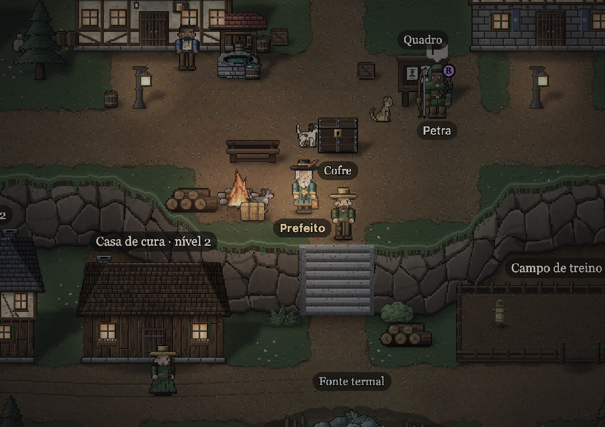
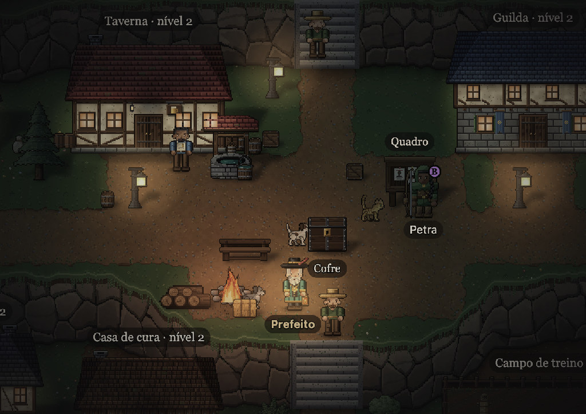
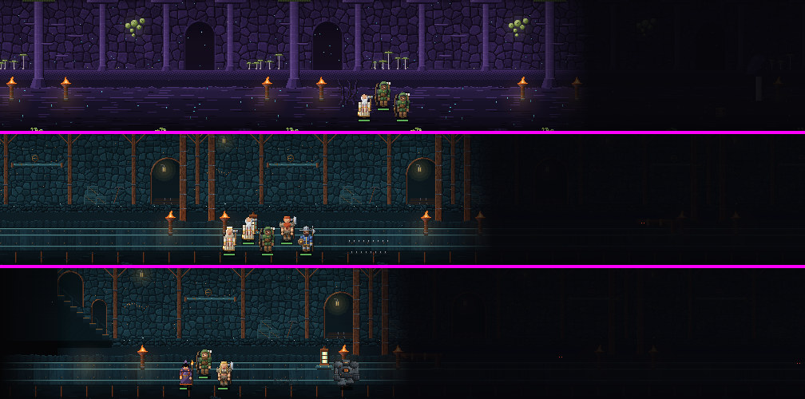
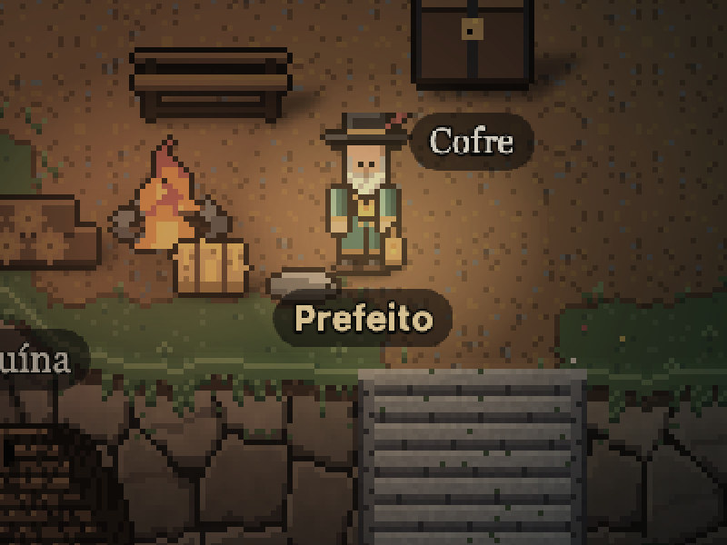
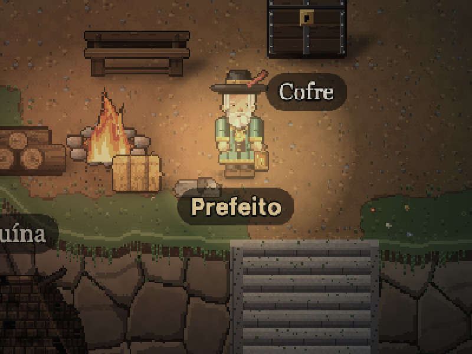

# Vigília

Simulador de vila em fantasia sombria, no navegador. Você é o prefeito: atrai heróis, reconstrói a vila e cuida de quem volta do abismo. Os heróis descem sozinhos, em grupos, e a luta segue automática.

Jogue a versão publicada: **https://welingtonfidelis.github.io/vigilia_game/**





Três grupos no abismo ao mesmo tempo, cada um no corredor do seu ato:



A arte é toda própria e tem duas versões. Escolha em **Menu → Arte**; a troca é na hora:

| 16-bit | 32-bit |
|---|---|
|  |  |

Documentação completa, arquitetura, GDD, arte e histórico de decisões:
**[docs/VIGILIA.md](docs/VIGILIA.md)**.

## Início rápido

```bash
npm install
npm run dev      # http://localhost:5173
npm test
npm run build
```
