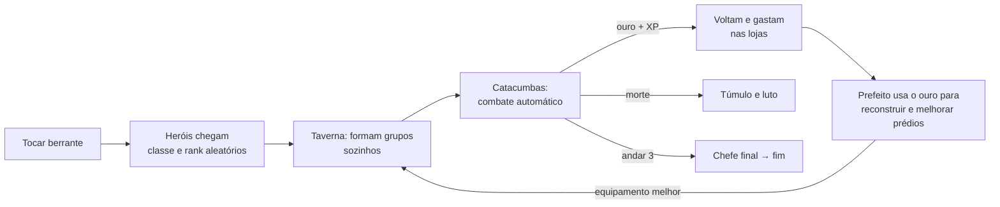
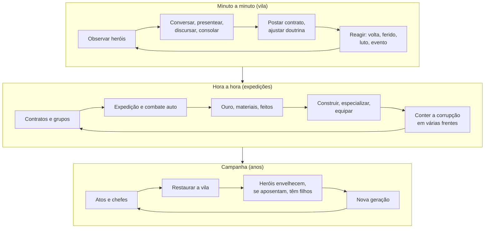

# Vigília — documentação única

Versão do documento: 2026-10-21
Jogo: **Vigília** — simulação de vila + expedições automáticas ao abismo.
Stack: TypeScript, Vite, Preact e Phaser 3.
Pack de arte atual: **Vigília Art Pack 1.9.0** (CC0 1.0, Equipe Vigília).

Este arquivo substitui o README antigo, o GDD e os briefs/históricos soltos em `docs/art/`.
O README da raiz é apenas uma porta de entrada.

**Jogar publicado:** https://welingtonfidelis.github.io/vigilia_game/

## Índice

1. [Estado, como jogar e arquitetura](#1-estado-como-jogar-e-arquitetura)
2. [Game Design Document](#2-game-design-document)
3. [Direção de arte e pipeline](#3-direção-de-arte-e-pipeline)
4. [Kit de arena da dungeon — pedido entregue no pack 1.9](#4-kit-de-arena-da-dungeon--pedido-entregue-no-pack-19)
5. [Corredor da dungeon — pedido de arte (pack 2.0, em aberto)](#5-corredor-da-dungeon--pedido-de-arte-pack-20-em-aberto)
6. [Histórico de decisões e pedidos antigos](#6-histórico-de-decisões-e-pedidos-antigos)

---

## 1. Estado, como jogar e arquitetura

**Publicado:** https://welingtonfidelis.github.io/vigilia_game/

Jogo de gestão em que você é o prefeito de uma vila à beira de um abismo e os heróis agem sozinhos. Design completo na seção 2 deste documento.

**Estado atual: M4 concluído (corredor da dungeon com arte própria nos seis atos, itens nomeados, forja, especializações de nível 3, bancada do joalheiro, salas novas, chefes em duas fases, provisões e mecenato) e pack de arte Vigília 1.9 integrado no cenário, prédios, moradores, heróis e retratos. O M5 (O Abismo das Dimensões) está no `main`. Próximo: o M6 (Histórias sem fim, seção 9.6 do GDD), no branch `m6-historias`.** A vila roda no navegador (Phaser + Preact) por cima do núcleo de simulação headless. Dá para jogar do Ato I ao Coração do Abismo, com heróis que se ferem, casam, têm filhos, se aposentam com uma função e ganham epitáfio; moradores nomeados que trabalham, pagam imposto pelo humor e podem morrer; e incursões que descem do abismo quando a corrupção sobe.

### Jogar

```bash
npm install
npm run dev                                     # abre em http://localhost:5173
npm run dev -- --host                           # idem, acessível pelo celular na mesma rede
```

- **Prefeito:** WASD/setas ou clique (toque) no chão para andar. Clique num prédio, no berrante, no quadro, no cofre, no abismo ou no cemitério: o prefeito vai até lá e interage. Perto de algo, **E** interage.
- **Heróis:** clique num herói para ver a ficha (vida, ânimo com a marca de fuga, traços revelados e ocultos, vínculos, feitos). Eles não obedecem: escolhem o que fazer e com quem descer.
- **Tempo:** Espaço pausa · 1, 2, 3 = 1×, 2×, 4× · **M** abismo · **H** heróis · **C** crônica · **Esc** fecha.
- **Som:** liga no primeiro clique (regra dos navegadores). **N** ou o alto-falante no topo silencia; Menu → Som ajusta geral, música, ambiente e efeitos.
- **Save:** salva sozinho no `localStorage` a cada dia do jogo e ao sair da página. Menu → Salvar/Carregar/Novo jogo.
- **Celular:** toque para andar e interagir. Em telas de até 720 px, a barra de navegação vira um botão flutuante no canto, que abre os painéis num leque em quarto de círculo (Menu → canto esquerdo, para canhotos). Os painéis viram folhas que descem até embaixo. O topo cabe numa linha: o som sai de lá (fica em Menu → Som), e a velocidade vira a pausa mais um botão que alterna 1×, 2× e 4× a cada toque (pausado, o toque volta a andar na velocidade mostrada). Em tela de toque (celular ou tablet), o aviso "E …" de perto dos objetos não aparece: tocar no prédio, no quadro, no cofre ou no bicho já leva o prefeito até lá. Menu → A−/A+ ajusta o tamanho da interface.

### Rodar as ferramentas

```bash
npm test                                        # 129 testes (núcleo, itens, mecenato, corredor, pessoas, economia, sessão, save, vila, sprites, textos, som)
npm run build                                   # typecheck + bundle de produção em dist/
npm run chronicle -- --seed 4 --years 3         # Crônica da Vila de uma campanha jogada pelo prefeito automático
npm run balance -- --seeds 10 --years 30        # Ritmo, mortalidade, economia e saúde em várias sementes
npm run playtest                                # Playtest automático: 30 sementes × 30 anos, salvando e carregando a cada 5 anos
npm run deaths -- --seeds 6 --years 5           # Diagnóstico de quem morre, onde e para quem
npm run typecheck
```

Node 22+ roda os `.ts` direto (type stripping). Não há passo de build para as ferramentas.

### Arquitetura

```
index.html, src/main.tsx   monta a sessão, o HUD/painéis (Preact) e o Phaser; atalhos, autosave e avisos
src/game/   ponte entre tela e núcleo, sem Phaser nem DOM (testável no Node)
  session.ts     acumulador de tick fixo (10 ticks/s em 1×, 2×, 4×, pausa), comandos, eventos e resumo das expedições
  storage.ts     salvar/carregar no localStorage com try/catch e preferências da tela
src/render/ Phaser: só lê o World a cada quadro
  VillageScene.ts  cena da vila: prédios por nível, heróis indo aos lugares da atividade, prefeito, dia/noite, túmulos
  layout.ts      planta da vila e destino de cada herói por atividade (puro, testado)
  town.ts, ground.ts  vila no tileset do pack Vigília 1.9 (marcos, casas, árvores, enfeites de transição, copas da frente e neblina); ground.ts diz onde há terra e trilha
  terrain.ts     chão pintado pixel a pixel numa textura única: terra e trilha com borda orgânica, tufos e pedrinhas, marcas de carroça, cinza da fogueira, rebaixo da fonte, paredões de rocha e escadarias
  relief.ts      relevo em degraus (platô do cemitério; alto: portão e berrante; meio: templo, taverna, guilda, praça e caverna; baixo: estalagem, casa de cura, campo, ferreiro, fonte): borda e altura dos paredões (a encosta da meseta é vedada coluna a coluna), escadarias e as células que eles bloqueiam (puro, testado)
  sprites.ts     moradores, prefeito, crianças, heróis, retratos e monstros do pack 1.9
  art32.ts       modo de arte 16/32: escolhe a peça 32-bit quando ela existe (índice em pack32.ts, gerado por `npm run pack32`)
  art.ts         o pouco que o pack não tem (lápide, fogueira, berrante, ícones), pixel a pixel
  nav.ts         grade de bloqueios e rotas da vila (A*), lidos da transparência da arte (puro, testado)
  fx/            visual 2.5D, componentes reutilizáveis sem regra de jogo:
    shadows.ts     camada única de sombras projetadas (silhueta achatada e deitada para leste), oclusão na base das paredes e sombra suave de pé
    lighting.ts    mapa de luz em multiplicação (noite fria #1a2421) e LightSource (cor, raio, intensidade, tremulação, pulsação, halo); as luzes se somam em SCREEN, porque o ADD do Phaser perde carimbos no lote
    particles.ts   emissores leves: fagulhas, fumaça de chaminé, vapor da fonte e miasma da caverna
    wind.ts        pipeline WebGL do vento: o topo das árvores balança numa onda que corre pela floresta, sem custo de CPU
    parallax.ts    copas escuras em primeiro plano nas bordas, que correm 1,15× mais rápido que o mundo e só aparecem na beira do mapa
    fog.ts         bancos de neblina rasteira (cemitério e bordas da floresta) que passam com o vento
    alpha.ts       leitura e cache da transparência das texturas (janelas acesas, pegadas, sombras)
  lane/          corredor da dungeon em Canvas 2D (sem Phaser): model.ts (posições, câmera, névoa, golpes novos; puro, testado), sprites.ts, renderer.ts
src/ui/     Preact: HUD, objetivos, avisos e painéis (herói, abismo, crônica, prédios, berrante, quadro, cofre, elenco, cemitério, menu)
src/audio/  som 100% sintetizado (Web Audio, sem arquivos)
  director.ts    eventos → efeitos (prioridade e intervalo mínimo) e clima do mundo → música (puro, testado)
  sfx.ts         26 efeitos: berrante, moedas, martelo, sino fúnebre, fanfarra do chefe, eco dos mortos…
  music.ts       trilha generativa em Ré menor: dia, noite, luto, tensão (chefe) e alvorada (fim)
  ambience.ts    vento, grilos, pássaros, fogueira, metal distante do combate e o zumbido do abismo (cresce com a corrupção)
  engine.ts      mesa com canais de música, ambiente e efeitos, reverb e compressor
src/data/   classes, traços, biomas/monstros/Senhores, regras das dimensões, prédios, nomes (dados puros)
src/sim/    regras: tudo determinístico, estado 100% JSON
  world.ts       cria o mundo
  loop.ts        step(): 1 tick = 0,1 s em 1× · hora = 20 ticks · dia = 480 ticks · ano = 40 dias (~32 min)
  town.ts        necessidades e IA de utilidade (descansar, beber, rezar, comprar, treinar, túmulo, socializar, quadro)
  party.ts       formação autônoma de grupos e escolha do andar (confiança × doutrina × traços × corrupção)
  expedition.ts  descida, salas, saque, conquista, retorno, luto, contratos
  people.ts      lesões e cicatrizes, casamentos e filhos, aposentados com função, velhice e epitáfios
  combat.ts      combate em tempo real: papéis, ânimo, fuga, retirada, vingança, mecânicas de chefe
  dungeon.ts     abismo (M5): nível, passagens geradas por semente, andares (mapa persistente até conquistar), guardião, inimigos, afixos, regras, pressão por passagem, estimativa de força
  economy.ts     tesouro, preços, efeitos dos prédios, população e impostos
  commands.ts    alavancas do prefeito (berrante, construir, contrato, sino, doutrina, imposto, patrocínio, dispensar)
  chronicle.ts   Crônica da Vila (eventos com texto em pt-BR)
  save.ts        serialize/deserialize/checksum
  bot.ts         prefeito automático (o "jogador médio" do balanceador)
tools/      balanceador, crônica, diagnóstico de mortes
tests/      vitest
```

O RNG (mulberry32) vive dentro do `World`. Por isso salvar no meio de um combate e carregar continua **exatamente** a mesma partida, e há um teste que garante isso.

A tela fala com o núcleo só por `src/sim/index.ts`: `step()` no acumulador da sessão, `commands.*` para as alavancas do prefeito e consultas somente-leitura (custos, vagas, limiar de fuga, salas do andar). Um teste confirma que jogar pela sessão, quadro a quadro, dá o mesmo mundo que rodar o núcleo direto.

A câmera acompanha o prefeito com zoom fixo: 1,5× na tela grande e 1× no celular (lado curto da tela menor que 600 px); não há zoom por roda ou pinça.

**Atalhos de depuração** (só em `npm run dev`, no console do navegador): `vigilia.days(n)` avança n dias, `vigilia.advance(ticks)`, `vigilia.autoplay(n)` deixa o prefeito automático jogar n dias e `vigilia.frames(n)` roda quadros do Phaser na mão (útil com a aba em segundo plano, quando o navegador para o `requestAnimationFrame`).

### Retrato do balanceamento (playtest automático: 30 sementes × 30 anos, prefeito automático)

Medido com o M4 inteiro (itens, forja, especializações, bancada do joalheiro, salas novas, chefes em duas fases, provisões e mecenato) e com os ajustes do playtest guiado: famílias mais cedo (laço 65 para casar, 20% de chance de filho por estação) e os bichos da vila. O prefeito automático escolhe Cervejaria, Dormitório, Lâminas, Penitência, Mercenária, Disciplina e Cirurgia, encomenda peças quando o tesouro sobra e entrega uma peça do cofre por dia. A cada 5 anos o mundo é salvo e carregado: os 180 saves voltaram idênticos.

| Chefe | Ano médio | Horas em 1× | Faixa | Sementes que chegaram |
|---|---|---|---|---|
| Catacumbas | 1,2 | 0,6 h | 0,7–1,8 | 100% |
| Minas Inundadas | 3,1 | 1,7 h | 1,4–5,3 | 100% |
| Jardim de Fungos | 5,3 | 2,8 h | 3,0–9,1 | 100% |
| Cidade Afogada | 8,7 | 4,6 h | 5,7–13,5 | 100% |
| Forja Abissal | 15,2 | 8,1 h | 10,1–21,3 | 100% |
| Coração do Abismo | 17,8 | 9,5 h | 11,3–25,1 | 97% |

- **Mortalidade:** 5,0 mortes/ano com elenco de ~22. Ninguém é dispensado: são cerca de 20 aposentadorias por campanha, cada uma com uma função na vila.
- **Pessoas, por campanha:** ~74 lesões, ~3 cicatrizes, ~27 casamentos, ~35 filhos e ~17 deles chegando à maioridade como heróis. O primeiro filho costuma nascer entre o ano 2 e o 3,5 e já aparece na praça.
- **Vila (M3), por campanha:** ~28 incursões, ~12 moradores mortos e quase ninguém deixando a vila; a população termina no teto (~136, abstrata), o humor médio fica em ~54 e os prédios em ruína no fim são raros porque o prefeito automático reconstrói.
- **Expedições:** ~102 por ano, 0 impasses de combate, no máximo 1 dia seguido sem expedição e **4% de retiradas**. A confiança ao descer separa o risco: ≥0,5 → 0,46 morte por expedição; ≥1,0 → 0,07; ≥1,5 → 0,01.
- **Ouro:** o tesouro termina abaixo de ~2 mil; o ouro dos heróis termina em média com 22,7 mil (12–32 mil), dentro da meta. As provisões fazem o grosso do gasto; a bancada e o mecenato pegam os mais ricos (algumas obras por campanha).
- **Desempenho:** ~2,2 s para simular uma campanha de 30 anos com os saves.

### O que o M0 entrega

- [x] Heróis com classe, rank E–S, nível, 12 traços (1 oculto), ânimo, lealdade, necessidades, luto, vínculos, idade, aposentadoria e feitos que promovem o rank
- [x] IA de utilidade na vila e formação autônoma de grupos (com veteranos que "adotam" novatos)
- [x] 6 atos × 4 andares, 18 inimigos, 5 afixos de elite, 6 chefes com mecânicas (invocar, couraça, veneno, maldição, retaguarda, ecos dos seus mortos)
- [x] Combate em tempo real com regra anti-impasse (o soft-lock da curandeira do jam não existe aqui)
- [x] Fuga individual por ânimo, retirada por doutrina, sino de retirada, heróis vingativos que se recusam a recuar
- [x] Mapa persistente até conquistar, restos de heróis caídos recuperáveis, resgates, santuários, baús
- [x] Corrupção por ato que sobe com o tempo e re-infesta salas; os heróis priorizam conter o pior ato
- [x] Economia de duas carteiras (heróis × tesouro), 7 prédios com 3 níveis e materiais por bioma
- [x] Crônica da Vila em português, save/load versionado e balanceador headless

### Inspiração e créditos

Vigília é um projeto original inspirado na **proposta** de [**Tristram**](https://bippinbits.itch.io/tristram), jogo criado em 72 horas na Ludum Dare 55 (2024) por René Habermann (Bippinbits), Raffaele Picca, Luca Martinelli, Anne Hecker, Cameron Paxton e equipe. A ideia central vem de lá: ser o prefeito de uma vila que convoca heróis autônomos para uma masmorra e reconstrói a cidade com o que eles trazem. O crédito pelo conceito é deles.

- **Nada do Tristram foi reutilizado:** nenhum código, arte, música, texto, nome ou dado. Regras, números, classes, inimigos, chefes, nomes e textos deste repositório foram escritos do zero.
- O estudo do jogo original (mecânicas observadas, pontos fortes, limitações e pedidos dos jogadores) está na seção 1 do GDD (neste documento).
- A Bippinbits está desenvolvendo a versão completa oficial do Tristram. Este projeto não tem relação com ela nem com a Bippinbits.
- "Tristram" e "Diablo" são marcas da Blizzard Entertainment. Vigília não usa elementos desse universo e não é afiliado à Blizzard.

#### Arte

Toda a arte é própria, sem peças de terceiros:

- **Vigília Art Pack 1.9** (Equipe Vigília, CC0 1.0): terreno, 7 prédios × 3 níveis + ruína, casas, portão/berrante, termas, props, FX, moradores, prefeito, crianças, heróis com ataque/morte, retratos, 18 inimigos + 6 chefes, variantes de profundidade, 6 arenas de dungeon em camadas, 24 fundos por andar, UI de dungeon, outono, lamparinas, bancos e carroças. Fica em `public/assets/vigilia/`, com `licenses/LICENSE.md` e o gerador no pacote original.
- **Arte 32-bit** (mesma licença): o par de cada peça com o dobro de pixels, em `public/assets/vigilia/export32/`, gerado pelos scripts versionados em `art32/`.
- Até a versão 1.x o jogo usava também o [Tiny Town](https://kenney.nl/assets/tiny-town), de Kenney, e o [16x16 DungeonTileset II](https://0x72.itch.io/dungeontileset-ii), do 0x72 (ambos CC0). Os dois saíram do jogo com a arte 32-bit.

### O que o M1 entrega

- [x] Vila em Phaser: 7 lotes (ruína × níveis 1–3), berrante, quadro de contratos, cofre com a pilha de ouro, fogueira, **fonte termal**, cemitério com uma cova por herói caído, abismo com a abadia em ruínas e brilho que cresce com a corrupção, dia e noite
- [x] Heróis andando até o lugar da atividade escolhida pelo núcleo (estalagem, taverna, templo, ferreiro, campo, quadro, túmulo do amigo, conversa com outro herói), entrando no abismo e voltando por ele
- [x] Prefeito com WASD, clique/toque para andar e interação por proximidade (E ou o botão na tela)
- [x] Painel do abismo: atos e andares, corrupção, grupos com a sala atual (névoa sala a sala), vida e ânimo com a marca do limiar de fuga, inimigos do combate, momentos e o sino de retirada; resumo das expedições recentes
- [x] HUD (tesouro, data e hora, população, heróis/vagas, materiais, velocidade), objetivos abertos, avisos da crônica e fim de ato
- [x] Ficha do herói (atributos, traços revelados e "?", vínculos, luto, feitos, patrocinar, dispensar), elenco, cemitério, cofre (imposto, gráfico do tesouro), crônica navegável por ano e filtro
- [x] Save no `localStorage` (automático por dia e manual), preferências da tela e layout de celular
- [x] Pixel art CC0: pack Vigília 1.9 no cenário/prédios/moradores, heróis e retratos, câmera fixa que acompanha o prefeito e cena dessaturada para a fantasia sombria
- [x] Som sintetizado: efeitos ligados à crônica e aos comandos, trilha que muda com o clima, ambiente vivo, volume por canal e mudo

### O que o M2 entrega

Especificação na seção 9.1 do GDD (neste documento).

- [x] **Prefeito com energia diária (4):** conversar, presentear (bebida, relíquia ou arma), consolar quem está de luto, discursar na praça, renomear e aposentar com honras
- [x] **Lesões** (braço, perna, olho, costelas) para quem sai de um combate por um fio. O grupo volta carregando o ferido, que se trata por dias. Algumas viram **cicatrizes** permanentes; com 2 delas o herói fica *Marcado*. A **Casa de cura** (7º prédio) acelera a recuperação e evita cicatrizes
- [x] **Casamentos** entre heróis muito ligados, **filhos** que crescem na vila e viram heróis aos 16 anos com traço, classe e arma herdados; a morte de um cônjuge pesa no outro
- [x] **Aposentados com função** (mentor, ferreiro, contador de histórias, curandeiro) que ficam na vila e melhoram o prédio onde trabalham, e que podem morrer de velhice
- [x] **Epitáfios** gerados a partir da vida de cada herói (feito, como caiu, traço, quem fica)
- [x] Save v1 → v2 migra sozinho (heróis mortos antes do M2 ganham epitáfio)
- [x] Sons novos: lesão, casamento, nascimento, discurso e ações do prefeito
- [x] **Interface:**
  - velas de energia do prefeito no HUD;
  - na ficha do herói, conversar, presentear, consolar, renomear e aposentar com função (a sugerida vem marcada);
  - lesão com barra de recuperação e bandagem no mapa;
  - família e crianças brincando na praça; aposentados no posto de trabalho;
  - epitáfio ao clicar na lápide;
  - discurso na fogueira da praça.

### O que a Fase A entrega (polimento pós-M2)

- [x] **Rótulos do mapa com prioridade:** nomes de heróis não se empilham; em multidão só o nome sob o ponteiro/selecionado aparece (a medalha de rank fica); as placas de prédios vizinhos descem uma linha em vez de encostar uma na outra.
- [x] **Celular:** HUD compacto, objetivos recolhidos por padrão, avisos acima do botão de interação e prompt acima da barra de navegação.
- [x] **Tensão calibrada:** o grupo se acha mais capaz do que é (`confidenceBias`), o que leva as mortes de 2,8 para 4,2 por ano, aumenta retiradas e lesões e faz a confiança ao descer prever o risco de verdade. Massacres continuam raros por desenho (fuga individual + retirada), o que é proposital.
- [x] **Fim de campanha:** painel com anos de vila, chefes, expedições, ouro saqueado, população e os epitáfios de quem não voltou; dá para continuar jogando. O menu reabre o resumo.
- [x] **Sumidouros de ouro:** festa na praça (no Cofre), pensão diária dos aposentados e ofertas que os heróis ricos deixam no templo.
- [x] **Save v2 → v3** migra sozinho (data da última festa).

### Ajustes antes do M3

- [x] **Arma de classe fora do mapa.** O desenho ao lado do herói era um enfeite fixo da classe, não o equipamento comprado — e ficava enorme. O herói anda sem arma na mão; a ficha mostra a arma de classe, o tier comprado e o bônus exato de ataque, vida e defesa (o tier sempre entrou no combate).
- [x] **Fonte termal.** Bacia de pedra no lugar do antigo portão sul, com vapor e água quente que sobe do abismo. Não tem nível nem preço: heróis machucados, sem ânimo ou de luto vão sozinhos, e a água recupera 20% da vida, 12 de energia, 12 de ânimo, alivia o luto e adianta meio dia de lesão. O painel mostra quem está na água.

### O que a Fase B entrega (primeira fatia: vila viva)

- [x] **Cidadãos nomeados.** A vila começa com 6 moradores e chega a 8 nomes (um a cada 4 de população, até 8), com ofícios que saem dos prédios reconstruídos: guarda, copeiro, ferreiro, acólito, pedreiro e lavrador. Eles andam pela vila (trabalho de dia, praça no meio do dia, estalagem ou fogueira à noite), aparecem no mapa sem rótulo e abrem o painel da Vila quando clicados. **Lavradores**, que não têm prédio próprio, circulam entre a praça, as estradas e a fonte; o campo de treino fica para os heróis.
- [x] **Humor e imposto.** O humor médio (0–100) puxa o imposto dos moradores e decide quem fica: abaixo de 30, o morador pode deixar a vila. Festa na praça e pouca corrupção levantam o humor; incursões derrubam.
- [x] **Incursões noturnas.** Às 22h, o ato mais corrompido (≥55) pode subir à vila. A defesa soma heróis em casa, aposentados e guardas; o resultado é **repelida**, **segurada com custo** ou **saqueada**. No pior caso, prédios voltam a ruínas, moradores morrem, heróis se ferem e o tesouro sangra — a campanha nunca acaba. Aviso na crônica, no toast, no mapa (vultos saindo do abismo) e na navegação.
- [x] **Painel da Vila** com população, humor, guardas, ameaça, ofícios, a lista de moradores com a barra de humor e as últimas incursões.
- [x] **Sprites de morador:** quatro ofícios — lavrador, artesã, acólito e guarda — em dois gêneros, agora com a arte do pack 1.4 de frente; heróis e moradores não dividem o mesmo corpo.
- [x] **Casinhas e noite:** cinco casas na borda sul, com caminhos de terra. À noite a maioria entra em casa e some; os guardas ficam no portão e copeiros/alguns noctívagos, na taverna.
- [x] **Entrada e câmera:** portão de madeira com o berrante grande montado sobre a viga, no centro-esquerdo. A câmera fixa em 1,5× acompanha o prefeito; o zoom por roda/pinça saiu.
- [x] **Save v3 → v4** migra sozinho (moradores, crescimento, incursões).

### M3: vila viva (concluído)

- [x] **Salários dos guardas.** A milícia recebe por dia e o Cofre mostra o custo separado; a defesa noturna continua somando guardas, heróis em casa e aposentados.
- [x] **Três decretos com trade-off:** taxa de guerra (+25% de imposto, −humor), toque de recolher (+20% de defesa, −humor) e funeral com honras (custa ouro, alivia luto e melhora o humor). No máximo dois ficam ativos.
- [x] **Cofre atualizado** com impostos, manutenção, pensões, salários, decretos e saldo diário.
- [x] **Save v4 → v5** migra sozinho (lista de decretos).
- [x] **Eventos sazonais:** primavera traz a caravana; verão alterna peste e eclipse; outono tem o festival da colheita; inverno alterna cobrador do rei e visita lendária. Cada um pausa o jogo e oferece escolhas com custo.
- [x] **Save v5 → v6** migra sozinho (evento pendente e chave do último evento).
- [x] **Expansão sul:** limpar a floresta abre três lotes de moradia; o jogador escolhe em qual lote construir. Cada casa aumenta a capacidade populacional em 6 e as vagas de herói em 1.
- [x] **Save v6 → v7** migra sozinho (distrito sul e casas).

### M4 — Profundidade (primeira fatia)

- [x] **Visualizador de dungeon:** o painel do Abismo ganhou o botão **Acompanhar**. A tela usa as **arenas em camadas do pack 1.9** (fundo por ato e por andar, piso, primeiro plano, props e moldura), heróis e monstros com animações de idle/ataque/dano/morte, variantes de profundidade dos monstros, vida, dano flutuante, ouro saqueado, sala/andar, momentos e abas para trocar de grupo. O combate continua automático: o jogador só assiste. Até três expedições aparecem empilhadas, cada card tem seu próprio sino (chama só aquele grupo, ao custo de 1 de reputação) e, ao terminar, cada uma gera um relatório com XP, ouro, salas, andar vencido, heróis caídos e heróis que subiram de nível.
- [x] **Acompanhar sem quebrar:** cada grupo tem o seu corredor rodando em segundo plano desde a partida (`src/render/lane/lanes.ts`); a tela só pendura o canvas nele, então abrir no meio da expedição mostra o grupo onde ele está, com corpos e sangue das salas anteriores. Inimigo morto vira um corpo só (não renasce andando). Ao fugir, atender ao sino ou terminar, o grupo dá meia-volta e some, e um aviso no meio do corredor mostra o desfecho, a chegada e o saque, em vez de refazer o caminho todo.
- [x] **Quadro do grupo:** retrato, nome, nível, vida com números e experiência (com a parte do saque desta expedição, que entra na volta) por cima do corredor, no alto à esquerda; no celular, uma grade embaixo. "Abalado" avisa quem está perto de fugir.
- [x] **Som da masmorra:** acompanhando, a vila some: música da masmorra (tensão em luta de chefe), ambiente de caverna (gotas, correntes, ronco de pedra) e os golpes do corredor (corte, crítico, flecha, fogo, luz, magia, abate, cura, explosão); só os avisos que importam lá embaixo passam. Ao sair, volta o som da vila.
- [x] **Atalho para acompanhar:** botão "Acompanhar" no alto à direita (pulsa com luta) e tecla **G**, abrindo direto no grupo em combate.
- [x] **Painéis e decisões:** clicar fora fecha os painéis de consulta; decisões (eventos sazonais) viram um diálogo no meio da tela que só sai com uma escolha (Esc, clique fora e atalhos não fecham).
- [x] **Efeitos e retratos:** impacto/corte do ato no alvo e retratos 32×36 dos monstros no painel do Abismo.
- [x] **Corredor lateral:** o andar inteiro virou uma faixa em canvas (`src/render/lane/`). O grupo anda de verdade de sala em sala, no compasso da simulação, e as pernas seguem a distância percorrida (sem deslizar em 4×); a câmera acompanha; a névoa esconde o que falta explorar, com olhos nas salas de luta; cada golpe vem do registro do combate (`combat.log`) com investida corpo a corpo ou projétil, número, flash e sangue que fica no chão junto com os corpos. A lista do grupo fica numa coluna ao lado (faixa embaixo no celular). A arte ainda é a 1.9 montada por sala; o pedido da arte contínua está na seção 5.
- [x] **Chefes e fases:** fundo do quarto do chefe, portão, círculo ritual, faixa de chefe, posicionamento dos lacaios e troca para a variante de fase 2 abaixo de 50% de vida. Teste cobre os seis atos e as 24 variantes.
- [x] **Mobile:** até três dungeons empilhadas com escala proporcional ao espaço, sem overflow horizontal.
- [x] **Histórico:** os últimos 10 relatórios ficam no armazenamento local e podem ser reabertos pelo Abismo ou pelo botão Relatórios.
- [x] **HUD:** moldura de vida e nós de sala do pack 1.9.
- [x] **Itens nomeados e afixos:** três encaixes (arma, armadura, amuleto), raridades comum/rara/épica/lendária, 8 afixos ligados aos números do combate e nome que muda com a classe de quem usa ("Machado afiado de osso"). As peças caem de baús, elites e do primeiro chefe de cada ato (uma lendária com nome próprio) só em andar ainda não conquistado; voltam dos restos de quem caiu; passam de pai para filho. Na volta, cada peça vai para quem mais ganha com ela; o resto fica no **arsenal** do Cofre, de onde o prefeito presenteia (1 de energia) ou vende. Ficha do herói com a história de cada peça e relatório da expedição com as peças trazidas (`src/sim/items.ts`, `src/data/items.ts`).
- [x] **Fabricação no ferreiro:** encomenda de arma, armadura ou amuleto com ouro e material do abismo; rara a partir do nível 2, épica com a especialização do encaixe; fila com prazo e entrega no cofre.
- [x] **Especializações de nível 3:** ao subir um prédio para o nível 3, um diálogo oferece os dois caminhos (Cervejaria × Casa de apostas, Quartos de luxo × Dormitório, Lâminas × Couraças, Luz × Penitência, Mercenária × Ordem, Disciplina × Arena, Cirurgia × Ervas); prédios que já estavam no nível 3 escolhem pelo painel (`src/data/specs.ts`). Save v8 → v9 migra sozinho.
- [x] **Andares mais claros:** o cabeçalho do corredor diz "andar 2 de 4" e onde fica o chefe; cada sala mostra "sala 3 de 5" ao passar o mouse.
- [x] **Bancada do joalheiro** (ferreiro nível 3; no M5, nível 5): heróis ricos vão sozinhos encantar (+1 afixo; rara vira épica), reforjar (troca um afixo que não serve à classe) ou polir a lendária (+1 tier), com o próprio ouro; a história da peça guarda cada serviço e o painel do ferreiro mostra quem passou.
- [x] **Salas novas:** mercador errante (vende uma peça a quem pagar, ouro do herói) e armadilha (dardos ou espinhos; arqueiros e lanceiros percebem antes; fere sem matar). O corredor desenha o mercador com a arca e os espinhos.
- [x] **Chefes em duas fases:** abaixo de 50% cada chefe ganha um segundo comportamento (urnas que estouram, couraça dura e golpe duplo, jardim que brota, silêncio nas curas, caçada aos feridos, olhar que drena o ânimo); o corredor treme e o relatório conta. O relatório da expedição ganhou a lista de momentos.
- [x] **Provisões:** ao partir, cada herói compra ração e tochas (gasta metade da energia entre as salas) e, com templo, uma relíquia (foge menos), com o próprio ouro e guardando reserva; o preço cresce com a profundidade. É o gasto que se repete e segura o ouro dos heróis.
- [x] **Mecenato:** quem junta fortuna paga obras na vila com o nome gravado (estátua, vitral, fonte, muro dos nomes), cada nível mais caro; efeito até o 5º nível e o **mural dos mecenas** no Cofre (`src/sim/patronage.ts`).
- [x] **Playtest automático:** `npm run playtest` roda 30 sementes × 30 anos salvando e carregando a cada 5 anos e confere ritmo, mortalidade, ouro, tesouro e saves. Todos os critérios passam.
- [x] **Playtest guiado** (roteiro na seção 9.4): o jogo até o ano 2 trouxe os ajustes da seção seguinte (famílias, bichos, tiers e dificuldade). O resto do roteiro seguiu junto com o teste do M5.

### Próximo: M6

O M4 está fechado, e o playtest guiado dele (seção 9.4) trouxe os ajustes abaixo. O **M5: O Abismo das Dimensões** (seção 9.5 do GDD) foi testado e está no `main`: fases procedurais, amuletos e Senhores, pós-jogo sem fim e uma vila longa com manutenção. O próximo marco é o **M6: Histórias sem fim** (seção 9.6), para o jogador ter o que decidir na vila e ver um abismo que varia, sem mudar a economia nem a duração das dungeons. Ele sai em seis fases no branch `m6-historias`.

**Ajustes do playtest guiado (ano 2):**

- Crianças aparecem na praça desde que nascem, e as famílias se formam mais cedo (laço 65 para casar, 20% de chance de filho por estação).
- Cães e gatos (`src/sim/pets.ts`): dois no primeiro ano, três depois. Chegam pelo portão, ficam de 3 a 5 anos e vão embora, e outro, de outra pelagem, chega no lugar. O prefeito faz carinho clicando ou com E, um por dia por bicho. O sorteio é um hash da semente e do dia, sem mexer no RNG do núcleo.
- Fornalha do ferreiro acesa (fogo e halo) e lampiões com halo à noite, como a lanterna do prefeito.
- A floresta do distrito sul cobre os lotes até o prefeito mandar limpar.
- Menu: sem a dica de zoom (que saiu do jogo), com uma seção sobre as velas do prefeito. A versão é `0.<commits>.0`.
- A área de clique do portão estava na praça, ao lado do quadro; voltou para a passagem do portão.

**Dificuldade, tiers de equipamento e segundo plano (feedback do playtest):**

- **Tiers maiores.** Relato de jogador: das lendárias que conseguiu, só uma era de tier alto (12). Era assim porque a lendária cai no tier do ato em que saiu e não sobe mais sem polimento. Mudanças:
  - A lendária cai **2 tiers acima** do que a forja faz na hora (ou do tier do ato, o que for maior).
  - A lendária **acompanha a vila**: quando o ferreiro sobe de nível ou se especializa, toda lendária fica pelo menos **1 tier acima** do teto da forja. O polimento do joalheiro continua levando até 2 acima.
  - **Encomendas na forja** saem acima do que se compra pronto: rara **+1 tier**, épica **+2 tiers**.
- **Dificuldade (Fácil, Normal, Difícil).** Escolhida no novo jogo e trocável no menu a qualquer momento (vale dali em diante; fica na crônica). Normal é o balanceamento de sempre. Os multiplicadores:

  | | Fácil | Normal | Difícil |
  |---|---|---|---|
  | Experiência dos heróis (abismo e treino) | 1,4× | 1× | 0,9× (era 0,85× antes do M5) |
  | Ouro do saque de cada expedição | 1,3× | 1× | 0,85× |
  | Chance de peça rara e épica (baús e elites) | 1,5× | 1× | 0,8× (era 0,65× antes do M5) |
  | Chance de fragmento de amuleto (M5) | 1,15× | 1× | 1× |
  | Custos do prefeito (prédios, berrante, festa, decretos, eventos, encomendas, lotes) | 0,8× | 1× | 1,25× |
  | Força dos monstros nos andares | 0,9× | 1× | 1× |
  | Pressão do abismo por dia | 0,8× | 1× | 1,15× |
  | Força das incursões | 0,8× | 1× | 1,25× |

  O save antigo abre em Normal. Retrato com o prefeito automático, já com os tiers novos (10 sementes × 30 anos, `npm run balance -- --difficulty <id>`):

  | | Fácil | Normal | Difícil |
  |---|---|---|---|
  | Último chefe | ano 9,4 (7–14), em todas | ano 14,5 (9–21), em todas | ano 21 (17–28), em 70% |
  | Mortes por ano | 4,2 | 5,0 | 5,0 |
  | Ouro dos heróis no fim | 29 mil | 21,5 mil | 13,5 mil |

  No Difícil, o que segura é a economia e a corrupção. Com os monstros 10% mais fortes, só 20% das campanhas fechavam em 30 anos, então a força dos monstros ficou igual à do Normal. O retrato da campanha 5× do M5 está na seção 9.5 (item 15.5).
- **Segundo plano em 1×.** Com a aba em segundo plano, o jogo segue sempre em 1×, qualquer que seja a velocidade escolhida. Os 2× e 4× ficam só para quem está olhando, e a vila não avança horas de jogo sozinha a 4×.

**Arte própria em 32-bit e opção 16/32 (branch `arte-32bit`, só entra no main depois do teste):**

- **Objetivo:**
  - Redesenhar toda a arte em 32-bit, com o dobro de pixels, 4 a 5 tons por material, contorno colorido de 1 px e luz de cima e da esquerda. O piloto foi a taverna nível 3 e o Guardião em 48×64.
  - Tirar toda a arte de terceiros: o Kenney Tiny Town e o DungeonTileset II, do 0x72.
  - O jogador escolhe no menu **Arte: 16-bit / 32-bit**, e a troca acontece na hora.
- **Convenção da peça 32-bit:**
  - Espelha a 16-bit: mesmo id, arquivo com o mesmo nome em `export32/` no lugar de `export/`.
  - Tem dimensões exatamente 2×, inclusive cada quadro; mesma quantidade e ordem de quadros; mesma âncora.
  - O jogo mostra a 32-bit em meia escala; colisão, sombras, janelas acesas e rótulos continuam lendo a 16-bit, que tem o mesmo enquadramento.
  - Peça que ainda não tem versão 32-bit aparece em 16-bit, então a opção funciona desde o começo.
  - Os geradores ficam versionados no repositório, em `art32/` (Python + Pillow), com a base comum em `art32/lib32.py`.
  - `npm run pack32` lista o que existe em `export32/` num índice (`src/render/pack32.ts`).
- **A troca 16/32:**
  - A preferência `art` fica nas preferências da tela, não no save.
  - Na vila, a cena reinicia e o mundo segue intacto.
  - O corredor do abismo escolhe a folha a cada quadro. Na 32-bit, o recorte é o dobro e o desenho fica nas medidas da 16-bit; o canvas já é desenhado na densidade da tela, então o detalhe aparece.
  - Retratos e ícones da interface trocam com a próxima renderização. Em ``, a 32-bit vai sozinha num `srcset` "2x", que mantém o tamanho natural da 16-bit; em fundos CSS, o `background-size` já é fixo.
  - `npm run pack32` também lista todo arquivo de `export32/` com par em `export/` (retratos pequenos, ícones), para a interface.
- **Arte de terceiros que sai e o que entra no lugar:**
  - Ecos de heróis mortos no abismo: a folha do próprio herói, em tom fantasma.
  - Vultos que correm do abismo para a praça na incursão: monstros do ato.
  - Moeda animada, baú e flecha do corredor: arte nova do pack.
  - Retrato de monstro reserva na interface: o retrato do pack.
  - Prédios em blocos de tiles (`src/render/buildings.ts`, sem uso): sai.
  - Ajuste de UV do atlas do Kenney (`insetTownFrames`): sai.
  - Créditos: o menu deixa de citar Kenney e 0x72.
- **Etapas:**
  1. Opção 16/32 e índice das peças 32-bit. **Feito.**
  2. Tirar a arte de terceiros. **Feito:** as pastas do Kenney e do 0x72 saíram do repositório, e um teste confere que nenhuma peça vem delas.
  3. Vila: chão, prédios nos 4 estados, casinhas, enfeites, árvores, portão, berrante, caverna, fonte e cemitério. **Feito.** O chão é pintado direto no dobro de pixels com o tileset 32-bit (medidas e ruídos crescem junto; tufos, pedrinhas e fendas ficam do tamanho do pixel novo).
  4. Personagens: os 12 heróis com todas as animações (parado, andando, golpe, acerto e morte), prefeito, moradores, crianças e bichos. **Feito.** Na 32-bit o herói morre caindo de costas (o último quadro é o corpo no chão), em vez de virar pó.
  5. Abismo: monstros, chefes com fases e variantes, corredor e arena dos 6 atos, efeitos. **Feito.**
  6. Interface: retratos e ícones. **Feito.** O modelo animado da ficha do herói (48×64) usa, na 32-bit, a folha 32-bit do herói, que tem quadros do mesmo tamanho.
- **Situação:** 401 das 461 peças têm versão 32-bit. As que faltam não aparecem no jogo (o portão antigo com berrante, as folhas 16×28 antigas dos heróis, os modelos 48×64 da ficha, que a folha 32-bit substitui), são vetoriais (os ícones SVG) ou são ícones do site.
- **Pendente, depois do teste:**
  - Desenhar o canvas da vila na densidade da tela. Hoje ele é desenhado no tamanho CSS: no zoom do computador (1,5×) o pixel 32-bit ocupa 1,5 pixel do canvas e as linhas finas ficam com espessura irregular. No celular, com zoom 1, o pixel 32-bit cai em 1 pixel do canvas.
  - Escolher o modo padrão (hoje 16-bit).
- **Aceite:**
  - Cada peça 32-bit respeita a convenção.
  - A vila, o corredor e a interface rodam nos dois modos, sem nenhuma imagem de terceiros carregada.
  - Testes e build passam.
  - Só depois do teste do jogador o branch entra no main.

---


---

## 2. Game Design Document

> Codinome provisório. Versão expandida e **original** inspirada na proposta de *Tristram* (Bippinbits, Ludum Dare 55).
> Status: decidido **fantasia sombria original + web/TypeScript**. M0–M3 concluídos; o M4 começou pelo visualizador de dungeon, relatórios, arenas e polimento de mobile. Falta a camada de itens/fabricação/especializações e playtest amplo.

---

### 0. Resumo em uma tela

**Fantasia:** você não é o herói, você é a cidade. O prefeito de uma vila arrasada, à beira de um abismo, convoca aventureiros que **agem sozinhos**: escolhem com quem descer, quanto arriscar, o que comprar e de quem sentir falta. Você só pode influenciar.

**O que o jam acertou:** a perspectiva invertida, heróis com nome que geram histórias (luto, vingança, visita ao túmulo), o crescimento visível da vila e a tensão da morte permanente.

**Por que acaba em 30–60 min:** pouco conteúdo (3 andares, 1 chefe), poucas alavancas (berrante, expulsar/trocar, construir), economia linear (depois de comprar tudo o ouro não serve para nada), heróis rasos (rank e classe, sem traços com efeito real) e nenhuma pressão sobre a vila nem progressão entre partidas.

**A proposta:** manter o núcleo intacto e ampliar quatro eixos:
1. **Pessoas:** traços, vínculos, envelhecimento, aposentadoria, filhos, legado.
2. **Influência:** contratos, doutrinas, sino de retirada, decretos, impostos, conversas e presentes.
3. **Cidade viva:** lotes, cidadãos, impostos passivos e incursões noturnas quando o abismo não é contido.
4. **Abismo com forma:** 6 atos com biomas e chefes, andares procedurais, eventos e profundezas infinitas.

**Meta de duração:** campanha de 20–30 h, mais o modo infinito e as Eras (NG+) para jogar centenas de horas.

---

### 1. Estudo do original

#### 1.1 Ficha

| Item | Valor |
|---|---|
| Evento | Ludum Dare 55 (abr/2024), 72 h |
| Engine | Godot 4 (web + Windows) |
| Equipe | René Habermann (Bippinbits), Raffaele Picca, Luca Martinelli, Anne Hecker, Cameron Paxton e outros |
| Recepção | 4,7/5 com ~580 avaliações e ~285 comentários |
| Duração | 10 min a 1 h; relatos de fim no "ano 7", "ano 11" e "ano 12" |
| Save | Não tem ("it's only a jam game") |
| Futuro | A Bippinbits está fazendo a versão completa, com € 335 mil de fomento do governo alemão (out/2025 a mai/2027). O dev respondeu "maybe 2027" |

#### 1.2 O que observei e o que os jogadores relatam

**Vila (hub):** taverna com mesas, portão de madeira com o berrante no centro-esquerdo, baú/poço no centro (a pilha de ouro cresce ali), ruínas para reconstruir, quadro de avisos à direita, ponte ao sul (caminho para a catedral) e lago. Prefeito com WASD/E. Velocidade 1×/2×/4×; a câmera fixa acompanha o prefeito, sem zoom.

**Heróis:**
- O berrante traz uma leva (~7 por toque).
- Cada herói tem nome e um estado visível no hover ("Waiting around").
- Classes: guerreiro/cavaleiro, tanque, curandeira, mago/piromante, valquíria e *wildling* (selvagem).
- Ranks de E a S.
- Barra de **confiança** (roxa/azul) que deveria decidir a fuga.
- Conversam entre si, visitam o túmulo de amigos e entram em "fúria vingativa" quando um aliado morre.

**Expedição:**
- Os grupos (até 4 a 5) se formam sozinhos, com 3 frentes.
- O combate é automático, e cada leva derrotada revela mais do mapa (indicador de progresso elogiado).
- O grupo volta com ouro e XP e gasta nas lojas.
- Há resumo da expedição.

**Alavancas:** *Hire* (dá 8 de ouro ao herói), *Sponsor* (ouro inicial extra), impostos que devolvem parte do ouro, expulsar/trocar membros (limite de 3 movimentos), upgrades de prédios e "o ancião".

**Fim:** chefe do 3º andar (demônio). O tempo passa em anos e os heróis não envelhecem.

#### 1.3 Loop original



#### 1.4 Por que funciona (preservar a todo custo)

1. **Perspectiva invertida:** "como se sentia o prefeito de Tristram?" é um gancho fortíssimo.
2. **Apego emergente:** os jogadores contam histórias como "o selvagem rank B, o mais fraco, matou o demônio sozinho depois que o grupo caiu".
3. **Morte que importa:** um comentário pede *para não* adicionar retirada porque "a tensão de perder quem você ama faz o jogo ficar muito melhor".
4. **Crescimento visível:** a pilha de ouro, a vila reconstruída e o "estouro" de ouro na volta.
5. **Atmosfera:** pixel art, música e o contraste entre a vila acolhedora e o abismo.
6. **Ritmo idle:** dá para deixar rodando e observar.

#### 1.5 Por que acaba cedo (causas, não sintomas)

| Sintoma relatado | Causa de design |
|---|---|
| "Termina rápido", "pouca coisa pra fazer" | Conteúdo finito e linear: 3 andares e 1 chefe, sem nada depois do fim |
| Ouro acumulado (10k, 19k) sem uso | Economia sem sumidouros permanentes; os upgrades são um checklist que acaba |
| Pouco ouro no começo | Nenhuma renda passiva; tudo depende de expedição |
| Frustração por não poder recuar ou escolher | Poucas alavancas e todas grosseiras (trocar é "hit/miss") |
| Curandeira em loop infinito (soft-lock) | Combate sem regra anti-impasse; a confiança não força a fuga |
| Heróis parecem iguais depois de um tempo | Personalidade só no texto, sem traços com efeito mecânico |
| Nada a perder entre expedições | A vila nunca é ameaçada e o tempo não pressiona |
| Sem motivo para rejogar | Sem save, sem variação de mapa, sem meta-progressão |
| Barra de confiança confusa, ouro sem HUD | Informação ilegível na hora de decidir |

#### 1.6 O que os jogadores pediram (por frequência)

1. **Versão completa / Steam / save**, de longe o mais pedido.
2. **Retirada ou recall** (com o contraponto de manter a tensão).
3. **Vínculos entre heróis** (amizade com bônus, rivalidade, favoritos juntos), renomear e dar presentes.
4. **Mais prédios e lojas**: campo de treino, estalagem, cervejaria, arena, lojas de equipamento.
5. **Mais biomas, monstros e andares**, desafios de fim de jogo e ranking.
6. **Decisões indiretas**: impostos, decretos, IA configurável (defensivo × egoísta).
7. **Estresse e lesões**, ressuscitar (raro), envelhecimento e sistema geracional (no estilo *Rogue Legacy*).
8. **Eventos na vila**, missões com prazo e pedidos de mercadores.
9. **Celular** (toque, clicar para mover) e acessibilidade.
10. **Escolher classe** ao convocar (pagando mais).

---

### 2. Ponto de partida legal e de mercado

- **Ideia e mecânicas são livres; expressão não é.** "Prefeito que gerencia heróis autônomos" pode ser usado à vontade. **Não** podemos usar nomes, arte, música, código ou textos do jam, nem nada de *Diablo* (Tristram, Catedral, Deckard Cain e afins são marcas da Blizzard).
- **A Bippinbits vai lançar a versão oficial (~2027).** Se a ideia for publicar, precisamos de identidade própria forte para não parecer clone. Esse é o motivo da proposta de ambientação na seção 10.
- **Diferenciais que o jam nem tocou:** gerações e legado, defesa da vila e cidade com cidadãos. São o nosso espaço.

---

### 3. Visão da versão completa

#### 3.1 Pilares

| # | Pilar | Teste de design: toda feature nova precisa… |
|---|---|---|
| 1 | **Você é a cidade, não o herói** | …ser influência, nunca controle direto em combate |
| 2 | **Toda história é de alguém** | …gerar ou alimentar uma memória de um herói específico |
| 3 | **A vila cresce e sangra** | …ter custo, manutenção ou risco, e não ser só um "+10%" |
| 4 | **O abismo tem forma** | …criar uma escolha de composição, rota ou timing |
| 5 | **Lenda longa** | …continuar valendo após 20 h (sem upgrades "mortos") |

#### 3.2 Loops em três escalas



**Regra de ouro do ritmo:** o jogador deve ter sempre **pelo menos 3 objetivos abertos de horizontes diferentes**, por exemplo o próximo prédio (minutos), o próximo chefe (hora) e a filha do herói favorito chegando à idade de lutar (campanha).

---

### 4. Sistemas

#### 4.1 Heróis

**Classes:** 6 na fatia vertical e 12 na v1.

| Classe | Papel | Identidade |
|---|---|---|
| Guardião | Tanque | Provoca e protege o mais ferido |
| Clériga | Cura | Prioriza quem tem vínculo com ela (fica emocional quando ele morre) |
| Selvagem | Corpo a corpo | Fica mais forte com pouca vida; o "azarão" do jam |
| Lanceira | Bruiser | Alcance de 2 e investida |
| Piromante | Dano em área | Forte contra hordas, frágil |
| Arqueiro | Alvo único | Prioriza elites |
| Ladina *(v1)* | Utilidade | Desarma armadilhas, abre baús, mais saque |
| Bardo *(v1)* | Suporte | Ânimo do grupo; conta as histórias na taverna |
| Necromante *(v1)* | Invocador | Levanta inimigos caídos; os cidadãos desconfiam (−felicidade) |
| Monge *(v1)* | Controle | Atordoa e esquiva |
| Caçadora *(v1)* | Pet | Companheiro animal que também pode morrer |
| Alquimista *(v1)* | Debuff | Bombas e poções; reduz o custo do templo |

**Rank (E → S) = potencial**, ou seja, o teto de nível e o ganho por nível. **Novidade:** o rank pode **subir por feitos** e não só por XP. Matar um chefe, sobreviver sozinho ou salvar o grupo gera um *Feito* que promove o herói. Isso responde à pergunta de um jogador: "o feito faz o herói ou o herói faz o feito?".

**Traços:** cada herói tem 2 visíveis e 1 oculto, revelado num momento-chave. Também podem ser **adquiridos**.

| Traço | Efeito mecânico |
|---|---|
| Covarde | Foge com 50% de ânimo; −lealdade se o prefeito o forçar |
| Vingativo | +dano após a morte de um aliado; ignora o sino de retirada |
| Ganancioso | Aceita contratos mais fundos e pega uma parte maior do saque |
| Leal | Aceita a formação sugerida pelo prefeito |
| Curioso | Explora salas laterais: mais saque e mais risco |
| Beberrão | Recupera ânimo na taverna, mas gasta tudo |
| Devoto | Recupera ânimo na capela; resiste a maldições |
| Supersticioso | Recusa andares onde um amigo morreu |
| Veterano *(adquirido)* | Recebido após 20 expedições; +ânimo para o grupo |
| Traumatizado *(adquirido)* | Recebido após um massacre; −ânimo em andares de mesmo bioma |
| Fobia de X *(adquirido)* | Recebido ao quase morrer para um tipo de monstro |
| Tocado pela morte *(adquirido)* | Recebido ao ressuscitar; mais forte, mas mórbido |

**Ânimo** (substitui a "confiança" do jam): uma barra com **marcas visíveis** dos limiares de fuga de cada herói. Sobe com vitórias, bardo, discurso e amigos no grupo. Desce com feridas, mortes e escuridão. Decide a fuga de verdade.

**Necessidades na vila:** descanso (fadiga), diversão, fé e equipamento. A **fadiga** impede o mesmo grupo de descer sem parar. Isso obriga a ter **rotação de elenco**, e mais heróis significam mais gestão e mais histórias.

**Vínculos:** cada par de heróis tem uma afinidade de −100 a +100. Ela se constrói em expedições juntos, em salvamentos e em conversas na taverna.
- **Amigos** dão bônus de ânimo e uma *habilidade combinada* por par de classes.
- **Rivais** dão mais dano, mas brigam por saque e podem abandonar o grupo.
- **Mentor/aprendiz** dão XP extra (aposentados podem ser mentores).
- **Casal:** com casa, gera filhos que viram recrutas anos depois e **herdam traço, afinidade de classe e um item**.

**Tempo de vida:**
- Idade e pico entre 25 e 40 anos, com declínio depois dos 45.
- **Aposentadoria** voluntária (por traço ou idade) ou incentivada.
- **Aposentados viram moradores com função:** mentor no campo de treino, ferreiro, guarda da muralha, contador de histórias. Ninguém some de vez.
- **Lesões graves** deixam cicatrizes permanentes (−atributo, +traço). A casa de cura atenua.
- **Ressurreição** existe só no fim de jogo: é um ritual caro e raro, com preço (traço *Tocado pela morte*). Assim a morte continua pesando.

**Legado:**
- Cemitério e memorial com **epitáfio gerado** a partir da vida do herói.
- Itens nomeados herdáveis ("Lâmina de Bram").
- Salão das Lendas com bônus permanentes.
- Renomear heróis.

#### 4.2 Influência indireta (as alavancas do prefeito)

Cada alavanca tem custo (ouro, reputação ou energia do prefeito) para que importe:

| Alavanca | O que faz | Custo / limite |
|---|---|---|
| Berrante | Convoca uma leva; o **chamado direcionado** pede uma classe | Ouro; o direcionado custa mais e tem recarga |
| Quadro de contratos | O prefeito posta um objetivo e uma recompensa; os heróis se candidatam conforme traços | A recompensa sai do tesouro |
| Contratar / Patrocinar | Do jam, expandido: patrocinar um herói específico aumenta a **lealdade** | Ouro |
| Formação sugerida | O prefeito monta o grupo ideal e cada herói aceita conforme a lealdade | Recusar custa ânimo |
| Doutrina da guilda | Postura (cautelosa / equilibrada / agressiva), limiar de retirada e prioridade de alvo | Desbloqueio no prédio da guilda |
| Sino de retirada | Chama um grupo de volta no meio da masmorra | Recarga longa e −reputação; os vingativos ignoram |
| Conversar / presentear / discursar | O prefeito anda até o herói (mantém o charme do avatar) | **Energia diária limitada** |
| Decretos | Políticas com dilema: imposto sobre saque, toque de recolher, funeral com honras, proibir necromancia, recrutamento forçado | Afetam felicidade e lealdade |
| Preços e impostos | Ajuste por loja | Imposto alto aumenta o tesouro, mas os heróis vão embora |
| Defesa | Posicionar guardas e torres antes das noites de incursão | Salários |

#### 4.3 Expedições e combate

- Combate **automático em tempo real**, como no jam, sobre uma simulação de *tick* fixo e determinística por semente (permite repetir e balancear).
- Cada classe tem 3–4 habilidades, mais uma passiva de traço e as combinadas de vínculo.
- **Regra anti-impasse:** depois de N segundos, os inimigos entram em fúria e o ânimo drena até alguém ceder. Isso mata o soft-lock da curandeira.
- **Várias frentes:** começa com 1 grupo e chega a 3–4 grupos simultâneos em atos diferentes.
- **Resumo da expedição:** saque, XP, abates e **momentos marcantes** ("Mira salvou Aldric de um golpe fatal"). Rolável e sem cortar botões.
- **Itens:** raridade de comum a lendário, com afixos. Os heróis compram nas lojas **com o próprio ouro**, e o prefeito pode presentear. Artefatos únicos têm história (o "Um Anel" do jam vira uma família de relíquias).

#### 4.4 O abismo

**Estrutura:** 6 atos × 4 andares, mais um chefe por ato e as **Profundezas infinitas** no pós-jogo.

| Ato | Bioma | Material | Chefe (mecânica que pede composição) |
|---|---|---|---|
| I | Catacumbas | Ossos | Invoca hordas: pede dano em área |
| II | Minas inundadas | Ferro-negro | Couraçado: pede perfuração (arqueiro/lança) |
| III | Jardim de fungos | Esporos | Envenena: pede cura e alquimia |
| IV | Cidade afogada | Pérolas negras | Amaldiçoa: pede clériga/devoto |
| V | Forja abissal | Brasas | Fases com troca de alvo: pede tanque forte |
| VI | Coração do abismo | Fragmentos de alma | Final: usa os **mortos da sua campanha** contra você |

**Andares procedurais** (por semente) com névoa revelada sala a sala, como no jam. Tipos de sala:
- Matilha, ou elite com afixos (veloz, vampírico, explosivo…).
- Armadilha (a ladina resolve).
- Santuário com bênção ou maldição; a escolha depende do traço de quem toca.
- Baú.
- **Prisioneiro** (vira um recruta).
- **Restos de um herói perdido seu** (recupera o item e fecha o luto).
- Mercador errante e eventos de história.

**Corrupção:**
- Cada ato tem um medidor que **sobe com o tempo** e cai quando os andares são limpos.
- Acima do limiar, os monstros ficam mais fortes e há **incursões noturnas na vila**.
- Isso cria a pressão de "pratos girando" que sustenta horas de jogo, e dá motivo para manter grupos em atos antigos.

#### 4.5 A vila

- **Começa em ruínas** (mantém a fantasia de reconstruir). O mapa **expande** quando o prefeito limpa a floresta, constrói a ponte ou abre a colina.
- **Lotes:** o jogador escolhe onde construir, com adjacências simples (por exemplo, taverna perto da estalagem dá +ânimo).
- **Cidadãos:** a população cresce com moradia, comida e segurança. Eles pagam **impostos passivos** (resolve o começo sem ouro), trabalham nos prédios e têm humor. A morte de um herói querido entristece a vila.
- **Noites de incursão:** um mini-loop de defesa com torres, guardas, aposentados e heróis que estão na vila. Pode fazer o jogador perder prédios, mas nunca a campanha.

| Prédio | Função | Especialização (nível 3) |
|---|---|---|
| Taverna | Recrutas, ânimo, conversas | Cervejaria (ânimo) × Casa de apostas (ouro) |
| Estalagem | Capacidade de heróis, descanso | Quartos de luxo × Dormitório |
| Ferreiro | Armas e armaduras | Lâminas × Couraças |
| Alquimista | Poções, antídotos | Cura × Bombas |
| Templo | Cura, bênçãos, ressurreição (tardia) | Luz × Penitência |
| Casa de cura | Trata lesões e trauma | Cirurgia × Ervas |
| Guilda | Contratos, doutrinas | Mercenária × Ordem |
| Campo de treino | XP passiva, mentores | Disciplina × Arena (luta entre heróis) |
| Cartógrafo | Mapas persistentes e rotas | Atalhos × Previsão de elites |
| Biblioteca arcana | Magias, identificação | Fogo × Proteção |
| Cemitério/Memorial | Luto mais curto, legado | Mausoléu × Ossuário (necro) |
| Mercado | Comércio, caravanas | Rota de luxo × Mercado negro |
| Tesouraria | Juros, empréstimos | Banco × Cofre |
| Fazenda/Moinho | Comida → população | — |
| Muralha e torres | Defesa noturna | Balistas × Sinos |
| Escola | Filhos de heróis viram recrutas | — |
| Prefeitura | Decretos e energia do prefeito | — |
| Joalheiro | Encantar, engastar | — |

**Fonte termal.** Um marco fora dos lotes, no lugar do antigo portão sul, sem nível nem preço: uma bacia de pedra com água quente que sobe do abismo. Heróis machucados, sem ânimo ou de luto vão sozinhos; a água recupera vida e energia, levanta o ânimo, alivia o luto e adianta a recuperação de lesões. É o lugar de respiro entre expedições — e um motivo para o prefeito reparar em quem voltou mal.

**Cidadãos e incursões.** Moradores nomeados (de 6 a 8) trabalham nos prédios, andam pela vila, pagam imposto conforme o humor médio e podem deixar a vila quando o humor afunda. Cinco casinhas na borda sul servem de moradia: à noite a maioria entra e some, enquanto guardas e alguns noctívagos ficam no portão e na taverna. Quando um ato passa de 55 de corrupção, uma incursão pode subir às 22h: a defesa soma heróis em casa, aposentados e a milícia de guardas. O resultado é repelida, segurada com custo ou saqueada; prédios podem voltar a ruínas, moradores morrem, heróis se ferem e o tesouro sangra, mas a campanha nunca acaba. É a tensão fora da masmorra que o M3 pedia.

#### 4.6 Economia

- **Duas carteiras:** o **ouro dos heróis** (gasto em lojas, taverna e templo) e o **tesouro da vila** (impostos sobre vendas e saque, cidadãos e contratos). O imposto é a ponte entre as duas, e o prefeito a regula.
- **Materiais por bioma** são necessários para os níveis de prédio e para a fabricação, o que dá motivo para revisitar atos.
- **Sumidouros permanentes:** manutenção de prédios, salários de guardas, festivais, contratos, ritual de ressurreição, decretos e decoração. **O ouro nunca vira número morto.**
- **HUD:** tesouro, renda por dia e um gráfico simples (pedido explícito dos jogadores).

#### 4.7 Tempo e calendário

- Dia → estação → ano, com pausa e velocidades 1×/2×/4×.
- **Envelhecimento anual.** Uma campanha cobre de 40 a 60 anos de jogo, o que permite 2–3 gerações.
- **Eventos sazonais:**
  - Festival da colheita (ânimo).
  - Caravana (itens raros).
  - Peste (doença).
  - Eclipse (surto de corrupção).
  - Visita de um herói lendário.
  - Cobrador do rei (imposto externo).
  - Vila rival tentando recrutar os seus heróis.

#### 4.8 Motor de histórias

- **Tudo vira evento estruturado** (quem, o quê, onde, quando), que alimenta:
  - A **Crônica da Vila**, um livro navegável com a história da campanha.
  - **Falas contextuais** dos heróis que lembram fatos reais ("Desde que o Bram caiu no andar 3 eu não desço sem tocha extra").
  - **Epitáfios** e feitos para a promoção de rank.
- **Arcos emergentes por templates:** rivalidade que vira amizade, último sobrevivente, traição (ganancioso foge com o saque), redenção (covarde que fica para salvar o amigo).

#### 4.9 Continuidade de longo prazo

| Camada | Duração | Gancho |
|---|---|---|
| Campanha (6 atos) | 20–30 h | Restaurar a vila e descobrir o que dorme no abismo |
| Gerações | Dentro da campanha | Filhos, herança, dinastias, rivalidades de família |
| Profundezas infinitas | Ilimitado | Andares escalonados, recordes por herói |
| Eras (NG+) | Ilimitado | Séculos depois a vila é ruína de novo, mas o **Salão das Lendas** e as relíquias permanecem. *Pactos* opcionais aumentam a dificuldade em troca de recompensas (estilo *Hades*) |
| Desafio semanal | Opcional | Semente fixa com modificadores e ranking |
| Modo Ferro | Opcional | Um save só, sem recarregar |

---

### 5. Correções de base (lições do jam)

- **Save automático e slots**, com export/import de JSON.
- **Sem soft-lock:** regra anti-impasse e a fuga forçada pelo ânimo.
- **Informação legível:** ouro no HUD, limiares de ânimo, tooltips de equipamento e atributos, resumo rolável e notificações ("Mira morreu no andar 3").
- **Desempenho com mais de 100 aldeões:** simulação separada da renderização, com animação simplificada fora da tela.
- **Celular:** toque, clicar para mover e UI escalável.
- **Acessibilidade:** fonte maior, alto contraste, menus navegáveis por teclado e leitor de tela nos menus.

---

### 6. Escopo de conteúdo

| Item | Jam | Fatia vertical (M1) | v1.0 |
|---|---|---|---|
| Classes | ~6 | 6 | 12 |
| Traços | — (só texto) | 12 | 40+ |
| Andares / chefes | 3 / 1 | 4 / 1 | 24 / 6 + infinito |
| Inimigos | poucos | 12 | 60+ com afixos |
| Prédios | ~6 | 6 | 18+ com especializações |
| Eventos de vila | 0 | 3 | 30+ |
| Duração | 30–60 min | 2–3 h | 20–30 h + infinito |
| Save | não | sim | sim + Eras |

---

### 7. Tecnologia (recomendação)

**TypeScript + Vite + Phaser 3 (ou PixiJS)**, mesma família do *Rolê do Popinho*:
- Roda no navegador (itch.io) e depois vai para desktop (Tauri/Electron → Steam) e celular (Capacitor).
- Eu consigo testar tudo pelo navegador e por **simulação headless**.

**Arquitetura-chave:** um **núcleo de simulação puro e determinístico**, separado da renderização.

```
vigilia/
  src/sim/      # regras puras: heróis (IA de utilidade), combate, masmorra, economia, calendário, crônica
  src/data/     # classes, traços, inimigos, itens, prédios, eventos (dados, não código)
  src/render/   # cenas Phaser: Vila, Masmorra
  src/ui/       # HUD, painéis, crônica
  tools/        # balanceador headless: simula 50 anos em segundos, Monte Carlo de mortalidade e ouro
```

- **IA de utilidade** para a vida na vila: cada herói pontua ações (descansar, beber, comprar, aceitar contrato, visitar túmulo, treinar) por necessidade × traço. É o motor da "personalidade autônoma".
- **Save** é o estado da simulação serializado em JSON, versionado.
- **O balanceamento por script** é o que torna viável um jogo de 20 h feito por uma equipe pequena.

**Alternativa:** Godot 4, a mesma engine do original. É o melhor ferramental 2D e facilita console, mas o ciclo de teste daqui fica mais lento.

---

### 8. Arte e áudio

- Pixel art top-down em 3/4, com sprites de 16–32 px e paleta escura com luzes quentes (vila acolhedora × abismo).
- **Protótipo com asset packs licenciados** (uso comercial) para validar o loop; artista dedicado para a identidade final.
- Música e efeitos licenciados no começo e encomendados depois. O tema da vila muda conforme o estado (paz, luto, incursão).

---

### 9. Roadmap por marcos

| Marco | Entrega | Critério de pronto |
|---|---|---|
| **M0: Núcleo** ✅ | Simulação headless com heróis, necessidades, traços, expedição, combate, economia, save e balanceador | Simula 10 anos sem soft-lock; relatório de mortalidade e ouro coerente |
| **M1: Fatia vertical** ✅ | Vila jogável com 7 prédios, berrante, quadro de contratos, 6 classes, ranks, 12 traços, ânimo, sino de retirada, Ato I e HUD | Paridade com o jam, mais correções, 2–3 h divertidas |
| **M2: Pessoas** ✅ | Vínculos, luto/vingança, lesões, envelhecimento, aposentadoria, crônica, memorial, conversas e presentes | Os playtesters contam histórias dos heróis sem você perguntar |
| **M3: Vila viva** ✅ | Cidadãos, incursões noturnas, lotes e expansão sul, impostos e decretos, eventos sazonais | O ouro nunca fica parado; existe tensão fora da masmorra |
| **M4: Profundidade** ✅ | Atos II–IV, materiais, fabricação, especializações, itens nomeados, chefes com mecânica | 12+ h sem repetir decisões |
| **M5: O Abismo das Dimensões** ✅ | Fases procedurais (dimensões e passagens), amuletos e Senhores 1–10, chefe máximo e pós-jogo sem fim, escala sem teto, vila longa com manutenção (ver 9.5) | Campanha ~5× mais longa, com o chefe máximo perto do ano 80, e pós-jogo jogável |
| **M6: Histórias sem fim** | Audiências e desejos, cargos e torneio, nêmesis, rumores, encontros nas salas, modo destaque, bestiário, dinastias e cosmética da vila (ver 9.6) | O jogador tem o que decidir todo dia e o abismo varia, sem mudar a economia nem a duração das dungeons |

#### 9.1 Especificação do M2: Pessoas

Vínculos, luto, vingança, envelhecimento e crônica já existem desde o M0. O M2 acrescenta cinco sistemas.

**Energia do prefeito.** O prefeito tem 4 pontos por dia, que recarregam à meia-noite. As ações custam energia e só valem com o herói na vila:

| Ação | Energia | Efeito |
|---|---|---|
| Conversar | 1 | +lealdade e +ânimo; 1 vez por dia por herói; às vezes revela o traço oculto |
| Presentear | 1 + ouro | Bebida (Beberrão adora), relíquia (Devoto adora) ou arma (sobe 1 tier dentro do limite do ferreiro) |
| Consolar | 1 | −luto e +ânimo de quem chora alguém |
| Discursar | 2 | +ânimo e +lealdade de todos na vila; 1 vez por dia |
| Renomear | 0 | Troca o nome do herói |
| Aposentar | 0 | Aposentadoria honrosa: o herói fica na vila com uma função; não custa lealdade aos amigos, ao contrário de dispensar |

**Lesões, cicatrizes e Casa de cura.**
- **Quem pega lesão:** quem termina um combate (ou foge) com menos de 15% de vida pode se ferir. A lesão vai no braço, na perna, no olho ou nas costelas e traz uma penalidade no atributo correspondente.
- **Recuperação:** a lesão leva de 8 a 25 dias. Nesse período o herói não desce e passa o tempo se tratando.
- **Cicatrizes:** ao sarar, a lesão pode virar cicatriz permanente com penalidade menor. Com 2 cicatrizes, o herói ganha o traço adquirido *Marcado* (+ânimo, porque já viu o pior).
- **Casa de cura (7º prédio, níveis 1–3):** acelera a recuperação e reduz a chance de cicatriz.

**Casais e filhos.**
- **Casamento:** a cada estação, dois heróis com vínculo ≥ 80 podem se casar (qualquer combinação de gênero).
- **Filhos:** casais que estão na vila têm chance anual de ter (ou adotar) um filho.
- **Maioridade:** aos 16 anos o filho vira recruta. Herda um traço e, com frequência, a classe de um dos pais, além de equipamento herdado.
- **Órfãos:** a criança cresce mesmo se os pais morrerem. A morte de um cônjuge gera luto máximo.

**Aposentados com função.**
- **Quem se aposenta:** quem se aposenta (por idade, por cicatrizes ou por ordem do prefeito) continua na vila.
- **Funções:**

| Função | Efeito |
|---|---|
| Mentor | Campo de treino: mais XP |
| Ferreiro | Equipamento mais barato |
| Contador de histórias | Taverna: mais ânimo |
| Curandeiro | Casa de cura: recuperação mais rápida |

- **Velhice:** aposentados com 70 anos ou mais podem morrer de velhice e vão para o memorial.

**Memorial.** Todo herói morto ganha um epitáfio gerado a partir da vida dele: feito mais notável, como caiu, um traço marcante e quem chora por ele.

**Critério de pronto:** saves antigos carregam (migração v1 → v2), o balanceador mantém 0 impasses e ócio ≤ 4 dias, e a crônica de 3 anos tem casamentos, lesões e epitáfios que contam histórias.

---

#### 9.2 Especificação do M4 (segunda fatia): itens nomeados, fabricação e especializações

O equipamento hoje é só um número por encaixe (tier de arma e de armadura). Esta fatia transforma as peças em **itens com nome, raridade e história**, dá uso aos **materiais** além das obras e fecha os prédios com uma **escolha de especialização no nível 3**. Continua valendo a influência indireta: o prefeito encomenda, guarda e presenteia; quem usa é o herói.

**Itens.** Três encaixes por herói: **arma**, **armadura** e **amuleto** (novo, só afixos). Toda peça equipada vira um item com:

| Campo | O que é |
|---|---|
| Tier | A qualidade base de hoje (arma dá ataque, armadura dá vida e defesa). O amuleto não tem tier. |
| Raridade | Comum (0 afixos), rara (1), épica (2), lendária (3 e nome único). |
| Afixos | Bônus que entram nos números do combate que já existem. |
| Nome | Comum: "Espada de ferro (tier 3)". Rara em diante: base + qualificativo do afixo ou do material ("Machado de osso afiado"). Lendária: nome próprio de uma lista ("Vigia Partida", "Lamento de Ferro-negro"). |
| História | Onde nasceu ("forjado no ano 2", "achado no andar 3 das Catacumbas") e quem o usou; a crônica e a ficha contam. |

Oito afixos, ligados a estatísticas que o combate já usa:

| Afixo | Efeito | Material que o dá na forja |
|---|---|---|
| Afiado | +5% de crítico | Ossos |
| Perfurante | +15% de perfuração | Ferro-negro |
| Guardião | +4 de defesa | Ferro-negro |
| Robusto | +10% de vida máxima | Esporos |
| Sereno | limiar de fuga −8 (foge menos) | Pérolas negras |
| Ágil | ataques 10% mais rápidos | Brasas |
| Sanguessuga | recupera 8% do dano causado | Fragmentos de alma |
| Afortunado | +10% do ouro do saque do grupo | (só no saque e nas lendárias) |

**De onde vêm.** Baú (chance de rara e, nos andares fundos, de épica); elite (chance); chefe (épica garantida; o primeiro chefe de cada ato deixa uma **lendária**); **restos de um herói** devolvem as peças dele; filho de herói **herda** uma peça dos pais (substitui o "tier de herança" de hoje). A peça achada vai para quem a pegou, se for melhor que a dele; senão, para o **arsenal da vila**.

**Arsenal da vila.** Um baú no Cofre com as peças sem dono (achadas, deixadas por quem trocou de equipamento, de mortos sem restos, aposentados). O prefeito pode **presentear** uma peça a um herói na vila (1 de energia, +lealdade; o temperamento conta como nos presentes de hoje) ou **vender** (metade do valor para o tesouro).

**Como o herói escolhe.** Valor de uma peça = tier + 0,8 por afixo. O herói só compra um tier novo no ferreiro se ele valer mais que a peça atual; ao trocar, a antiga vai para o arsenal ("deixou o machado no cofre da vila"). Os heróis continuam pagando o tier comum com o próprio ouro.

**Fabricação no ferreiro.** O prefeito **encomenda** uma peça: escolhe o encaixe (arma, armadura ou amuleto) e o material, paga ouro e material do tesouro e espera alguns dias; a peça cai no arsenal e a crônica registra.

| Encomenda | Exige | Custo | Prazo |
|---|---|---|---|
| Rara (1 afixo do material) | Ferreiro nível 2 | 1,5× o preço do tier máximo + 10 do material | 2 dias |
| Épica (afixo do material + 1 sorteado) | Ferreiro nível 3 com a especialização daquele encaixe | 3× o preço + 25 do material | 4 dias |

A forja faz uma encomenda por vez (duas com a especialização "Lâminas" ou "Couraças" no seu encaixe). O tier da peça é o máximo que o ferreiro forja hoje; o amuleto não tem tier.

**Especializações (nível 3).** Ao subir um prédio para o nível 3, abre um diálogo com duas escolhas, como os eventos sazonais. A escolha é definitiva.

| Prédio | Escolha A | Escolha B |
|---|---|---|
| Taverna | **Cervejaria**: bebida dá o dobro de ânimo e diversão | **Casa de apostas**: rende ouro por herói na vila, mas os heróis gastam mais |
| Estalagem | **Quartos de luxo**: descanso recupera +20% de vida e dá ânimo | **Dormitório**: +4 vagas de herói |
| Ferreiro | **Lâminas**: armas épicas na encomenda, +1 tier máximo de arma, 2 encomendas de arma | **Couraças**: o mesmo para armaduras |
| Templo | **Luz**: fé e luto se recuperam no dobro da velocidade | **Penitência**: limiar de fuga −6 para todos e a corrupção cai 10% mais rápido ao limpar andares |
| Guilda | **Mercenária**: +1 grupo simultâneo e contratos pagam +25% | **Ordem**: grupos de até 6 e +10 de lealdade ao voltar |
| Campo de treino | **Disciplina**: XP sem descer +50% | **Arena**: diversão alta, apostas dão ouro ao tesouro e uma chance pequena de lesão leve |
| Casa de cura | **Cirurgia**: lesões curam no dobro e nunca viram cicatriz | **Ervas**: o grupo recupera 10% da vida entre as salas |

**Telas.** Ficha do herói com os três encaixes (nome com cor da raridade, afixos e história); arsenal no Cofre com presentear e vender; encomenda e fila no painel do ferreiro; diálogo de especialização ao chegar no nível 3 e a escolha à mostra no painel do prédio; relatório da expedição com os itens achados. Ícones: armas por classe e armadura do pack; o amuleto e a moldura de raridade, em CSS até chegar arte.

**Save v8 → v9.** As peças de hoje viram itens comuns do mesmo tier; o "tier de herança" das crianças vira uma peça comum; arsenal, fila da forja e especializações começam vazios.

**Balanceamento.** Afixos somam pouco por peça; uma lendária completa vale cerca de 2 tiers. Validar com `npm run balance -- --seeds 10 --years 30` (0 impasses, ócio ≤ 4 dias, ~3 mortes/ano) e acrescentar ao balanceador um prefeito automático que encomenda e presenteia.

**Fica para depois.** Joalheiro (encantar/engastar), alquimista e poções, mercador errante, armadilhas, mais variações de chefe e de sala.

**Ajustes feitos na implementação (balanceamento).** O primeiro corte deixava o jogo curto demais (o último chefe caía no ano 9, contra 22 antes) e criava ouro do nada. Ficou assim:

- **Peças só em terreno novo.** Baú, elite e chefe só dão peça em andar ainda não conquistado; refazer um andar dá ouro e experiência. O total da campanha cabe no mapa. O chefe repetido não dá nada (a lendária é só a do primeiro).
- **Tier das peças achadas** limitado ao que a forja já faz; o ganho está nos afixos.
- **Encomenda** custa 150 + 60 por tier de ouro (épica ×2,5) e 40 de material (épica, 100). O valor de uma peça é o da encomenda; a venda paga 25% e o cofre cheio derrete a pior peça, sem dar ouro.
- **Sanguessuga** soma no máximo 12%. Na fúria, a cura (e o sanguessuga) cai pela metade e continua caindo, e os inimigos passam a ignorar a defesa aos poucos: um grupo de curandeiros bem equipado não empata mais com o chefe.
- **Poder dos atos IV, V e VI** subiu de 4,8 / 6,4 / 8,2 para 5,3 / 7,9 / 10,6, para o ritmo voltar perto do de antes com o poder novo dos heróis.

#### 9.3 Especificação do M4 (terceira fatia): bancada do joalheiro, salas novas e chefes em duas fases

Três problemas que o playtest e o balanceador mostram: os heróis terminam a campanha com ~3× mais ouro do que conseguem gastar; os andares se parecem (seis tipos de sala); e cada chefe faz a mesma coisa do começo ao fim da luta. Esta fatia ataca os três sem mexer no que já funciona. Continua valendo a influência indireta: quem gasta o ouro é o herói, por conta própria.

**Bancada do joalheiro (sumidouro de ouro dos heróis).** Com o ferreiro no nível 3, a forja ganha uma bancada. Heróis ricos vão sozinhos até ela (atividade nova, "joias"), pagando com o próprio ouro:

| Serviço | O que faz | Preço (do herói) |
|---|---|---|
| Encantar | +1 afixo sorteado numa peça rara ou épica (rara vira épica; épica chega a 3 afixos e vira "épica encantada") | 1.500 + 400 por tier (amuleto conta como tier 8) |
| Reforjar | Troca o afixo mais fraco para a classe por outro sorteado | metade do encantar |
| Polir a lendária | +1 tier na lendária, até 2 acima do máximo da forja | 10.000 |

O herói escolhe o serviço que mais aumenta o valor da peça que ele usa e só vai quando sobra ouro depois de comprar o tier comum. Cada serviço entra na história da peça ("encantada por Mira no ano 9") e na crônica quando muda a raridade. O prefeito não paga nem manda: só vê na ficha e no painel do ferreiro quem passou pela bancada.

**Duas salas novas.**

| Sala | Onde | O que acontece |
|---|---|---|
| Mercador errante | Andar 2 em diante, rara | Vende uma peça rara ou épica do ato. Quem mais ganha com ela e tem o ouro compra (ouro do herói); se ninguém compra, ele segue caminho. Aparece também em andar já conquistado (é outro sumidouro, não uma fonte grátis de peças). |
| Armadilha | Andar 2 em diante | Dardos ou espinhos: dano de 10% a 20% da vida em todos. Um arqueiro ou lanceiro no grupo tem chance de perceber antes (mais chance com dois); o Curioso aumenta a chance de cair nela. |

No corredor: o mercador é um morador do pack com uma arca; a armadilha são espinhos desenhados em código no chão, que sobem quando o grupo passa.

**Chefes em duas fases.** Abaixo de 50% de vida, cada chefe ganha um segundo comportamento, além do que já tem (a arte de fase 2 já troca nesse momento):

| Ato | Chefe | Fase 2 |
|---|---|---|
| I | O Guardião das Urnas | Invoca o dobro de esqueletos, e cada invocação estoura as urnas: dano pequeno em todos |
| II | A Couraça Submersa | Endurece (+50% de defesa) e os golpes passam a atingir dois heróis |
| III | A Mãe-Bolor | O veneno vem mais rápido e ela faz brotar dois Brotados |
| IV | O Arcebispo Sem Fôlego | A maldição vem mais rápido e, depois de cada uma, as curas rendem metade por 6 s |
| V | O Martelo Que Não Dorme | Passa a mirar quem tem menos vida e dá um golpe em área a cada 6 s |
| VI | Aquilo que Vigia | O olhar drena o ânimo de todos aos poucos (além dos ecos que já ergue) |

O corredor marca a troca: a faixa "FASE 2", um tremor curto da câmera e um momento no relatório ("O Guardião das Urnas quebrou as próprias urnas").

**Telas.** Ficha do herói com os serviços da bancada na história da peça; painel do ferreiro com a bancada (preços e quem passou por ela nos últimos dias); relatório da expedição com as compras do mercador e as armadilhas; legendas das salas novas no mapa de salas do corredor e do Abismo.

**Save.** Sem migração: as salas novas e os campos novos da peça (encantamentos) são opcionais e nascem vazios.

**Balanceamento.** Meta: o ouro dos heróis no fim volta para perto do de antes do M4 (~15–40 mil), sem mudar o ritmo (último chefe por volta do ano 17) nem a mortalidade (~5/ano), com 0 impasses e ócio ≤ 4 dias. A armadilha não pode virar fonte de mortes: ela não mata (deixa com pelo menos 1 de vida).

**Fica para depois.** Alquimista e poções, eventos de história nas salas, mais afixos de elite.

**Ajustes feitos na implementação.** Encantar custa 2.000 + 500 por tier (a forja fica com 10%); na fase 2 o Guardião chama 3 esqueletos por vez e as urnas batem com 25% do ataque dele (com 4 e 35% o primeiro chefe atrasava meio ano). Resultado no balanceador: ouro dos heróis no fim entre ~38 e 55 mil (meta de 15–40 mil alcançada só em parte, porque a bancada satura), último chefe no ano ~18, 4,8 mortes/ano e 0 impasses.

#### 9.4 Especificação do M4 (última fatia): provisões, mecenato e playtest

A bancada do joalheiro tira ouro dos heróis, mas para quando as peças chegam a três afixos: no fim da campanha eles ainda guardam ~38–55 mil. Esta fatia fecha o M4 com dois sumidouros que **não saturam**, porque um se repete a cada descida e o outro fica mais caro a cada obra, e com um playtest amplo antes de seguir para o M5. Continua valendo a influência indireta: quem gasta é o herói; o prefeito só colhe.

**Provisões da expedição (gasto que se repete).** Ao partir, cada herói compra provisões com o próprio ouro, se tiver o dobro do preço (guarda o resto). O preço cresce com a profundidade do andar-alvo, então o gasto acompanha a riqueza ao longo da campanha:

| Provisão | Preço (por herói, por descida) | Efeito na expedição |
|---|---|---|
| Ração e tochas | 30 × (1 + profundidade)^1,3 (profundidade = ato × 4 + andar; Ato VI, andar 4 ≈ 1.900) | Gasta metade da energia entre as salas (o grupo aguenta salas a mais) |
| Relíquia do templo (com templo) | Metade da ração | Limiar de fuga −5 (o Supersticioso e o Covarde compram primeiro) |

O efeito vale só naquela descida; o relatório diz quem foi provido.

**Mecenato (gasto que fica mais caro).** Herói com mais de 5 mil de ouro paga, por conta própria, uma **obra** na vila com o nome dele. Cada obra tem níveis sem fim; o preço cresce a cada nível e o efeito para de crescer no nível 5 (depois disso, é só glória: o nome na crônica e no mural).

| Obra | Onde | Efeito por nível (até o 5º) |
|---|---|---|
| Estátua | Praça | +2 de reputação |
| Vitral | Templo | A fé dos heróis cai 5% mais devagar |
| Fonte | Praça | +1 de humor dos moradores |
| Muro dos nomes | Memorial | O luto passa 5% mais rápido |

Preço do nível n de uma obra: 4.000 × 1,6^(n−1). O herói escolhe a obra mais barata no momento (todas sobem juntas devagar). A crônica registra cada nível ("Mira pagou o terceiro vitral do templo; o nome dela ficou gravado") e o Cofre ganha o **mural dos mecenas**: obras, níveis, efeitos e quem pagou.

**Playtest amplo.** Duas frentes:

- **Automática:** o balanceador roda 30 sementes × 30 anos; a cada 5 anos, salva e carrega o mundo (o save tem que voltar idêntico) e mede o tempo por campanha. Critérios: 0 impasses, ócio ≤ 4 dias, 3–6 mortes/ano, último chefe entre os anos 14 e 22 em ≥ 80% das sementes, ouro dos heróis no fim entre 15 e 40 mil e tesouro sem estourar.
- **Guiada (você joga):** um roteiro curto no doc com o que olhar em cada ato (primeira hora, primeiro chefe, primeira encomenda, primeira especialização, celular) e onde anotar o que pareceu errado; os achados viram a lista de ajustes antes do M5.

**Telas.** Mural dos mecenas no Cofre; provisões no relatório da expedição e na ficha do herói ("comprou provisões para 6 descidas"); a obra nova aparece na crônica.

**Save.** Sem migração: as obras começam vazias e os campos novos são opcionais.

**Balanceamento.** Meta: ouro dos heróis no fim entre 15 e 40 mil, sem mudar o ritmo nem a mortalidade. As provisões dão pouco poder de propósito (só energia e fuga); se o ritmo acelerar, o preço sobe antes de o efeito ser cortado.

**Fica para depois (M5).** Propriedades e renda dos heróis, alquimista, eventos de história nas salas.

**Ajustes feitos na implementação.**

- **Provisões** saíram mais baratas que o previsto: ração a 10 × (1 + profundidade)^1,3 (no Ato VI, andar 4, ~620) e só para quem tem 4× o preço (com 30 e folga de 2×, os heróis deixavam de comprar equipamento, o jogo ficava mais lento e morriam mais). A relíquia pede a mesma folga em preço de ração (metade dela para o Supersticioso e o Covarde).
- **Mecenato** a partir de 3 mil de ouro, com a primeira obra a 2,5 mil (com 5 mil e 4 mil, nenhum herói chegava lá; exigir o equipamento completo também deixava a obra sem nenhum mecenas). Hoje são de 1 a 4 níveis de obra por campanha: uma glória rara, como deve ser.
- **Poder dos atos V e VI** voltou para 7,6 / 9,2 (com o gasto novo, o último ato atrasava).
- **Critério do último chefe:** a janela "anos 14–22 em 80% das sementes" mede uma dispersão que já existia antes do M4 (o prefeito automático erra o ritmo em algumas sementes). Passou a ser "cai em pelo menos 80% das sementes, com média entre os anos 14 e 22"; a faixa continua no relatório.

##### Roteiro do playtest guiado

Jogue em 1× e 2×, no computador e no celular. Anote em `docs/PLAYTEST.md` (ou numa mensagem) o momento, o que esperava e o que aconteceu.

1. **Primeira hora.** Reconstruir a guilda e o ferreiro, tocar o berrante, ver o primeiro grupo descer. Acompanhar pela tecla G: o corredor faz sentido? O grupo anda sem deslizar? O som muda?
2. **Primeiro chefe (Catacumbas).** A fase 2 aparece (urnas, tremor)? O relatório conta o que houve? A lendária chega na volta e aparece na ficha?
3. **Primeira encomenda.** Ferreiro no nível 2, encomendar uma peça rara, esperar, entregar a um herói pelo Cofre. Os nomes das peças soam bem?
4. **Primeira especialização.** Subir um prédio ao nível 3 e escolher o caminho. O efeito se nota?
5. **Meio de campanha (Atos III e IV).** Mercador e armadilha aparecem? Os heróis ricos vão à bancada? O ouro deles fica razoável?
6. **Fim (Atos V e VI).** Os chefes pedem composição? Alguém pagou uma obra (mural dos mecenas)? O ritmo cansa em algum ponto?
7. **Celular.** Painéis, diálogo de decisão, corredor empilhado, botão Acompanhar e som ao voltar do segundo plano.

#### 9.5 Especificação do M5: O Abismo das Dimensões

Os atos fixos dão lugar a um **motor de fase procedural**. Cada descida abre passagem para uma dimensão diferente. Fragmentos de amuleto levam aos Senhores do abismo, um nível por vez até o 10, e depois ao chefe máximo. Depois dele, o jogo segue sem fim. A campanha fica cerca de 5 vezes mais longa, e a vila cresce devagar, com prédios que se desgastam.

**Decisões do usuário (2026-10-22):**

- Os 6 atos viram **dimensões** sorteadas a cada descida. Mais adiante entram dimensões novas, com arte nova.
- Saves antigos não são convertidos: abrem com aviso e começam uma **campanha nova**.
- Ritmo **~5× o atual**: o chefe máximo cai perto do ano 80, cerca de 40 h em 1×. Os heróis envelhecem e se aposentam várias vezes no caminho.
- Desgaste dos prédios com **conserto mandado pelo prefeito**.

**História.** A caverna a leste não é só uma masmorra: ela liga a Vigília a outras dimensões, mundos de criaturas agressivas governados por monstros poderosos, os **Senhores**. Ninguém sabe o que há do outro lado até atravessar. Nas lutas, às vezes os heróis acham um **fragmento de amuleto**. Com cinco, o joalheiro monta o amuleto, que abre caminho até o covil do Senhor daquele nível. No fim de tudo está **Aquilo que Vigia**, que dá nome à vila.

##### O ciclo

1. Os grupos descem pela guilda, como hoje. Cada um entra numa **passagem**: uma já aberta, que a guilda conhece, ou uma nova, que ninguém conhece.
2. A passagem nova revela uma dimensão quando o grupo entra: cenário, monstros, uma regra especial, o número de andares e as salas.
3. Combates vencidos e voltas triunfais têm uma chance pequena de render um **fragmento** do nível atual.
4. Com 5 fragmentos do mesmo nível, o joalheiro monta o **amuleto**, e a guilda abre o **contrato do Senhor**.
5. Os heróis mais fortes enfrentam o Senhor:
   - **Vitória:** o **nível do abismo** sobe 1.
   - **Derrota:** o amuleto se perde.
6. O amuleto do nível 10 leva ao chefe máximo. Depois dele vem o **pós-jogo**: níveis sem fim, amuletos e Senhores cada vez mais fortes.

##### 1. Nível do abismo

- Um número global, que começa em **1** e sobe 1 a cada Senhor vencido.
- Toda passagem **nova** abre no nível atual. Uma passagem já aberta mantém o nível com que abriu até fechar, então dá para voltar a um mundo mais fácil enquanto ele existir.
- O nível define a força dos monstros, o tier do saque, o nível dos fragmentos e o material das salas.
- Substitui o "ato" como medida de progresso. A crônica e o relatório passam a dizer "nível 4 do abismo".

##### 2. Dimensões

Uma dimensão é um **bioma** (cenário, monstros e material) com **regras** sorteadas. Os seis atos de hoje viram os seis primeiros biomas e mantêm toda a arte: corredor, arena, monstros com variantes, chefes e retratos.

| Bioma | Aparece a partir do nível | Material | Monstros | Senhor ligado |
|---|---|---|---|---|
| Catacumbas | 1 | ossos | esqueleto, rato, acólito | Guardião das Urnas |
| Minas Inundadas | 1 | ferro-negro | mineiro, enguia, golem | Couraça Submersa |
| Jardim de Fungos | 2 | esporos | esporento, aranha, brotado | Mãe-Bolor |
| Cidade Afogada | 3 | pérolas negras | sacerdote, sereia, cavaleiro salobro | Arcebispo Sem Fôlego |
| Forja Abissal | 5 | brasas | ferreiro cinzento, cão de brasa, escravo da forja | O Martelo Que Não Dorme |
| Coração do Abismo | 7 | fragmentos de alma | sombra faminta, lamento, arauto do fundo | Aquilo que Vigia (chefe máximo) |
| Colmeia Pálida (F6) | 6 | esporos | zangão de quitina, mariposa pálida, casulo vivo | A Rainha dos Esporos |
| Fossa Cantante (F6) | 7 | pérolas negras | peixe-lanterna, água-viva abissal, caranguejo de casco negro | O Coro Submerso |
| Cidadela de Engrenagens (F6) | 8 | ferro-negro | autômato sentinela, aranha de engrenagem, fornalha ambulante | O Colosso de Ferro-negro |
| Deserto de Ossos (F6) | 9 | ossos | múmia errante, chacal de ossos, escorpião gigante | O Rei dos Ossuários |

**Biomas novos:** quatro, um por Senhor dos níveis 6 a 9 (seção 7). Entram na tabela a partir do nível 6, com arte própria em 16 e 32-bit (cenário, três monstros com variantes, o Senhor com as duas fases e os retratos).

**Gerador.** Usa uma semente própria da passagem: o mesmo mundo sai sempre igual, e o save guarda só a semente e o que já mudou.

- **Andares:** 3 no nível 1, mais um a cada 3 níveis, até 6.
- **Salas por andar:** 4 + andar + 0 a 2, com os mesmos tipos de hoje (matilha, elite, baú, santuário, vazia, prisioneiro, mercador, armadilha). O peso de cada tipo muda com a regra.
- **Guardião da passagem:** no último andar. É um elite grande, com 2 ou 3 afixos e acólitos. Vencê-lo **sela** a passagem.
- **Monstros:** os três do bioma.
  - A partir do nível 4, uma matilha pode trazer um **invasor** de outro bioma já liberado.
  - Elites com 1 afixo até o nível 2, 2 afixos até o 5 e 3 depois.
- **Regras:** nenhuma ou 1 até o nível 4, 1 ou 2 até o 9 e 2 depois. Ficam escondidas até o grupo entrar.

| Regra | Efeito |
|---|---|
| Calmaria | Nenhum (a mais comum no começo) |
| Névoa espessa | Crítico pela metade, dos dois lados |
| Maré alta | Todos 15% mais lentos; descida 1 h mais longa |
| Esporos no ar | Os heróis perdem 2% da vida a cada sala andada |
| Calor da forja | Inimigos com 20% mais ataque; 30% mais ouro |
| Silêncio | Cura 40% menor |
| Ganância | 50% mais baús e elites |
| Lua de sangue | O afixo vampírico aparece duas vezes mais |
| Ecos | Os ecos de heróis mortos aparecem com mais frequência |

##### 3. Passagens: o mistério e o mapa da guilda

- **Passagem nova:** a guilda só sabe que ela existe. O painel mostra "passagem desconhecida" até o primeiro grupo entrar. Aí a crônica registra: "O grupo de Mira abriu passagem para as Catacumbas, sob Névoa espessa".
- **Passagens abertas:**
  - A guilda guarda até **1 + nível da guilda** abertas ao mesmo tempo.
  - Cada uma fica aberta por **40 dias** (um ano de jogo) ou até ser selada.
  - Salas limpas continuam limpas; é o mapa persistente de hoje, agora por passagem.
- **Selar:** vencer o guardião fecha a passagem com uma recompensa grande (ouro, material e chance maior de fragmento) e baixa a pressão do abismo.
- **Restos de heróis caídos** ficam na passagem onde morreram. Um grupo que voltar lá antes de ela fechar recupera o corpo e o equipamento. Se fechar antes, o memorial registra que o abismo ficou com ele.
- **Escolha do grupo:** a guilda decide entre voltar a uma passagem conhecida (mais segura, a confiança usa o que já se sabe) e abrir uma nova (mistério, mais recompensa). O prefeito orienta pelo **quadro**: os contratos passam a apontar uma passagem e um andar, ou "abrir uma passagem nova".

##### 4. Pressão do abismo e incursões

A corrupção por ato vira a **pressão de cada passagem**, de 0 a 100. A vila sente a da passagem mais pressionada.

- **Começa** em 30 quando a passagem abre.
- **Sobe** 2 por dia.
- **Desce** 1 a cada sala limpa nela e 10 a cada andar conquistado. Selada, a passagem fecha e deixa de contar.
- **Efeitos:**
  - Os monstros daquela passagem ficam mais fortes, como a corrupção de antes.
  - Acima de 70, salas já limpas dela voltam a ser ocupadas.
  - Quando a mais pressionada passa de 55, voltam as **incursões**. Os monstros sobem por ela, com força proporcional ao nível dela.
  - Os eventos sazonais que mexiam na corrupção passam a mexer na pressão de todas as passagens.

Na implementação (F1), uma pressão única para o abismo inteiro caía rápido demais: são cerca de 600 salas limpas por ano contra um número só. Com uma pressão por passagem, os números da corrupção de antes continuam valendo, e uma passagem abandonada apodrece sozinha.

##### 5. Fragmentos e amuletos

- **Onde caem:** só em passagens do **nível atual**.
- **Chances iniciais** (o balanceador ajusta):
  - 0,3% por combate de matilha vencido;
  - 1% por elite;
  - 4% pelo guardião;
  - 3% numa **volta triunfal** (o grupo volta inteiro, tendo feito o que foi fazer).
- **Quem carrega:** o herói que acha leva o fragmento.
  - Se ele morrer, o fragmento fica com os restos na passagem.
  - Na volta, entrega ao prefeito; o fragmento vai para o Cofre, e o herói ganha lealdade e fama na crônica.
- **Montagem:** com 5 fragmentos do mesmo nível, o **joalheiro** (na bancada do Cofre) monta o amuleto. Custa ouro proporcional ao nível e leva 2 dias.
- **Fragmentos de níveis passados** viram relíquia de museu (ouro pequeno ao vender) ou enfeite no memorial.
- Só existe **um amuleto por vez**: o do nível atual.

##### 6. Contrato do Senhor

- Com o amuleto pronto, a guilda abre o **contrato do Senhor de nível N**.
- **Formação do grupo:** a guilda propõe os heróis **mais fortes disponíveis** (saudáveis, na vila, fora de expedição), até o tamanho máximo de grupo da guilda. O prefeito pode trocar qualquer um por outro disponível e confirma; aí o grupo parte.
- **A descida:**
  - Vai direto ao covil, sem passar por uma passagem.
  - Tem duas salas de guarda (elites do bioma do Senhor) e depois o Senhor, com as duas fases e as mecânicas de hoje.
  - O sino de retirada funciona, mas recuar também gasta o amuleto.
- **Vitória:**
  - O nível do abismo sobe 1.
  - O grupo ganha uma lendária (regra de hoje: acima do teto da forja), muito ouro, reputação e um capítulo na crônica.
  - A vila ganha uma festa sem custo.
  - Os fragmentos passam a cair no nível novo.
- **Derrota** (o grupo foge ou cai): o amuleto se desfaz, e são precisos 5 fragmentos novos do mesmo nível. Os mortos ficam no covil, sem resgate.

##### 7. Os Senhores e o chefe máximo

| Nível | Senhor | Arte |
|---|---|---|
| 1 | O Guardião das Urnas | a de hoje |
| 2 | A Couraça Submersa | a de hoje |
| 3 | A Mãe-Bolor | a de hoje |
| 4 | O Arcebispo Sem Fôlego | a de hoje |
| 5 | O Martelo Que Não Dorme | a de hoje |
| 6 | A Rainha dos Esporos (Colmeia Pálida, mecânica colmeia) | nova (F6) |
| 7 | O Coro Submerso (Fossa Cantante, canto) | nova (F6) |
| 8 | O Colosso de Ferro-negro (Cidadela de Engrenagens, placas) | nova (F6) |
| 9 | O Rei dos Ossuários (Deserto de Ossos, exército) | nova (F6) |
| 10 (chefe máximo) | **Aquilo que Vigia**, no Coração do Abismo | a de hoje (fase 2 incluída) |

Decisão do usuário (2026-10-22): os níveis acima do 5 têm Senhores inéditos, e não os cinco primeiros de volta.

Correção na F2: pela regra do usuário, o amuleto do nível 10 leva ao chefe máximo. Então o Senhor do nível 10 é o próprio Vigia, e os Senhores novos ficam nos níveis 6 a 9 (quatro, não cinco).

Até a F6, o jogo usou nomes novos com a arte e a mecânica de um dos cinco primeiros, só para a campanha poder ser jogada e balanceada de ponta a ponta (na F6 eles viraram os chefes dos biomas novos, com os mesmos nomes):
- 6: A Rainha dos Esporos (Mãe-Bolor);
- 7: O Coro Submerso (Arcebispo);
- 8: O Colosso de Ferro-negro (Couraça);
- 9: O Rei dos Ossuários (Guardião).

Ficam em `src/data/lords.ts`.

##### 8. Fim e pós-jogo

- Vencer o Vigia **fecha a campanha**: tela de fim com o resumo dos anos, os heróis lendários e o memorial. Continua valendo `endedTick`.
- O jogo **continua**:
  - O nível do abismo segue em 11, 12, ... sem limite.
  - Os Senhores voltam em ciclo, como **Ecos**, mais fortes a cada volta.
  - A cada 10 níveis, o Vigia volta como chefe do amuleto.
- Prédios, heróis e equipamento continuam crescendo sem teto (seção 9).

##### 9. Escala sem fim

Hoje a força dos heróis é **linear** no nível e no tier, e os atos sobem de força quase em quadrado. A escala nova mantém isso: os três lados crescem de forma **polinomial** (perto do quadrado do nível do abismo). Assim os números ficam legíveis por muito tempo; no nível 50, um monstro tem algumas centenas de milhares de vida.

- **Monstros:** força ∝ ~N² (N = nível do abismo), mais o crescimento por andar e a pressão.
- **Heróis:** o teto de nível de cada rank sobe **+4 por nível do abismo** (rank E: 10 no nível 1; rank S: 30 no nível 1 e 66 no nível 10). O resto da progressão de ranks segue igual.
- **Equipamento:**
  - Tier sem teto (sai o `dropTierMax`).
  - Saque no tier do nível + andar: **2 por nível até o 6, depois 4 por nível** (nível 6: 10; nível 10: 26; nível 30: 106). Era 3N na proposta; 4 por nível é o que casa com o quadrado da força (seção 15.3).
  - O saque não fica mais preso ao teto da forja: acima do que a vila forja, o equipamento vem do abismo.
  - O ferreiro de nível n forja até o tier **3n + 1**, sem passar do tier do nível do abismo + 4 (F4: a forja só faz o que o abismo já mostrou).
  - A regra das lendárias (acima do teto da forja) continua.
- **Defesa:** a defesa extra dos monstros para de crescer no nível 6, e a da armadura conta só até o tier 12 (acima, a armadura dá vida). O dano é ataque × 100/(100 + defesa); com a defesa crescendo sem teto dos dois lados, as lutas ficariam cada vez mais longas e a fúria decidiria tudo. Assim vida e ataque crescem juntos dos dois lados, e a duração das lutas se mantém.
- **Recrutas:** chegam com 3 níveis a mais por nível do abismo e com arma e armadura comuns de metade do tier do nível. Quem chega a uma vila do nível 8 vem de um mundo mais duro.
- **Interface:** números compactos a partir de 10 mil ("12,3 mil", "4,5 mi").
- **Coeficientes:** saem do balanceador. A regra é que um grupo bem cuidado no nível N tenha a mesma chance que no nível 1.

##### 10. Vila longa: mais níveis e manutenção

- **Níveis:**
  - Os 7 prédios vão até o **nível 10** na campanha e seguem subindo no pós-jogo.
  - O custo dos níveis 1 a 3 é o de hoje. Do 4 em diante, o ouro é o do nível 3 vezes **1,75 a cada nível**, com o material do bioma da faixa: pérolas negras (4 e 5), brasas (6 e 7), fragmentos de alma (8 e 9) e alma com brasas do 10 em diante, de 20 unidades no nível 4 a mais 8 por nível.
  - **Desde o M6 (2026-10-23), todo material de obra vale 8 vezes isso** (`buildingMaterialMult`): o nível 2 pede de 160 a 200 ossos, o 3 de 200 a 240 de ferro-negro ou esporos, e o 4 já pede 160 pérolas. Com a conta antiga, o Cofre guardava de 15 a 100 vezes o que a próxima obra pedia, e só o ouro segurava a vila.
  - Os efeitos de hoje viram curvas: o nível 1 vale 1 e cada nível acima vale 0,55. O efeito atual do nível 3 fica entre o 4 e o 5.
  - **Marcos:** a especialização no nível 3 (como hoje), a **bancada do joalheiro no 5** (era no 3) e, no **7**, o prédio ganha também o outro caminho do par.
- **Arte por faixa:** a de nível 1 para os níveis 1 a 3, a de nível 2 para os níveis 4 a 6 e a de nível 3 do 7 em diante; a ruína continua no nível 0. Peças novas: **andaime** (durante o conserto) e **desgaste** (quando a conservação está baixa).
- **Conservação (0 a 100):**
  - **Cai:** 0,25 por dia (cerca de 10 por ano). Incursões tiram de 10 a 30 de 1 ou 2 prédios (vitória custosa) ou de 2 a 3 (saque). Dois eventos sazonais novos também desgastam: a **tempestade** (verão: 15 em 2 prédios) e a **geada** (inverno: 8 em todos). A proteção custa metade do conserto que ela evita.
  - **Efeitos por faixa:**

    | Conservação | Efeito |
    |---|---|
    | 50 ou mais | normal |
    | 25 a 50 | o prédio rende 80% |
    | abaixo de 25 | rende 50% e não pode subir de nível |
    | 0 | perde um nível e volta a 50 |

- **Conserto:**
  - O prefeito manda consertar no painel do prédio.
  - **Custo:** 50% do ouro do nível atual para cada 100 de estrago. Acima de 40 de estrago, também o material da faixa (1 a cada 10 de estrago).
  - **Duração:** 1 dia, mais 1 a cada 40 de estrago (de 1 a 3), com andaime; nesse tempo o prédio rende 80%, não se desgasta e não sobe de nível.
  - Subir de nível também deixa o prédio inteiro.
  - O tesouro avisa quando um prédio cai abaixo de 50.
- A **manutenção diária** de hoje (por nível) continua. O conserto é o gasto grande que equilibra a economia longa.

##### 11. Ritmo e metas do balanceador

`npm run balance` passa a simular **100 anos** por semente. Metas de partida:

| Meta | Alvo |
|---|---|
| Senhor do nível 1 | anos 4 a 7 |
| Senhor do nível 5 | anos 30 a 40 |
| Chefe máximo | cai em pelo menos 80% das sementes, com média entre os anos 70 e 90 |
| Contratos do Senhor perdidos | 20% a 35% (tem que haver tensão) |
| Mortes por ano | 3 a 6 |
| Impasses e ócio | 0 impasses; ócio de no máximo 4 dias |
| Nível médio dos prédios | ~3 no ano 10, ~6 no ano 40, ~8 no ano 75 (era ~9 antes do ajuste do ouro, 15.9) |
| Manutenção e consertos | de 15% a 30% do que entra no tesouro |
| Ouro dos heróis no fim | 50 a 150 mil em 100 anos (definido na F5, com o primeiro retrato) |
| Tesouro no fim | até 60 mil em 100 anos (o antigo "até 20 mil" era da campanha de 16 anos) |
| Fácil e Difícil | chefe máximo entre os anos 45 e 65 no Fácil (80% das sementes) e entre 85 e 115 no Difícil (2/3 das sementes, em 130 anos) |

O prefeito automático aprende a montar amuletos, abrir o contrato do Senhor e mandar consertar. O balanceador marca ✔/✘ em cada meta (no Fácil e no Difícil valem as faixas de ano dos Senhores).

##### 12. Save

`SAVE_VERSION` 11.

- Um save antigo (10 ou menos) abre o aviso: "O abismo mudou. Esta versão começa uma campanha nova."
- O save antigo fica guardado numa chave à parte, com botão para exportar.
- O mundo novo guarda o nível do abismo, a pressão, as passagens (semente, nível, dias, salas limpas e restos), os fragmentos, o amuleto e a conservação dos prédios.

##### 13. Telas

- **Painel do Abismo:**
  - nível do abismo, pressão e fragmentos (x/5);
  - lista de passagens abertas, com bioma, regras, andares selados, dias até fechar e restos;
  - a linha "passagem desconhecida".
- **Corredor e arena:** usam a arte do bioma da passagem (hoje é a do ato).
- **Cofre:** fragmentos, montagem do amuleto na bancada e o contrato do Senhor, com o grupo proposto e a troca de membros.
- **Prédios:** barra de conservação, botão Consertar e níveis até 10.
- **Fim:** tela de fim da campanha e um aviso de pós-jogo.

##### 14. O que sai

- Atos lineares e liberados em ordem.
- Corrupção por ato.
- Mapas persistentes por ato.
- Contratos por ato e andar.
- O fim no chefe do Ato VI.
- O "profundezas infinitas" do M5 antigo fica coberto pelo pós-jogo. Gerações, Eras e Pactos ficam para depois.

##### 15. Fases de entrega

Tudo no branch `abismo-procedural`, sem ir para o `main` até o teste do jogador.

| Fase | Entrega | Pronto quando |
|---|---|---|
| **F1** Motor de dimensões ✅ | Nível do abismo, gerador por semente (bioma, regras, andares, salas, monstros), passagens com mistério e mapa da guilda, restos por passagem, pressão e incursões, quadro com contratos novos, corredor e arena por bioma, save 11 e aviso de campanha nova | Testes do gerador (mesma semente, mesmo mundo; cada regra com efeito), balanceador sem impasse; jogável do nível 1 ao 2 sem amuleto, com o nível subindo por um atalho de teste |
| **F2** Amuletos e Senhores ✅ | Fragmentos, montagem, contrato do Senhor com a escolha do grupo, Senhores 1–5, provisórios nos níveis 6–9 e o Vigia no 10, fim e pós-jogo com os retornos | Os Senhores caem em ordem pelo prefeito automático. A campanha inteira até o Vigia depende da escala da F3 |
| **F3** Escala sem fim ✅ | Tetos de nível por nível do abismo, tier sem teto, curvas novas e números compactos | Nível 30 do pós-jogo sem número estourado e com a mesma chance de vitória do nível 1 |
| **F4** Vila longa ✅ | Prédios até 10 (e além), custos, segunda especialização, conservação, conserto, andaime e arte por faixa | Metas da vila e da manutenção no balanceador |
| **F5** Balanceamento 5× ✅ | Metas da seção 11 em 10 sementes × 100 anos; ajuste da dificuldade (Fácil/Normal/Difícil) | Todas as metas verdes no Normal; Fácil e Difícil com o chefe máximo na faixa deles |
| **F6** Biomas e Senhores novos ✅ | Os quatro biomas dos níveis 6 a 9, com arte própria (16 e 32-bit, pelos geradores de `art32/`), monstros e Senhores com mecânicas novas | Cada bioma com a arte completa, no gerador, e o Senhor dele no seu nível; os provisórios saem |

##### 15.1 Como ficou a F1

- **Código:**
  - `src/sim/dungeon.ts` concentra o abismo: nível, força por nível (`levelPower`), normalização por bioma, gerador de passagens e salas por semente, guardião, regras, pressão por passagem e fechamento.
  - Os biomas e os Senhores ficam em `src/data/biomes.ts` (os antigos atos). As regras ficam em `src/data/rules.ts`.
  - O grupo leva um "lugar" (`Spot`): a passagem, o nível, o bioma, as regras e o andar.
- **Monstros normalizados:** cada bioma tem a mesma ameaça média no mesmo nível. O bioma muda o jeito da luta (couraça, enxame, retaguarda), não a força.
- **Guardião:** é o monstro mais forte do bioma, com 2 afixos (3 a partir do nível 5), 5× a vida e dois acólitos. No corredor, ele usa a variante mais marcada do monstro e o portão do covil. Vencido, deixa uma peça épica e sela a passagem.
- **Escolha dos grupos:**
  - Preferem descer mais fundo nas passagens conhecidas.
  - Quando não há andar novo à altura e a guilda tem vaga, abrem uma passagem nova. A confiança num mundo desconhecido é a média dos biomas possíveis, com 10% de desconto.
  - Com uma passagem acima de 60 de pressão, quem pode desce nela para conter.
- **Contratos:** apontam um andar de uma passagem conhecida ou "abrir uma passagem nova". Se a passagem fechar, a recompensa volta ao tesouro.
- **Save 11:** um save antigo vai para a chave `vigilia:save:antigo`, e as boas-vindas avisam e oferecem o download.
- **Atalhos de teste:**
  - `vigilia.abyssLevel(n)` no console do navegador, só em desenvolvimento.
  - `npm run balance -- --level-every N` sobe o nível a cada N anos.
- **Retrato (3 sementes × 10 anos, nível 1 o tempo todo):**
  - 116 expedições e cerca de 600 salas limpas por ano.
  - 19 passagens seladas por ano.
  - Pressão entre 8 e 29.
  - Quase ninguém morre: sem Senhores, o nível não sobe, e os heróis sobram.
- **Retrato com o atalho (nível subindo a cada 2 anos, até o 13):** roda sem erro, mas as mortes disparam (≈40 por ano). É o esperado: a escala dos heróis e do equipamento é a F3, e o ritmo real vem dos amuletos (F2) e do balanceamento (F5).

##### 15.2 Como ficou a F2

- **Fragmentos:** a chance é de 0,1% por matilha vencida, 0,3% por elite, 1,2% pelo guardião e 0,9% pela volta triunfal (todos voltam, depois de uma conquista), vezes a sorte da dificuldade. Só cai em passagens do nível atual, e nunca no covil.
  - O grupo carrega o fragmento. Se ninguém voltar, ele fica com os restos de quem caiu por último.
  - Na volta, o fragmento vai para o Cofre.
  - Fragmento de um nível já vencido vira relíquia de museu (40 de ouro). Os que sobram no Cofre quando o Senhor cai também.
- **Amuleto:** o joalheiro monta com 5 fragmentos e 300 × força do nível^0,8 de ouro, ajustado pela dificuldade. Fica pronto em 2 dias. Só existe um por vez.
- **Contrato do Senhor:** fica no Cofre e no painel do amuleto (botão "Amuleto e contrato" no Abismo).
  - A guilda propõe os mais fortes na vila, sem lesão, até o tamanho do grupo. O prefeito marca e desmarca quem vai, e a tela mostra a confiança estimada.
  - O covil tem duas salas de guarda (elites) e o Senhor. Fica no fundo do nível e não é uma passagem.
  - Quem morre lá não deixa restos.
- **Vitória:** o nível sobe 1, o amuleto se cumpre, a vila festeja sem custo, cai uma lendária e o jogo pausa na tela "o Senhor caiu".
- **Derrota:** se o grupo cai, foge ou recua, o amuleto se desfaz.
- **Fim da campanha:** vencer o Vigia no nível 10 fecha a campanha (tela de fim). O jogo segue no 11 com os retornos: "O Guardião das Urnas (1º retorno)", e a cada 10 níveis o Vigia volta.
- **Prefeito automático:** monta o amuleto quando tem os fragmentos e o ouro. Desafia com o grupo mais forte quando a confiança passa de 1,1, ou de 0,85 depois de 60 dias esperando.
- **Retrato (6 sementes × 40 anos):** os Senhores do nível 1 caem no ano 3,4 em média, e os do nível 5 no ano 27,9. Todas as sementes param no nível 6 ou 7, porque os heróis batem no teto de nível 30 e de tier 12, e os monstros seguem crescendo. Isso é a F3. Só 3% dos contratos se perdem, porque o prefeito automático só vai quando se acha capaz; a meta de 20% a 35% é da F5.

##### 15.3 Como ficou a F3

- **Calibragem:** um grupo "bem cuidado" (rank A, no teto de nível, com o equipamento do nível) tem a mesma confiança do nível 6 ao 50:

  | Nível | Força dos monstros | Teto do rank A | Tier | Vida do guardião herói | Confiança |
  |---|---|---|---|---|---|
  | 6 | 9,2 | 46 | 11 | 2,5 mil | 4,5 |
  | 10 | 25,6 | 62 | 27 | 6,0 mil | 4,1 |
  | 20 | 102 | 102 | 67 | 20 mil | 3,7 |
  | 30 | 230 | 142 | 107 | 42 mil | 3,6 |
  | 50 | 639 | 222 | 187 | 109 mil | 3,7 |

  Os testes conferem a confiança e lutas de verdade contra elites: a taxa de vitória no nível 30 fica a até 35 pontos da do nível 6.
- **Interface:** números a partir de 10 mil aparecem compactos ("12,3 mil", "4,5 mi", "1,2 bi").
- **Retrato (4 sementes × 100 anos, salvando e carregando a cada 5 anos):**
  - **O que deu certo:** os Senhores caem em ordem até o nível 15 ou 16, sem impasse, e o save volta idêntico (80/80).
  - **Ritmo:** Senhor do nível 1 no ano 3,2; do 5 no ano 25,9; o Vigia (nível 10) no ano 55,4, em todas as sementes. O pós-jogo segue a cerca de 7 anos por nível.
  - **Ainda fora das metas (F4 e F5):**
    - Mortalidade de 0,9 por ano (meta: 3 a 6).
    - Ouro dos heróis no fim em 119 mil.
    - Tesouro de até 223 mil, sem a manutenção da vila longa.
    - O Vigia cai cedo (meta: anos 70 a 90).
    - Só 7% dos contratos do Senhor se perdem (meta: 20% a 35%).

##### 15.4 Como ficou a F4

- **Código:**
  - `src/sim/economy.ts` separa o nível **construído** (`builtLevel`: painel, arte e custo) do **efetivo** (`level`: o construído vezes o rendimento da conservação, nunca abaixo de 1).
  - Os efeitos contínuos usam o **grau** (`grade`), e as curvas ficam num lugar só (`EFFECTS`), que a simulação e o painel compartilham.
  - A conservação, o desgaste, o conserto e a perda de nível ficam em `src/sim/care.ts`.
- **Vila e telas:**
  - A arte segue a faixa do nível (`artLevel` em `src/render/pack.ts`).
  - O **andaime** e as marcas de **desgaste** (rachaduras, musgo e buracos, com o prédio mais apagado) são desenhados na hora sobre a arte do nível (`src/render/scaffold.ts`), nos dois modos de arte. A placa mostra "em obra".
  - O painel do prédio mostra "Nível N de 10", a barra de conservação, o conserto (custo e dias) e os dois caminhos.
  - O Cofre lista os prédios gastos, e os objetivos pedem o conserto do mais gasto.
- **Prefeito automático:**
  - Conserta abaixo de 55 de conservação, antes de qualquer obra.
  - Guarda o ouro da próxima obra: festa, encomenda e mecenato só usam o que sobra, e os contratos esperam metade.
  - Sem isso, os contratos e o mecenato levavam de 60% a 75% do tesouro e a vila parava no nível 2 até o ano 20.
- **Balanceador:**
  - Mostra o nível médio dos prédios nos anos 10, 40 e 75, a parte do que entra no tesouro que sai em manutenção e consertos, e a coluna de prédios e conservação no ano a ano.
  - O tesouro agora registra o que entra (`earn`) e para onde sai cada moeda (`spend`, em `metrics.spent`).
- **Retrato (8 sementes × 100 anos, salvando e carregando a cada 5 anos):**
  - Save idêntico em 160 de 160. Saves 11 da F1 a F3 abrem com os prédios inteiros.
  - **Manutenção e consertos:** 16% do que entra (meta: 15% a 30%), com cerca de 120 consertos por campanha e conservação média de 79 no fim.
  - **Nível médio dos prédios:** 4,1 no ano 10, 7,2 no 40 e 8,2 no 75 (metas: ~3, ~6 e ~9). O começo está rápido porque as pérolas do nível 4 chegam com o abismo 3, por volta do ano 6.
  - **Com a vila forte, o abismo andou mais rápido:** o Vigia caiu no ano 44 (era 55 na F3). A forja presa ao nível do abismo segurou só um pouco.
  - **Fica para a F5:** desacelerar o abismo até as metas (Senhor do 1 nos anos 4 a 7, Vigia de 70 a 90). Isso também atrasa as pérolas e deve trazer a vila para ~3 no ano 10. Continuam fora das metas: mortalidade (1,2 por ano), contratos do Senhor perdidos (6%) e ouro dos heróis (214 mil).

##### 15.5 Como ficou a F5

- **O diagnóstico:** o ritmo é o relógio dos fragmentos, e com 5× mais tempo em cada nível os heróis subiam no ritmo antigo e chegavam ao teto muito antes do Senhor. A confiança mediana dos grupos era 3,4 no nível 1, quase ninguém morria e o Senhor caía até com 0,85. Quatro alavancas, todas em `src/sim/config.ts`:

  | Alavanca | Valor | O que faz |
  |---|---|---|
  | `xpPace` | 0,4 | Toda a experiência (abismo e treino) segue o ritmo da campanha. |
  | `fragmentPace` | 0,52 | A chance de cada fragmento: é o relógio dos Senhores. |
  | `enemyLethality` | 2,8 | Monstros (menos o Senhor) com ataque × 2,8 e vida ÷ 2,8: a ameaça e a confiança ficam iguais, mas a luta fica curta e perigosa. O viés de confiança e andares mais íngremes quase não mexiam nas mortes; esta alavanca mexe, e muito (2 dá ~2 mortes por ano, 3 dá ~5, 4 dá 14). |
  | `floorPowerGrowth` | 0,25 | Cada andar 25% mais forte (era 18%). Com 35%, o guardião do 6º andar ficava fora de alcance nos níveis 8 a 10. |

- **Senhores:**
  - Cada desafio sorteia afixos para o Senhor: 1 até o nível 3 e 2 depois. **Explosivo não entra**, porque 8% da vida do Senhor em cada herói matava o grupo na hora da vitória.
  - A confiança contra o Senhor passou a contar a defesa do nível (até +50, que ficava de fora) e a composição: −15% sem tanque e −15% sem curandeiro. A guilda propõe um tanque e um curandeiro à altura (pelo menos metade da força do melhor) antes dos outros.
  - Cada Senhor ganhou `power` e `threat` em `src/data/lords.ts`, medidos com `npm run lords` (grupos sintéticos contra cada Senhor, pela expedição de verdade). `threat` corrige a mecânica que a conta não vê, para a confiança 1 dar metade de chance. `power` põe em ~1,15 o grupo que vence o guardião mais fundo do nível com 1,5. A conta antiga errava muito de um Senhor para outro: o do nível 1 quase não perdia, e o do nível 9 só caía com confiança 1,6.
  - **Grupos reais vencem mais que os sintéticos** (itens com afixos, lendárias, traços, provisões): a metade de chance deles fica em 0,61, com a curva mais suave (inclinação 3,7). A escala `lordConfidenceScale` = 1,6 deixa a confiança mostrada honesta para eles: 1 ≈ metade, 1,2 ≈ dois terços ("O grupo acha que dá conta"), 1,5 ≈ 80%.
  - O prefeito automático desafia com 1,2; depois de 90 dias, com 1; depois de 240, com 0,85.
- **Vila:** o ouro do nível 4 em diante cresce 1,65× por nível (era 1,75×), para a vila chegar perto do 9 no ano 75 com o abismo mais lento.
- **Dificuldade:**
  - Os fragmentos ganharam multiplicador próprio (`fragments`): Fácil 1,15, Normal e Difícil 1. Antes seguiam a sorte das peças raras (1,5× e 0,65×), forte demais para um relógio de 80 anos.
  - No Difícil, a experiência foi de 0,85 para 0,9 e as peças raras de 0,65 para 0,8, para a cauda das campanhas que empacavam no nível 5.
- **Retrato (10 sementes; 100 anos no Normal e no Fácil, 130 no Difícil):**

  | | Fácil | Normal | Difícil |
  |---|---|---|---|
  | Senhor do nível 1 | ano 4,7 | ano 5,5 (4,5–7) | ano 6,9 |
  | Senhor do nível 5 | ano 23 | ano 32,6 (24–44) | ano 56 (em 90%) |
  | Chefe máximo | ano 54 (47–70), em todas | ano 73 (62–92), em 90% | ano 90 (67–112), em 70% |
  | Contratos do Senhor perdidos | 18% | 23% | 22% |
  | Mortes por ano | 3,1 | 4,8 | 4,5 |
  | Nível médio dos prédios (anos 10, 40 e 75) | 3,8 · 8,4 · 10,6 | 3,1 · 6,9 · 8,4 | 3,0 · 5,6 · 6,3 |
  | Manutenção e consertos | 17% | 18% | 20% |
  | Ouro dos heróis no fim | 223 mil | 105 mil (79–130) | 85 mil |

  No Normal todas as metas ficam verdes: 0 impasses, ócio de no máximo 1 dia, tesouro de até 44 mil no fim e save idêntico em 200 de 200. No Difícil, uma semente teve 5 dias de ócio seguidos.
- **Em tempo de jogo:** o Vigia cai por volta de 39 horas em 1× no Normal (cerca de 29 no Fácil e 48 no Difícil).
- **Para a F6:** os Senhores novos dos níveis 6 a 9 saem com `power` e `threat` medidos por `npm run lords`. Depois, uma rodada do balanceador confere as faixas.

##### 15.6 Spec da F6: biomas e Senhores novos

Quatro dimensões mais fundas, uma por Senhor dos níveis 6 a 9. Os Senhores mantêm os nomes provisórios, e cada bioma é de uma das famílias de material de sempre. Assim a vila não ganha recursos novos, e a faixa de material dos prédios continua valendo.

| Nível | Bioma | Material | Monstros | Senhor | Mecânica do Senhor |
|---|---|---|---|---|---|
| 6 | **Colmeia Pálida**: floresta de árvores-esporo brancas e câmaras de quitina | esporos | Mariposa Pálida (voa, rápida), Zangão de Quitina (soldado), Casulo Vivo (tanque) | A Rainha dos Esporos | **Colmeia:** solta zangões a cada tanto; enquanto houver zangão vivo, ela leva 40% menos dano. Na fase 2, sobe para o alto do ninho (fica na retaguarda) e solta mais. |
| 7 | **Fossa Cantante**: fenda do fundo do mar, escura, com luz viva | pérolas negras | Peixe-lanterna (retaguarda), Água-viva Abissal (enxame), Caranguejo de Casco Negro (tanque) | O Coro Submerso | **Canto:** a cada tanto, encanta o herói que mais bate, que fica parado por 4 s. Na fase 2, encanta dois e se cura um pouco a cada canto. |
| 8 | **Cidadela de Engrenagens**: fortaleza de ferro preto, vapor e latão | ferro-negro | Aranha de Engrenagem (enxame), Autômato Sentinela (soldado), Fornalha Ambulante (tanque) | O Colosso de Ferro-negro | **Placas:** uma blindagem de 30% da vida absorve o dano e volta se não for quebrada a tempo. Na fase 2, superaquece: jatos de vapor em todos, e a defesa cai pela metade. |
| 9 | **Deserto de Ossos**: dunas de ossos gigantes sob um sol preto | ossos | Chacal de Ossos (enxame), Múmia Errante (soldado), Escorpião Gigante (tanque) | O Rei dos Ossuários | **Exército:** quem cai do lado dele pode levantar de novo como esqueleto (uma vez cada). Na fase 2, cada golpe dele cura e ele levanta dois de uma vez. |

- **Biomas:** entram no sorteio a partir do nível de cada um (6, 7, 8 e 9) e seguem a normalização de sempre (mesma ameaça média; o bioma muda o jeito da luta).
- **Senhores:** os níveis 6 a 9 passam a ser os chefes desses biomas, com covil, guardas e arte próprios, e perdem a marca de provisório. `power` e `threat` saem de `npm run lords`, e uma rodada do balanceador confere as faixas da seção 11.
- **Arte (16 e 32-bit, nos geradores de `art32/`):**
  - Por bioma: os três monstros com as variantes do fundo (`-deep` e `-core`) e retrato; o Senhor com a fase 2 e o retrato; o corredor (entrada, duas paredes, arco, chão e primeiro plano); o portão do covil e três objetos; os efeitos de golpe e impacto.
  - O corredor substitui a arena (é o que o jogo desenha quando ele existe), então os biomas novos não precisam das camadas de arena.
  - O gerador desenha as duas resoluções do mesmo desenho, com o mesmo enquadramento: a 16-bit é nativa, sem redução da 32-bit. O pack original não tem mais o gerador dele aqui, por isso tudo sai de `art32/`.
  - O índice das peças novas é gerado junto (`src/render/pack-dimensoes.ts`) e somado ao do pack; `npm run pack32` registra as 32-bit.
- **Corredor e telas:** o corredor ganha os numerais VII a X para os biomas novos, com luz ambiente e objetos de cada um. O retrato aparece onde os outros aparecem.

##### 15.7 Como ficou a F6

- **Arte:**
  - Tudo sai de `art32/dimensoes32.py`, que desenha as duas resoluções do mesmo desenho, com coordenadas em unidades da 16-bit multiplicadas pela escala. A 16-bit é nativa e o enquadramento das duas bate por construção. A base (`dimensoes32_base.py`) traz formas orgânicas (oval inclinado, membro que afina, asa com veios, ventre em segmentos), a folha de 19 quadros com as variantes, o retrato, o kit do corredor e o índice `src/render/pack-dimensoes.ts`, que o `pack.ts` soma ao do pack.
  - São 108 peças em cada resolução: 16 personagens com variantes e retratos, os 4 corredores, 16 objetos e 8 efeitos (recoloridos dos do ato V).
  - O corredor dos biomas novos vai do VII ao X, com objetos, sangue, poeira e luz ambiente próprios.
- **Senhores:**
  - Mecânicas novas no combate (`src/sim/combat.ts`, constantes `lord*` no config): colmeia, canto, placas e exército, como na seção 15.6. Os esqueletos que o Rei levanta não dão ouro nem experiência e não levantam de novo.
  - `power` e `threat` dos quatro saíram de três rodadas de `npm run lords`: metade de chance entre 0,93 e 1,00 de confiança contra o grupo sintético. As mecânicas pesam muito: o Colosso começou com metade de chance só perto de 2,2 e o Coro perto de 1,4, e o Rei cedia já com 0,58.
- **Retrato (10 sementes × 100 anos):** no Normal, todas as metas da seção 11 seguem verdes, com os biomas novos no sorteio. Senhor do nível 6 no ano 38,6, do 9 no 58,6 e o Vigia no 72,1, em todas as sementes; 21% dos contratos do Senhor perdidos, 4,4 mortes por ano e save idêntico em 200 de 200. O Vigia cai no ano 55,5 no Fácil e no 86,8 no Difícil (em 70%, em 130 anos).

##### 15.8 Fila de ajustes pedidos durante o M5

- ✅ **Tela de dungeon** ("Dungeons em andamento", os cartões de cada grupo): aumentar um pouco os detalhes de cada herói (nome, nível, vida e o resto da plaquinha), que estavam pequenos demais para ler. Pedido em 2026-10-23. Feito:
  - O quadro passou de 136 para 160 px. O nome subiu de 0,72 para 0,86 rem, o nível de 0,6 para 0,72 rem, a barra de vida de 9 para 12 px (números de 8 para 10 px) e a de experiência de 4 para 5 px. Os cinco quadros seguem numa linha no desktop.
  - O aviso de volta à vila desceu para não encostar nos quadros.
  - No celular, a lista de corredores rola, e cada corredor tem 220 px. Antes, três corredores espremidos cortavam a faixa do grupo, e só a primeira linha de heróis aparecia.
- ✅ **Ouro rápido demais no Normal** (pedido em 2026-10-23, numa campanha nova). Feito: ver 15.9.

##### 15.9 Ajuste do ouro: menos saque e a compra de fragmentos

- **Diagnóstico** (prefeito "humano" simulado, que só toca o berrante, constrói, conserta e manda o grupo ao Senhor):
  - O tesouro junta cerca de 30 mil no ano 10 e 118 mil no ano 20.
  - A vila trava anos esperando material do abismo: fica no nível 5 do ano 13 ao 30, até as brasas do abismo 5.
  - Nesse tempo, o ouro não tem onde ser gasto. O prefeito automático não mostrava isso porque gasta tudo em contratos, festas e mecenato.
  - O que entra no tesouro: o imposto sobre o saque (cerca de 40%), as oferendas dos heróis ricos no templo, a margem da forja, o imposto dos moradores e o descanso. Quase tudo nasce do ouro dos monstros, que ainda estava no ritmo da campanha antiga.
- **Decisão do usuário (2026-10-23):** menos ouro e um gasto novo que vira progresso.
- **Menos ouro:** o ouro de todo monstro cai pela metade (`goldPace` 0,5). Os heróis ganham menos, e o tesouro também (pelo imposto e pelo que eles gastam na vila).
- **Compra de fragmentos:** no Cofre, o joalheiro compra fragmentos de amuleto do nível atual de mercadores do abismo.
  - **Preço:** 6 vezes o preço de montar o amuleto do nível, e 1,5 vez mais caro a cada compra no mesmo nível. A dificuldade ajusta o preço. No nível 1, saem 1.800, 2.700 e 4.050 de ouro.
  - **Limite:** no máximo 3 por nível. Os outros 2 do amuleto têm de vir do abismo. A contagem volta a zero quando o abismo desce.
  - O prefeito automático compra quando o tesouro sobra (duas vezes o preço, além da reserva e da próxima obra).
- **Metas:** as da seção 11 continuam valendo. O prefeito humano não pode passar de 30 mil no ano 20.

**Feito (2026-10-23):**

- **Prefeito automático:** com os fragmentos prontos, ele guarda o ouro do joalheiro antes de obra nova (e contratos, festas e mecenato só usam o que sobra).
  - Antes, contratos e mecenato comiam o tesouro e o amuleto ficava décadas sem sair. Com o ouro pela metade, 2 de 10 sementes paravam no nível 4 com 10 fragmentos no Cofre e um grupo com confiança 2.
  - Era o mesmo defeito por trás da cauda do Difícil que "empacava no nível 5" (15.5).
- **Difícil:** com o defeito corrigido, o Difícil ficou só 5 anos atrás do Normal no meio da campanha (Senhor do nível 5 no ano 36,7). A chance de fragmento do Difícil foi de 1 para 0,9.
- **Vila:** com menos ouro, a meta do ano 75 passou de ~9 para ~8. Testado e descartado: guardar a obra inteira antes dos contratos leva a vila ao 9, mas o tesouro volta a juntar 35 a 81 mil no fim (esperando prédios de 25 a 40 mil) e a manutenção passa de 30% do que entra.
- **Prefeito humano simulado** (3 sementes, 75 anos; constrói o mais barato, conserta e compra fragmento quando não há obra):
  - Tesouro de 1,9 a 17 mil no ano 20 (era 118 mil) e no máximo 21 mil no ano 75.
  - A vila fica perto do 8 no ano 75.
- **Retrato:**

  | | Fácil (10 × 90 anos) | Normal (20 × 100 anos) | Difícil (10 × 130 anos) |
  |---|---|---|---|
  | Senhor do nível 1 | ano 4,8 | ano 6,5 (2,5–10,7) | ano 8,0 |
  | Senhor do nível 5 | ano 24,0 | ano 32,3 (22,9–43,5), em todas | ano 41,3, em todas |
  | Chefe máximo | ano 62,5, em todas | ano 75,7 (58–99), em 90% | ano 101,9, em todas |
  | Contratos do Senhor perdidos | 19% | 21% | 22% |
  | Mortes por ano | 2,5 | 4,8 | 5,3 |
  | Nível médio dos prédios (anos 10, 40 e 75) | 3,3 · 7,1 · 8,4 | 2,6 · 5,9 · 7,3 | 2,1 · 4,4 · 6,0 |
  | Manutenção e consertos | 15% | 19% | 21% |
  | Ouro dos heróis no fim | 115 mil | 86,5 mil (60–107 mil) | 80 mil |
  | Maior tesouro no fim | 28 mil | 17,4 mil | 17,4 mil |

  - No Normal, todas as metas ficam verdes, menos o ócio: uma semente de 20 ficou 6 dias sem expedição no primeiro mês, com 4 dos 5 heróis tratando lesão. Com o ouro de antes, a mesma semente parava 4 dias no mesmo ponto, então é sorte de lesões, não o ajuste.

##### 16. Escolhas feitas por padrão (fáceis de trocar)

- Passagens ficam abertas 40 dias. A guilda guarda tantas quanto os grupos que ela comporta (1 + o grau dela).
- Passagens já abertas mantêm o nível de quando abriram, então dá para voltar a um mundo mais fácil.
- Recuar do Senhor também gasta o amuleto.
- O Vigia volta a cada 10 níveis no pós-jogo.
- O teto de nível dos heróis sobe +4 por nível do abismo; o tier do saque é 2 por nível até o 6 e 4 depois, mais o andar.
- O segundo caminho do nível 7 é o outro do par (não há uma terceira opção). Ele para quando a conservação derruba o nível efetivo abaixo de 7.
- O prédio em conserto rende 80%. O "Agora" do painel já mostra os efeitos com o rendimento da conservação.

#### 9.6 Especificação do M6: Histórias sem fim

Com o M5, a campanha dura uns 80 anos (cerca de 40 h em 1×). Pedido de 2026-10-23: o jogador fica entediado em dois lugares.

- **A vila fica sem decisão.** Depois que os prédios sobem, o prefeito passa dias sem nada novo para escolher.
- **O abismo repete o cenário.** Cada nível dura uns 7 anos (3 a 4 h em 1×) no mesmo bioma, e o Acompanhar mostra o mesmo corredor.

O M6 traz onze sistemas para o jogador ter o que decidir, acompanhar e colecionar.

**Regras do marco:**

- **Economia e duração das dungeons não mudam.** Nada mexe no ouro dos monstros, nos preços, no número de andares e salas nem nos 40 dias da passagem. Quando uma escolha envolve ouro, é valor simbólico. O balanceador confere em toda fase (item 13).
- **Influência indireta.** O prefeito pede, posta, aconselha e nomeia; os heróis decidem pelos traços e pela lealdade. Nada vira comando direto no combate.
- **O save 11 continua abrindo.** Os campos novos começam vazios, e a campanha em andamento ganha as novidades sem recomeçar.
- **Mapa.** A planta (50 × 40 tiles) só cresce se o que é novo não couber nela (item 12).

##### 1. Audiências da manhã

- Às 8h, chega uma petição a cada 4 dias, em média, de moradores e heróis com nome. Um dia dura 48 segundos em 1×, então é uma a cada 3 minutos. Elas ficam no painel novo **Audiências** e na mesa de audiências da praça, sem pausar o jogo. A mesa guarda no máximo 3.
- Cada petição tem 2 ou 3 respostas e vale por 5 dias (uns 4 minutos em 1×). Sem resposta, ela expira com a consequência mais branda ("o prefeito não ouviu"): um pouco de humor ou de lealdade de quem pediu.
- Responder não gasta energia. Algumas respostas custam 1 de energia (ouvir com calma, ir até a casa de quem pediu).
- **Efeitos:**
  - humor dos moradores, lealdade e ânimo de heróis, laço entre dois personagens e reputação;
  - um traço revelado, um morador que chega ou vai embora, uma criança que vira aprendiz;
  - ouro só simbólico: no máximo um dia de imposto por petição, para mais ou para menos.
- **As petições usam o que está acontecendo:** peste traz pedido de remédio, incursão traz pedido de muro, luto traz pedido de funeral e casamento traz pedido de festa.
- **Conteúdo inicial:** 30 modelos com variáveis (quem pede, contra quem, de qual prédio). Exemplos:

  | Petição | Respostas |
  |---|---|
  | Dois lavradores brigam pela cerca do campo | Dar razão a um (ele fica contente, o outro não); dividir a terra (os dois resmungam um pouco); mandar o guarda resolver (a vila toda fica menos contente) |
  | A filha de um herói quer treinar para o abismo antes dos 16 | Proibir (o pai fica mais leal); deixar treinar no campo (ela entra no elenco aos 16 com um nível a mais); dizer que a decisão é do pai (os dois discutem, e o laço muda) |
  | Um viajante pede abrigo na estalagem | Acolher (ele pode virar morador, ou ser ladrão); recusar (reputação cai um pouco) |
  | Um herói ganancioso quer parte maior do saque | Negar (ânimo cai); prometer uma festa em nome dele (lealdade sobe; a festa fica nos desejos dele) |
  | O guarda pede folga para o casamento da irmã | Dar a folga (a defesa cai um dia; o guarda fica contente); negar (o humor dele cai) |

- O prefeito automático responde pela opção mais segura, para o balanceador medir.

##### 2. Desejos dos heróis

- Cada herói pode ter **um desejo** por vez. Um sorteio por semana mantém cerca de 10% dos heróis com desejo. O desejo aparece na ficha, num balão sobre o herói no mapa e no painel Audiências.
- O desejo nasce da vida dele. O prefeito atende pelo que já existe no jogo:

  | Desejo | Como o prefeito atende | Recompensa |
  |---|---|---|
  | Recuperar a arma do pai ou da mãe nos restos | Postar contrato no andar onde ficaram os restos | A peça volta com a história, e o herói ganha o feito "Herdeiro" |
  | Uma lápide melhor para quem perdeu | Pagar a lápide (simbólico) | O luto passa mais rápido, e a lápide muda no mapa |
  | Descer junto com um amigo ou com o rival | Conversar com os dois no mesmo dia (eles podem formar grupo) | O laço sobe; o rival pode virar amigo |
  | Ser padrinho do filho do amigo | Conversar com os pais | Laço com a família e ânimo |
  | Ver a vila em festa | Fazer uma festa no prazo | Ânimo e lealdade |
  | Uma peça do material do bioma onde nasceu | Encomendar na forja com aquele material | Lealdade |
  | Voltar ao andar onde quase morreu | Postar contrato naquele andar | Pode perder o traço Traumatizado |
  | Ouvir a história de um veterano | Pôr os dois para conversar (o prefeito conversa com um e depois com o outro) | Experiência pequena para o novato e laço |

- O prazo é de 30 a 60 dias. Atendido, o desejo dá lealdade, ânimo e às vezes um traço adquirido ou um feito. Esquecido, tira um pouco de ânimo ("o prefeito esqueceu de mim").
- Desejo não pede ouro além do que a ação já custa.

##### 3. Cargos e títulos

- Três **cargos**, que o prefeito nomeia entre heróis e aposentados. A primavera abre a revisão do ano: o prefeito mantém ou troca.

  | Cargo | Quem pode | Efeito (sempre fora da masmorra) |
  |---|---|---|
  | Capitão da guarda | Herói na vila ou aposentado | +15% na defesa das incursões; os guardas ficam mais contentes |
  | Mestre da guilda | Herói de rank B ou acima, ou aposentado | Recrutas chegam com +10 de lealdade |
  | Campeão da vila | O vencedor do torneio (ou alguém nomeado, se não houve torneio) | Cargo de honra: ânimo para o campeão (o +5 de humor dos moradores saiu no balanço da F4, item 19) |

- **Ciúme:** quem tinha rank igual ou maior e ficou de fora perde laço com o escolhido. Trocar alguém do cargo tira lealdade dele.
- O capitão que desce ao abismo deixa o cargo vago até voltar. Nenhum cargo dá poder na masmorra.
- **Títulos honoríficos** saem dos feitos ("Mata-Senhor", "Escudo da Vila", "Último de Pé", "Vingador") e ficam na ficha e no epitáfio. Não têm efeito.

##### 4. Torneio da estação

- No último dia de cada estação, o campo de treino abre um **torneio de 8 heróis** na vila. Entram os de maior nível que quiserem; o Bravo entra primeiro e o Covarde fica de fora.
- Os duelos são de eliminação, pelo motor de combate (herói contra herói), e param quando um chega a 20% da vida. Ninguém se fere nem morre.
- O Acompanhar ganha a aba **Torneio**: a luta aparece na arena do campo, com a chave e o placar. Dá para assistir ou só ver o resultado no painel.
- **Palpite:** antes da primeira luta, o prefeito aponta um favorito. Acertar dá reputação; errar não custa nada.
- **Prêmios:** o vencedor vira Campeão da vila e ganha um feito. As lutas mexem nos laços: quem perde para o rival fica com raiva, e quem perde bem pode passar a respeitar.
- Não há ouro em jogo. Quem luta não desce naquele dia.

##### 5. Nêmesis

- Um monstro comum que mata um herói e **sai vivo da luta** vira nêmesis. Sai vivo quando o grupo foge, recua ou cai, ou quando ele mesmo foge: com menos de 25% da vida, o monstro que matou alguém naquela luta tem 50% de chance de sumir na névoa.
- A nêmesis ganha:
  - nome próprio ("Garra-Fria, a que levou Bram");
  - uma marca na arte (cicatriz e aura);
  - um degrau a cada herói que mata: +15% de vida e de ataque por degrau, até 3.
- **Onde aparece:** a cada passagem nova, uma nêmesis viva tem chance de estar lá, numa sala de luta comum (no lugar de um monstro do bando, sem sala a mais). No máximo 3 ficam vivas ao mesmo tempo. Quando o abismo desce, ela desce junto, com a força do nível novo e o mesmo degrau.
- **Vingança:** quem jurou vingança pela vítima (já existe) e a família dela querem descer na passagem onde ela foi vista. O prefeito pode postar uma **caçada** no quadro: é um contrato comum, com recompensa comum, no andar onde ela está.
- **Queda:** matar a nêmesis dá o feito "Vingou Bram" a quem acertou o golpe, um troféu no Salão das Lendas e uma página na crônica. O ouro dela é o de um monstro comum do mesmo tipo.
- **Telas:** a ficha da nêmesis (quem ela matou, onde foi vista, degrau) no painel do Abismo, e o aviso quando um grupo dá de cara com ela.

##### 6. Rumores da próxima passagem

- Quando a guilda tem vaga para uma passagem nova, ela traz **3 rumores**. Cada um mostra o bioma, uma das regras e uma frase ("dizem que há um mercador preso no segundo andar"; "lá dentro alguma coisa canta").
- O prefeito escolhe um rumor ao postar o contrato "abrir passagem nova", ou marca o rumor no mapa da guilda. Sem escolha, o primeiro grupo segue o primeiro rumor.
- Cada rumor guarda a semente da passagem: quem abre, abre aquela. O gerador sorteia sementes até achar 3 com o mesmo número de andares, então só muda o sabor, não o tamanho.
- As outras regras continuam escondidas até alguém entrar, como hoje.

##### 7. Encontros nas salas

- Sala nova, o **encontro**, no lugar de parte das salas vazias. O número de salas por andar não muda.
- O grupo acha algo e decide. O prefeito pode **aconselhar pelo corvo**:
  - o encontro aparece num cartão do Acompanhar e num aviso, sem pausar o jogo;
  - o prefeito tem uns 15 segundos (em 1×; 7,5 horas do jogo) para mandar o conselho, que custa 1 de energia;
  - o grupo segue o conselho conforme a lealdade média;
  - sem conselho, decide pelos traços: o Curioso abre, o Supersticioso e o Covarde passam longe.
- **Conteúdo inicial:** 24 encontros, 2 por bioma e 4 gerais. Exemplos: sarcófago selado, peregrino perdido, altar que pede sangue, espelho que mostra um herói morto, poço que canta.
- **Resultados possíveis:**
  - bênção ou maldição até o fim da expedição (10% a mais ou a menos num atributo);
  - um prisioneiro resgatado, que vira recruta (como a sala de prisioneiro);
  - um traço revelado ou adquirido;
  - uma peça comum, ou o ouro de um baú comum do andar;
  - uma página na crônica.
- **Nunca sai:** fragmento, ouro acima do baú, andar ou sala a mais.

##### 8. Modo destaque

- Botão **Destaques** no Acompanhar. A câmera troca sozinha para o grupo onde algo vai acontecer e fica pelo menos 8 segundos em cada um. Prioridade: Senhor, guardião, nêmesis, herói abaixo de 20% da vida, encontro, elite, luta comum.
- **Chamadas:** um aviso com o botão "Assistir" quando um grupo chega ao guardião, ao Senhor, a uma nêmesis ou a um encontro. O jogador escolhe no menu quais chamadas quer.
- **Melhores momentos:** o relatório da expedição guarda as 3 lutas mais marcantes (morte, golpe que virou a luta, nêmesis, guardião). Dá para revê-las no corredor, a partir do registro do combate (`combat.log`) e do mapa da sala, em 20 a 30 segundos cada.
- É só tela: a simulação não muda.

##### 9. Bestiário e códex

- Uma página por bioma, monstro, Senhor, regra e peça lendária, no Salão das Lendas e num painel.
- **Cada entrada abre em três passos:**
  - monstros: visto (silhueta e nome), 10 abates (vida, ataque e o que faz) e 50 abates (a história do monstro);
  - Senhores: visto, vencido e vencido sem baixas.
- Completar a página de um bioma libera um enfeite da vila com a cara daquele bioma (item 11).
- **Texto:** 2 ou 3 frases por entrada, no tom do jogo, cerca de 80 entradas.
- A contagem fica no save, sem outro efeito além do enfeite.

##### 10. Dinastias

- Quem casa e tem filho funda uma **casa**, com nome de família sorteado de uma lista nova de sobrenomes (o prefeito pode trocar). Filhos e netos levam o nome.
- **Árvore da família** no Salão das Lendas: gerações, casamentos, mortos, aposentados, feitos e as peças que passaram de mão em mão (a história da peça já existe).
- **Feitos da casa:** "três gerações no abismo", "um Senhor vencido por geração", "vinte anos sem baixas". Cada um dá reputação e um brasão, que aparece como estandarte na vila.
- A ficha do herói mostra a casa e os pais, e o epitáfio cita a casa.
- Não tem efeito em combate nem no ouro.

##### 11. Cosmética da vila

- **Estandarte da vila:** cores e símbolo escolhidos pelo prefeito. Aparece nas bandeiras do portão e da praça e na faixa do grupo no corredor.
- **Enfeites:** pontos fixos pela vila (canteiro, poste, banco, bandeirola, poço, arco de flores, troféu de nêmesis, enfeites dos biomas). O prefeito escolhe o enfeite de cada ponto num catálogo.
- **Como se liberam:** pelos feitos, não pelo ouro: Senhores vencidos, páginas do bestiário, torneios, feitos das casas e nêmesis caídas. Alguns custam ouro simbólico (até 50).
- **Nomes:** o prefeito dá nome às ruas e à praça ("Rua do Bram"), e a placa aparece no mapa.
- **Busto no memorial:** o prefeito escolhe um herói caído para o busto da entrada do cemitério e troca quando quiser. A estátua da praça continua sendo do mecenato.
- **Clima das estações** (pedido de 2026-10-23): a vila muda com a estação. Hoje ela tem a mesma cara o ano todo, com as árvores e a grama de outono do pack misturadas de vez.
  - **Primavera:** verde mais forte, flores espalhadas pelos gramados, pétalas soltas e uma garoa leve de vez em quando.
  - **Verão:** dias de sol alternando com tempestades fortes: chuva em diagonal, respingos no chão, céu mais escuro e relâmpagos. O evento da tempestade, que já existe, vira o dia mais forte.
  - **Outono:** árvores e grama em laranja e marrom, e folhas caindo e voando com o vento.
  - **Inverno:** dias de nevasca, com a neve acumulando no chão e nas árvores ao longo dos dias e derretendo no começo da primavera. O evento da geada vira um dia branco.
  - O clima do dia sai da semente e do dia: o mesmo dia tem sempre o mesmo clima, e o save não muda. A troca entra aos poucos no começo de cada estação, e os corredores da masmorra não mudam.
  - Como fazer: o chão já é pintado pixel a pixel e pode trocar a cor da grama por estação; as árvores passam pelo shader do vento, que recebe a cor da estação; chuva, neve, folhas e pétalas saem do sistema de partículas; a iluminação escurece nos dias de tempestade. O som ganha chuva e vento.
  - O menu ganha uma opção para desligar ou reduzir o clima no celular.
  - **Incerto:** neve nos telhados. Os prédios são imagens prontas; dá para tentar um shader que clareia a borda de cima. Se ficar feio, a saída é pedir peças ao pack (ficha no §3.2.4).
- Tudo é só aparência.

##### 12. Lugares novos e o mapa

- **Paço do prefeito:** audiências, cargos e o palpite do torneio. Até ele existir (F6), as audiências ficam numa mesa na praça, perto da fogueira.
- **Salão das Lendas** (pedido de 2026-10-23, vem na F5 junto com o painel): bestiário, casas e troféus das nêmesis.
  - É um prédio novo com **níveis só de aparência**: não tem preço, manutenção nem efeito no jogo.
  - O nível sobe com as **lendas da vila**: cada Senhor vencido, página de bioma completa no códex e feito de casa conta 1.
    - Nível 1: um salão de pedra simples, desde a F5.
    - Nível 2: colunas, braseiros acesos e estandartes das casas na fachada, por volta do ano 20 no Normal.
    - Nível 3: torre ou cúpula, vitrais e as portas abertas com luz dentro, por volta do ano 50.
    - O limiar exato sai do balanceador, que passa a contar as lendas.
  - **Estátuas na frente:** quem deu o golpe final em cada Senhor ganha uma estátua num pedestal: 2 pedestais no nível 1, 4 no 2 e 6 no 3.
    - A estátua é o desenho do próprio herói (classe e gênero) pintado de pedra, então cada uma é aquele herói, sem arte nova por estátua.
    - Com os pedestais cheios, a mais nova entra no lugar da mais antiga. O painel guarda a galeria completa, e o prefeito pode fixar uma estátua para ela não sair.
    - Não concorre com a estátua da praça (mecenato) nem com o busto do memorial (item 11).
  - Arte nova: o prédio nos 3 níveis e o pedestal, por `art32/historias32.py` (16 e 32-bit). Como ficou: item 20.
- **Paço do prefeito** é marco, como a fonte termal: sem nível, sem preço e sem manutenção, para não mexer na economia.
- **Como se chega lá:** a barra de baixo guarda só o que se usa a toda hora. Os lugares da vila abrem tocando neles no mapa, como já fazem o cemitério, o cofre, o quadro e a fonte termal.
  - O Salão das Lendas abre pelo prédio no mapa, por um botão no topo da Crônica (as duas são a memória da vila), pela casa na ficha do herói e pela tecla L. Não ganha botão na barra.
  - O Paço (F6) abre pelo mapa e pelo botão Audiências, que continua na barra.
  - **Botão flutuante no celular** (pedido de 2026-10-23, feito antes da F5): em telas de até 720 px, a barra de 6 botões, que já estava no limite, deu lugar a um botão redondo no canto de baixo à direita.
    - O toque abre os painéis num leque em quarto de círculo, ao alcance do polegar, com o fundo escurecido. Tocar fora fecha.
    - O botão mostra o aviso mais urgente: o número de petições e corvos (vermelho se há prazo vencendo ou perigo de incursão), ou "!" quando só há o perigo. Os grupos lutando ficam de fora, porque quase sempre há um e o Acompanhar já pisca. No leque, cada item mostra o seu indicador.
    - O painel desce até embaixo e ganha a altura da antiga barra. O fim da rolagem deixa espaço para o botão, que flutua no canto do painel. Trocar de painel custa 2 toques, em vez de 1.
    - Menu → "botão dos painéis no canto esquerdo" espelha tudo para canhotos.
    - No computador e no tablet, a barra continua.
    - **Topo enxuto no celular** (pedido do mesmo dia): o botão de som sai do topo (fica em Menu → Som), e os três botões de velocidade viram um só, que alterna 1×, 2× e 4× ao lado da pausa. O topo inteiro passa a caber numa linha. Os atalhos 1, 2 e 3 do teclado continuam.
    - **Sem o aviso de tecla na tela de toque** (pedido do mesmo dia): o aviso "E Quadro de contratos" some em celular e tablet, porque não há teclado. Tudo o que ele oferecia já funciona tocando no objeto. Os avisos do jogo descem para o lugar dele, logo acima do botão flutuante. O critério é a tela ser só de toque, e não a largura: num computador com a janela estreita, o aviso continua.
- **Pontos de enfeite:** uns 12, ao longo das estradas, na praça e no portão.
- **Onde cabem:** primeiro, no distrito sul, a leste dos lotes da expansão. Se não couber, a planta ganha uma faixa a leste (de 50 para 58 colunas), ligada por paredão e escada como os outros níveis. O teste `relief.test.ts` continua garantindo que tudo é alcançável.
- **Arte nova** (16 e 32-bit, pelo gerador do pack e por `art32/`): Paço, Salão, mesa de audiências, enfeites, estandartes, a marca da nêmesis, os objetos dos encontros (sarcófago, altar, espelho, poço), o balão de desejo e a arena do torneio no corredor.

##### 13. Ritmo e metas

- Em toda fase, o balanceador roda o Normal (10 sementes × 100 anos) com o prefeito automático usando as novidades:
  - responde petições pela opção segura e atende os desejos que já cabem no que ele faz;
  - nomeia os cargos pelo rank;
  - aconselha os encontros pela opção prudente;
  - posta caçada para as nêmesis.
- As metas da seção 11 continuam valendo, e mais uma: **nenhuma fase mexe no ritmo nem no ouro** além do ruído.
  - Senhores dos níveis 1 e 5 e chefe máximo a até 1,5 ano do retrato de 15.9 (6,5, 32,3 e 75,7).
  - Ouro dos heróis e tesouro no fim a até 10% do retrato (86,5 mil e 17,4 mil de máximo).
  - Mortes entre 3 e 6 por ano.
- **Medidas novas no relatório:** petições por ano, desejos atendidos, nêmesis por campanha (meta: de 5 a 15) e caídas, encontros por ano e torneios.

##### 14. Fases de entrega

No branch `m6-historias`, sem ir para o `main` antes do teste do jogador.

| Fase | Entrega | Pronto quando |
|---|---|---|
| **F1** Audiências e desejos | Petições (30 modelos), desejos (8 modelos), painel Audiências, mesa da praça, balão de desejo e o prefeito automático | Testes de expiração, efeitos e determinismo; balanceador dentro do item 13 |
| **F2** Nêmesis e rumores | Nêmesis (nome, degrau, migração, caçada, queda), rumores com semente no mapa da guilda e a marca na arte | Testes de nascimento, migração e queda; rumores do mesmo tamanho; balanceador dentro do item 13 |
| **F3** Encontros e destaques | Sala de encontro (24 encontros), conselho pelo corvo, modo destaque, chamadas e melhores momentos | Testes dos resultados (nada de fragmento nem sala a mais); balanceador dentro do item 13 |
| **F4** Cargos e torneio | Três cargos com a revisão da primavera, títulos, torneio com a aba no Acompanhar e o palpite | Testes de ciúme, defesa e duelo sem morte; balanceador dentro do item 13 |
| **F5** Bestiário e dinastias | Códex (cerca de 80 entradas com texto), sobrenomes e casas, árvore da família, feitos da casa, o painel do Salão e o prédio do Salão no mapa (3 níveis de aparência e as estátuas) | Testes de contagem e de herança do nome; save 11 abre |
| **F6** Cosmética e lugares | Estandarte, enfeites e o catálogo, nomes de ruas, busto, clima das estações, Paço no mapa (com a planta maior, se precisar) e a arte nova | Arte nos dois modos; `relief.test.ts` passa; tudo alcançável |

##### 15. Escolhas feitas por padrão (fáceis de trocar)

- 1 petição a cada 4 dias em média, válida por 5 dias, até 3 na mesa; desejo em cerca de 10% dos heróis, com 30 a 60 dias de prazo.
- 3 cargos, revistos na primavera; torneio de 8 no último dia da estação.
- Nêmesis: 5% de chance de nascer, até 3 vivas, degrau até 3, 50% de chance de fuga abaixo de 25% da vida, 35% de chance de se mudar para cada passagem nova, corpo de elite (vida ×2,5 e ataque ×1,3).
- 3 rumores por vaga; encontros no lugar de parte das salas vazias (peso 3 dos 7 da sala vazia); 15 segundos em 1× para o conselho do corvo.
- Enfeites liberados por feitos, com ouro simbólico de até 50.

##### 16. Como ficou a F1

- **Ritmo das audiências corrigido:** a spec pedia 1 petição por dia, válida por 2 dias, mas um dia do jogo dura 48 segundos em 1×. Isso dava uma petição nova a cada 48 segundos e 1 minuto e meio para responder. Ficou 1 a cada 4 dias, válida por 5 dias, até 3 na mesa (item 1).
- **Petições:** 31 modelos em `src/data/petitions.ts` (`src/sim/audiences.ts` sorteia, aplica e expira).
  - Cada um diz quem pede (morador de um ofício, herói com um traço ou uma marca da vida, aposentado), quem mais aparece, o prédio e a hora certa (peste, incursão, luto, casamento, nascimento, estação, pressão, cão na vila).
  - As respostas mexem em humor, lealdade, laço, reputação, luto e traço revelado. Também podem fazer uma criança virar aprendiz (chega à maioridade no nível 2), trazer ou levar um morador, dar folga a um guarda (um a menos na defesa daquela noite) ou dar um desejo a quem pediu.
  - O ouro é simbólico: custo e ganho em dias do imposto dos moradores (mínimo de 10 de ouro por dia). Sai no gasto `audiencia` e entra no ganho `audiencia`.
  - Os sorteios saem de um RNG próprio do dia, sem mexer no RNG do núcleo.
- **Desejos:** 9 modelos em `src/data/wishes.ts` (`src/sim/wishes.ts`), um a mais que a spec. Duas trocas:
  - "Uma peça do material do bioma onde nasceu" virou "uma peça nova do cofre": o herói não guarda de onde veio, e a peça chega pelo presente do arsenal.
  - "Voltar ao andar onde quase morreu" virou "descer de novo ao lado de um amigo e voltar inteiro", para quem ficou Traumatizado: o jogo não guarda onde alguém quase morreu. Cumprido, o traço pode sair (50%).
  - Entrou "estar no grupo que selar uma passagem".
  - Os desejos de par (descer junto, ouvir o veterano, superar o trauma) se cumprem quando o prefeito conversa com os dois no mesmo dia. Depois disso, os dois se procuram no quadro: +1 na escolha do companheiro.
- **Telas:**
  - Painel **Audiências** (botão na barra de baixo e tecla P; a tecla A já anda): as petições com as respostas, o que cada uma muda e o custo, os desejos com a dica e o prazo, e as últimas audiências.
  - A **mesa de audiências** fica na praça, ao lado do Cofre, com o E.
  - Aviso quando alguém chega à mesa.
  - Balão de desejo sobre o herói na vila e o desejo na ficha.
  - Lápide nova com flores no cemitério.
- **Arte:** `art32/historias32.py` desenha a mesa, o balão e as flores em 16 e 32-bit e grava o índice `src/render/pack-historias.ts`.
- **Prefeito automático:** responde tudo pela resposta segura às 9h e paga a lápide que alguém deseja quando o tesouro sobra. Os outros desejos ele cumpre sem querer, com as festas, os presentes e os contratos de sempre.
- **Testes:** 14 novos (`tests/audiences.test.ts`), 222 no total.
- **Retrato (Normal, 40 sementes × 100 anos de cada lado, a mesma conta no `main` e na F1):**

  | | `main` | F1 |
  |---|---|---|
  | Senhor do nível 1 | ano 6,8 | ano 6,8 |
  | Senhor do nível 5 | ano 31,9 | ano 33,1 |
  | Chefe máximo | ano 75,0 | ano 76,8 |
  | Ouro dos heróis no fim | 90,8 mil | 87,4 mil |
  | Tesouro médio no fim | 12,1 mil | 12,2 mil |
  | Mortes por ano | 4,8 | 5,0 |
  | Contratos do Senhor perdidos | 19% | 17% |

  - Por campanha: 10 petições por ano e 340 desejos (133 cumpridos pelo prefeito automático e 167 esquecidos).
  - Os alertas de contratos perdidos abaixo de 20% e de ócio vêm das sementes, não da F1: no `main`, as sementes 21 a 40 também dão 16% e 9 dias.
  - O chefe máximo ficou 1,8 ano depois, um pouco acima da margem de 1,5 do item 13. Com 40 sementes, o ruído da média é de uns 2 anos. Sem o bônus do par, o resultado sai idêntico: o prefeito automático quase nunca conversa com os dois no mesmo dia, então o par não explica a diferença.

##### 17. Como ficou a F2

- **Nêmesis** (`src/sim/nemesis.ts`, epítetos em `src/data/nemesis.ts`). Mudanças em relação ao item 5:
  - **Nascimento:** o monstro comum que matou alguém e saiu vivo da luta vira nêmesis com 5% de chance. A spec não tinha chance; sem ela nasciam 34 por campanha, e a meta é de 5 a 15.
  - Saem vivos: quem estava de pé quando o grupo fugiu, recuou ou caiu, e quem fugiu na névoa. Abaixo de 25% da vida, o monstro que matou alguém naquela luta tem 50% de chance de fugir. Na tela, ele vira as costas e some.
  - **Ao nascer, ela some na névoa.** Fica sem lugar e volta numa passagem nova (35% de chance por passagem), num andar antes do guardião. Na primeira versão ela ficava no mesmo andar, e o próximo grupo a matava sem drama.
  - **Corpo de elite:** vida ×2,5 e ataque ×1,3, mais 15% por degrau, sem o ouro de elite (o ouro é o de um monstro comum). Com só os degraus, um rato nêmesis caía num golpe.
  - **A confiança do grupo conta a nêmesis:** o andar onde ela foi vista soma a ameaça a mais da sala dela. Quem não vai à caça tende a evitar o andar.
  - **Caçada:** parentes e amigos das vítimas (laço de 40 ou mais, cônjuge, pais e filhos) aceitam 0,25 de confiança a menos para descer no andar dela. O quadro ganha o alvo "caçar …".
  - **Caçada em andar já conquistado:** vira um contrato especial, que se cumpre quando ela cai. Se outro grupo a derrubar, as caçadas que ninguém pegou devolvem o ouro ao tesouro.
  - Aparece uma vez por descida para cada grupo, numa sala de bando ou de elite, no lugar de um monstro.
  - **Queda:** quem deu o golpe ganha o feito "vingou …", que entra no epitáfio. Os parentes e amigos no grupo ganham ânimo e alívio no luto.
- **Rumores** (`src/sim/rumors.ts`, frases em `src/data/rumors.ts`): uma frase por regra e uma por bioma.
  - Os três rumores preferem biomas diferentes. A semente vem de um RNG próprio e muda a cada passagem aberta e a cada nível.
  - O prefeito marca o rumor no painel do Abismo, no lugar da antiga "passagem desconhecida". O alvo de passagem nova no quadro diz qual rumor segue.
  - O tamanho é garantido: os andares só dependem do nível.
- **Telas:**
  - Seção **Nêmesis** no painel do Abismo: nome, degrau, quem ela levou, onde foi vista e o botão de caçada. As caídas aparecem com quem as derrubou.
  - O andar dela fica marcado em vermelho no mapa da guilda.
  - No corredor, uma aura vermelha pulsa sob ela, com o nome em cima.
  - Avisos no nascimento, no encontro e na queda. A crônica põe as nêmesis em "Perdas", os desejos em "Heróis" e as audiências em "Vila".
- **Prefeito automático:** posta a caçada antes dos outros contratos quando o grupo chega ao andar.
- **Testes:** 12 novos (`tests/nemesis.test.ts`), 234 no total.
- **Retrato (Normal, 40 sementes × 100 anos de cada lado):**

  | | `main` | F1 | F2 |
  |---|---|---|---|
  | Senhor do nível 1 | ano 6,8 | ano 6,8 | ano 6,0 |
  | Senhor do nível 5 | ano 31,9 | ano 33,1 | ano 32,5 |
  | Chefe máximo | ano 75,0 | ano 76,8 | ano 77,5 |
  | Ouro dos heróis no fim | 90,8 mil | 87,4 mil | 87,3 mil |
  | Tesouro médio no fim | 12,1 mil | 12,2 mil | 11,9 mil |
  | Mortes por ano | 4,8 | 5,0 | 4,6 |
  | Contratos do Senhor perdidos | 19% | 17% | 18% |

  - Por campanha: 11,5 nêmesis, 12 encontros, 13 heróis levados por elas e 11,5 caídas.
  - O chefe máximo chega 2,5 anos depois do `main`, acima da margem de 1,5 do item 13. O ruído da média é de uns 2 anos, mas desde a F1 ele vem um pouco depois em toda rodada (76,8, 76,3 e 77,5).
  - A nêmesis não aumenta as mortes: com nascimento de 15%, 34 por campanha e o corpo de elite, ficaram em 4,5 por ano.
- **Pedido durante a F2 (2026-10-23): mais postes de luz.** A rua de baixo não tinha nenhum. Entraram quatro: entre a estalagem e a casa de cura, no pé da escada da fonte termal, antes do campo de treino e entre o campo e o ferreiro. Entrou também um na ponta oeste da rua de cima, na frente do templo. Cada um acende à noite com o halo dos outros.


##### 18. Como ficou a F3

- **Encontros** (`src/sim/encounters.ts`, 24 encontros em `src/data/encounters.ts`: 2 por bioma e 4 gerais):
  - A sala de encontro entra com peso 3 dos 7 da sala vazia: o número de salas do andar não muda.
  - O grupo espera o corvo por 150 ticks (uns 15 segundos em 1×, 7,5 horas do jogo). A spec falava em 1 hora do jogo, que dá 2 segundos.
  - O conselho custa 1 de energia. O grupo segue com chance de 0,35 mais a lealdade média dividida por 150.
  - Sem conselho, o Curioso escolhe a opção ousada; o Supersticioso e o Covarde, a prudente; os outros sorteiam.
  - Resultados: bênção ou maldição de 10% no ataque ou na defesa até o fim da descida, cura ou ferida, ânimo, resgate, traço revelado ou ganho, uma peça comum ou o ouro de um baú do andar. Nenhum dá fragmento.
- **Telas dos encontros:**
  - O cartão do corvo aparece embaixo, no corredor do grupo, e no painel Audiências ("Corvos do abismo"). O botão Audiências conta os corvos.
  - A sala mostra um braseiro aceso; a arte de cada encontro fica para a F6.
  - A crônica guarda o desfecho, em "Glória".
- **Chamadas do abismo** (`src/ui/calls.ts`): um aviso com "Assistir", que fica 12 segundos na tela.
  - Avisa quando começa a luta contra o Senhor, quando um grupo chega ao guardião, quando aparece uma nêmesis e quando um grupo pede conselho. O menu liga e desliga cada chamada.
  - Para não repetir o aviso, a crônica deixou de registrar a nêmesis que aparece (fica nos momentos da expedição) e a chegada do corvo.
- **Modo destaque:** o botão "Destaques" do Acompanhar mostra um corredor só, que troca para o grupo mais interessante e fica pelo menos 8 segundos em cada. A ordem: Senhor, guardião, nêmesis, herói abaixo de 20% da vida, encontro, elite, luta.
- **Melhores momentos** (`src/render/lane/replay.ts`):
  - Um gravador ao lado dos corredores guarda cada luta: os bonecos do começo e os golpes do registro do combate.
  - Ao fim da expedição, as 3 lutas mais marcantes (morte, nêmesis, Senhor, guardião, herói abaixo de 10% da vida) aparecem no relatório com ▶.
  - O replay roda no mesmo corredor, com até 220 golpes (de 20 a 30 segundos).
  - Vale só na sessão: o histórico salvo não guarda os replays (ficaria pesado), e a gravação só acontece com a tela do jogo visível.
- **Conserto:** o desenho do monstro passou a sair do id dele. A nêmesis, que tem nome próprio, aparecia como esqueleto.
- **Energia do prefeito: de 4 para 5 velas por dia.**
  - Com 4, o conselho do prefeito automático comia a energia do discurso da manhã, e a campanha atrasava 1,5 ano.
  - Testes de 40 sementes confirmaram: sem encontros, o ritmo era o da F2; com o conselho de graça, também. Guardar a energia da manhã não ajudou, porque o encontro antes das 10h ficava sem conselho.
  - A quinta vela devolve o que o discurso e as conversas tinham antes do M6.
- **Pedidos durante a F3 (2026-10-23):**
  - **Poste no portão:** um poste ao lado da passagem, logo abaixo do portão.
  - **Materiais no topo:** cada material ganhou ícone próprio (osso, lingote, cogumelo, pérola, brasa e alma), na cor dele. A dica mostra o nome, quanto há no Cofre, de quais biomas vem e para que serve.
  - **Material como desafio nas obras:** antes, o Cofre guardava de 15 a 100 vezes o que a próxima obra pedia, e em 40 anos nenhuma obra esperou só por material.
    - O material de obra agora vale 8 vezes nos níveis 2 e 3, 6 vezes no 4 e no 5, e 4 vezes do 6 em diante (`buildingMaterialMult`). O nível 2 pede de 160 a 200 ossos, e o 4, 120 pérolas.
    - Com 8 vezes em todos os níveis, as faixas do fim (brasas e alma) seguravam demais a vila (7,0 no ano 75) e a campanha (chefe máximo no ano 79). Por isso o multiplicador cai com o nível.
    - O prefeito automático passou a guardar o material da próxima obra antes de encomendar na forja.
    - Com um prefeito "humano" simulado, a obra espera material nas horas certas: a casa espera 160 ossos no ano 3, e o templo espera 200 esporos do ano 5 ao 8, até o Jardim de Fungos aparecer.
- **Relógio dos Senhores:** a chance de fragmento (`fragmentPace`) foi de 0,52 para 0,54. Ela compensa o 1,4 ano que o material das obras somou ao chefe máximo.
- **Testes:** 7 novos (`tests/encounters.test.ts`), 241 no total.
- **Retrato (Normal, 40 sementes × 100 anos de cada lado):**

  | | `main` | F2 | F3 |
  |---|---|---|---|
  | Senhor do nível 1 | ano 6,8 | ano 6,0 | ano 6,6 |
  | Senhor do nível 5 | ano 31,9 | ano 32,5 | ano 31,9 |
  | Chefe máximo | ano 75,0 | ano 77,5 | ano 76,3 |
  | Ouro dos heróis no fim | 90,8 mil | 87,3 mil | 89,0 mil |
  | Tesouro médio no fim | 12,1 mil | 11,9 mil | 12,1 mil |
  | Mortes por ano | 4,8 | 4,6 | 4,7 |
  | Contratos do Senhor perdidos | 19% | 18% | 20% |
  | Nível médio dos prédios (anos 10, 40 e 75) | 2,6 · 5,9 · 7,3 | — | 2,9 · 5,9 · 7,2 |

  - Por campanha: 15 encontros por ano (quase todos com o conselho prudente do prefeito automático) e 12 nêmesis.
  - O caminho até aqui, em 40 sementes: a F3 como saiu atrasava o chefe máximo para o ano 79,0. Com 5 velas, foi para 76,5. O material 8 vezes em todos os níveis levou a 79,2; o material escalonado, a 77,9; e o relógio em 0,54, a 76,3.

##### 19. Como ficou a F4

- **Cargos** (`src/sim/posts.ts`): capitão da guarda, mestre da guilda e campeão da vila, no painel Vila (seção "Cargos da vila"), com a escolha do herói e o botão Nomear ou Trocar.
  - Ninguém acumula cargos, e o titular precisa estar na vila ou aposentado. O mestre pede rank B ou acima (o aposentado pode qualquer rank).
  - O cargo vale com o titular na vila ou aposentado. Quem desce deixa o efeito parado até voltar.
  - **Revisão da primavera:** a troca de quem está no cargo só acontece na primavera; nas outras estações, só dá para preencher um cargo vago. No primeiro dia da primavera, a crônica lembra a revisão. O campeão foge à regra: cada torneio troca o campeão.
  - **Ciúme:** quem está na vila com rank igual ou maior perde 8 de laço com o nomeado. Quem sai do cargo perde 10 de lealdade. Vencer o torneio não dá ciúme.
  - Efeitos: o capitão soma 15% na defesa das incursões e dá +1 de humor aos guardas por dia. Com o mestre, os recrutas chegam com +10 de lealdade. O campeão é um cargo de honra: a coroação dá +15 de ânimo a quem venceu.
  - O prefeito automático preenche o capitão e o mestre quando estão vagos, primeiro com aposentados (que não descem) e depois pelo nível.
- **Títulos** (sem efeito no jogo, na ficha e no epitáfio):
  - Mata-Senhor: deu o golpe final num Senhor ou estava no grupo que o derrotou. Os guardiões das passagens não contam: o feito "chefe" só sai contra Senhor.
  - Vingador ou Vingadora: derrubou uma nêmesis.
  - Último ou Última de Pé: único sobrevivente do grupo.
  - Campeão ou Campeã do torneio, com "×n" a partir da segunda vitória.
  - Escudo da Vila: estava na vila em 3 incursões repelidas.
  - O epitáfio fecha com "Chamavam o/a de …".
- **Torneio da estação** (`src/sim/tournament.ts`):
  - No último dia de cada estação, às 8h, a chave sai com os heróis da vila que não estão feridos nem são Covardes. O Bravo entra primeiro; depois, os de nível mais alto.
  - A chave é de 8 quando há 8 heróis aptos, e de 4 quando há de 4 a 7. Com menos de 4, não há torneio. A spec pedia sempre 8, mas a vila raramente tem 8 heróis em casa ao mesmo tempo.
  - Às 16h, os duelos: melhor contra pior, até um cair a 20% da vida, com no máximo 90 segundos de luta. Quem sair da vila nesse meio-tempo fica de fora.
  - O duelo usa a conta de golpe do combate (ataque, defesa, perfuração, crítico e ritmo), sem as habilidades. Os sorteios saem de um RNG do dia, fora do RNG do mundo.
  - Quem está na chave não desce até as lutas. Ninguém se fere e não há ouro em jogo.
  - Laços: quem perde para um rival perde 8 de laço com o vencedor. Nos outros casos, ganha 5.
  - O campeão ganha o feito, a vitória na conta do título e o cargo de campeão da vila.
  - **Palpite:** nas Audiências, até as 16h. Acertar dá +3 de reputação. O prefeito automático aposta no herói de nível mais alto.
- **Telas do torneio:**
  - O painel Torneio mostra a chave por rodada e rodam os duelos, golpe a golpe no ritmo em que aconteceram, com retrato e barra de vida. Há "Próximo duelo" e "Ver o resultado". A chave só mostra quem passou de fase depois que o jogador assiste o duelo.
  - O painel abre pelo botão "Torneio" no Acompanhar (no dia do torneio), pelas Audiências e pela chamada.
  - Duas chamadas, que o menu liga e desliga: de manhã, "Hoje tem torneio", que leva às Audiências; à tarde, "Os duelos começaram", que leva ao painel, sem dizer quem venceu.
  - A spec pedia a luta na arena do campo, no corredor do Acompanhar. Ela ficou num painel próprio, e a arena desenhada vai para a F6 junto com a arte nova.
- **Pedidos durante a F4 (2026-10-23):**
  - **Dica nas velas do prefeito:** como nos materiais, passar o mouse (ou tocar) nas velas mostra quantas restam, que voltam à meia-noite e quanto custa cada ação.
  - **Visita por lembrança:** de vez em quando, um herói sem luto vai ao cemitério levar flores a um velho companheiro.
    - O companheiro é o morto com quem ele tinha mais laço, de pelo menos 40. Cônjuge, pai, mãe e filho contam como laço máximo.
    - Chance de 5% por dia, com intervalo de 60 dias entre as visitas. A visita dá +6 de ânimo.
    - A crônica registra: "Fulano levou flores ao túmulo de Beltrano, que caiu há N anos."
  - **Clima das estações:** chuva no verão, neve no inverno, folhas no outono e flores na primavera. Ficou para a F6 (item 11).
- **Balanço:** a F4 como saiu adiantava o Senhor do nível 5 para o ano 30,3, 2 anos antes do retrato de 15.9 e fora da margem de 1,5 ano.
  - Rodadas de 40 sementes, desligando uma peça por vez: sem o capitão, 30,3; sem a lembrança, 30,6; sem o torneio inteiro, 32,4; sem o mestre, 31,7.
  - Dentro do torneio: a reputação do palpite e o ânimo do campeão não mudaram nada. Este último porque o herói na vila volta à linha de base em poucas horas. Os laços dos duelos deram 30,8, e o humor dos moradores na coroação, 31,6.
  - **Ajuste:** a coroação deixou de dar +5 de humor aos moradores (o humor mexe nos impostos). O campeão virou um cargo de honra. Com isso, tudo ficou dentro das metas.
  - O ruído entre rodadas de 40 sementes que deviam dar quase o mesmo resultado chega a 1 ano no Senhor 5 e a 2 anos no chefe máximo (o sorteio de um morador que vai embora muda a campanha inteira). A atribuição de cada peça é aproximada.
  - Por campanha: 1,7 torneio por ano (das 4 estações, só nas que têm 4 heróis aptos na vila), e o palpite do prefeito automático acerta 37%.
- **Testes:** 9 novos (`tests/posts.test.ts`), 250 no total.
- **Retrato (Normal, 40 sementes × 100 anos de cada lado):**

  | | `main` | F3 | F4 como saiu | F4 |
  |---|---|---|---|---|
  | Senhor do nível 1 | ano 6,8 | ano 6,6 | ano 6,5 | ano 6,5 |
  | Senhor do nível 5 | ano 31,9 | ano 31,9 | ano 30,3 | ano 31,6 |
  | Chefe máximo | ano 75,0 | ano 76,3 | ano 74,6 | ano 75,3 |
  | Ouro dos heróis no fim | 90,8 mil | 89,0 mil | 91,9 mil | 86,7 mil |
  | Tesouro médio no fim | 12,1 mil | 12,1 mil | 12,9 mil | 12,2 mil |
  | Mortes por ano | 4,8 | 4,7 | 4,9 | 4,9 |
  | Contratos do Senhor perdidos | 19% | 20% | 20% | 21% |
  | Nível médio dos prédios (anos 10, 40 e 75) | 2,6 · 5,9 · 7,3 | 2,9 · 5,9 · 7,2 | 2,8 · 5,9 · 7,3 | 2,8 · 5,9 · 7,3 |

  - Por campanha: 15 encontros por ano e 12 nêmesis, como na F3.

##### 20. Como ficou a F5

- **Códex** (`src/sim/codex.ts`; textos em `src/data/codex.ts`): 78 entradas, perto das 80 da spec.
  - 10 lugares, 30 monstros, 10 Senhores, 8 regras das dimensões, 12 lendárias e 8 mistérios (ecos, nêmesis, elites, calmaria, passagens, fragmentos, contrato e retorno).
  - **Monstro:** o visto mostra a silhueta e o nome. Com 10 abates abrem a vida, o ataque, a defesa e o hábito; com 50, a história. O eco de um herói não conta como o monstro que ele imita; a nêmesis conta como o tipo dela.
  - **Senhor:** visto ao entrar no covil, depois vencido, e o segredo só sem baixas. O retorno do pós-jogo é o mesmo Senhor e abre o mistério "retorno".
  - Os lugares e as regras abrem na primeira descida; as lendárias, quando a peça nasce ("Maré Negra II" é a mesma entrada de "Maré Negra"); os mistérios, na primeira vez.
  - **Página do bioma completa:** os três monstros com a história aberta e o Senhor vencido. O enfeite que ela libera fica para a F6, junto com o catálogo.
  - Os textos (uns 130 trechos, de 1 a 3 frases) saíram dos dados do jogo, e o "vencido" de cada Senhor descreve a luta como o combate a faz.
- **Casas** (`src/sim/houses.ts`; sobrenomes, cores e símbolos em `src/data/houses.ts`):
  - O primeiro filho de um casal sem casa funda uma, com um de 48 sobrenomes. Se um dos pais já é de uma casa, a criança entra nela, e quem casou de fora também. Com duas casas, fica a mais antiga.
  - Os filhos levam a casa na maioridade. A ficha mostra "Heitor Valente" e o brasão, que leva à casa no Salão; o epitáfio diz "da casa Valente".
  - **Brasão:** escudo com campo e figura (metal sobre cor ou cor sobre metal), um de 12 símbolos e uma estrela por feito.
  - **Feitos:**
    - três gerações no abismo;
    - um Senhor por geração: toda geração que já desceu (pelo menos duas) tem alguém que estava no grupo que venceu um Senhor;
    - vinte anos sem baixas, com alguém da casa ainda na ativa (sem isso, casa só de aposentados ganhava fácil: 8,7 por campanha).
    - Cada feito dá +3 de reputação, e o primeiro ergue o estandarte da casa na fachada do Salão.
  - O prefeito troca o nome da casa (de 2 a 24 letras).
- **Salão das Lendas:**
  - Painel com quatro abas:
    - Bestiário;
    - Casas: lista, árvore por geração, feitos, peças de família e troca de nome;
    - Troféus: Senhores vencidos com quem deu o golpe final, e nêmesis caídas;
    - Estátuas: a galeria e o fixar.
  - Abre pelo prédio no mapa, pelo link na Crônica, pela casa na ficha e pela tecla L. Não ganhou botão na barra.
  - **Lendas:** Senhores vencidos, páginas completas e feitos de casa. O nível 2 vem com 6 lendas (por volta do ano 21) e o 3 com 16 (por volta do ano 47).
  - **Estátuas:** de quem deu o golpe final em cada Senhor. O save agora guarda quem foi e se o grupo voltou inteiro. São 2, 4 ou 6 pedestais, e a estátua é o sprite do herói refeito em tons de pedra. Tocar na estátua abre a ficha.
- **Prédio no mapa:** no canto leste do distrito sul (colunas 35 a 41, linhas 31 a 36), com o pátio dos pedestais na frente e uma trilha que desce da estrada de baixo pelo lado leste.
  - A expansão sul encolheu para as colunas 6 a 33. Os três lotes dela continuam onde estavam, e nada mais mudou na planta.
  - `relief.test.ts` confere que a porta do Salão é alcançável. Na F5 esta linha estava no doc, mas a conferência não tinha entrado no teste; entrou na F6a.
- **Arte** (`art32/historias32.py`, em 16 e 32-bit, com a camada de luzes): um salão de pedra com a empena virada para a frente, que se distingue do templo (telhado de quatro águas e torre).
  - Nível 1: cantaria grossa, óculo pequeno, porta dupla com cintas de ferro sob um lintel com placa, duas janelas estreitas e musgo no pé.
  - Nível 2: mais largo, com pórtico de duas colunas, frontão com coroa de louros, dois braseiros acesos (com fagulhas) e dois suportes de estandarte.
  - Nível 3: mais largo de novo, com quatro colunas, frontão com filete e coroa de ouro, cúpula de cobre sobre um tambor de janelinhas, rosácea de vitral, portas abertas com luz dentro e quatro suportes.
  - O pano dos estandartes é desenhado pelo jogo, nas cores do brasão de cada casa com feito (as de mais feitos ficam nos suportes de dentro).
  - Pedestal de calcário claro, para a estátua cinza se destacar.
  - **Estátuas:** 85% do tamanho do herói. O primeiro par fica ao lado da escada, por fora dos braseiros; o segundo, nos cantos do pátio; o terceiro, à frente da escada, ladeando a passagem como uma avenida. Em fila, as seis cobriam os braseiros e o pórtico.
- **Save antigo:**
  - O códex nasce com os Senhores vencidos, os biomas das passagens abertas e as lendárias que existem. Os abates por tipo contam daqui em diante.
  - As famílias viram casas na ordem dos nascimentos, fundadas no dia do primeiro filho.
  - Quem deu o golpe final sai do feito do herói.
- **Proteção do save:** num recarregamento do Vite no meio de uma edição, o save de teste não abriu, o jogo começou uma vila nova e o salvar sozinho gravou por cima.
  - Agora, o save que não abre por erro (não por versão) vai para `vigilia:save:quebrado` antes, e o jogo avisa.
  - O backup em disco recuperou o save de teste.
- **Correção da F4:** o título Mata-Senhor voltou a valer para qualquer feito "chefe". O guardião de passagem nunca gerou esse feito: "O Guardião das Urnas" é o Senhor do nível 1, e o conserto da F4 tinha partido desse engano.
- **Testes:** 9 novos (`tests/hall.test.ts`) e o do save quebrado em `tests/game.test.ts`; 259 no total.
- **Retrato (Normal, 40 sementes × 100 anos de cada lado):** idêntico ao da F4. Nada da F5 usa o sorteio do mundo, e a reputação dos feitos de casa chega com a vila já no teto.

  | | `main` | F4 | F5 |
  |---|---|---|---|
  | Senhor do nível 1 | ano 6,8 | ano 6,5 | ano 6,5 |
  | Senhor do nível 5 | ano 31,9 | ano 31,6 | ano 31,6 |
  | Chefe máximo | ano 75,0 | ano 75,3 | ano 75,3 |
  | Ouro dos heróis no fim | 90,8 mil | 86,7 mil | 86,7 mil |
  | Tesouro médio no fim | 12,1 mil | 12,2 mil | 12,2 mil |
  | Mortes por ano | 4,8 | 4,9 | 4,9 |
  | Contratos do Senhor perdidos | 19% | 21% | 21% |

  - Por campanha: 32 casas; feitos de três gerações 2,2, de um Senhor por geração 1,7 e de vinte anos 5,3. O códex fecha com 74 de 78 entradas e quase todas as páginas de bioma; o Salão termina no nível 3.

##### 21. Spec da F6, parte a: Paço e cosmética

A F6 ficou em duas partes, cada uma com seu commit: **F6a** (Paço, estandarte, enfeites, nomes e busto) e **F6b** (clima das estações e a arte do corredor: objetos dos encontros, marca da nêmesis e arena do torneio).

- **Paço do prefeito:** no nível de cima, a leste da torrinha do berrante (colunas 33 a 38, linhas 2 a 6), com a porta para o sul e uma trilha que sai da rua do portão por baixo do berrante.
  - O paredão a leste da guilda corta a área na diagonal e não deixa espaço; o distrito sul ficou com o Salão. A mata do norte abre espaço para ele, e a planta não cresce.
  - Marco sem nível, preço nem manutenção. A mesa de audiências continua na praça (as audiências são públicas, junto da fogueira).
  - Abre o painel do Paço, com cinco abas: Audiências, Cargos (sai do painel Vila), Estandarte, Enfeites e Nomes. O botão Audiências da barra abre o Paço na primeira aba.
  - O estandarte da vila pende da sacada.
- **Estandarte da vila:** campo, figura e símbolo, nas mesmas cores e símbolos dos brasões das casas. O primeiro sai da semente, e o prefeito troca de graça.
  - Aparece no Paço, em dois mastros ao lado do portão, num mastro da praça, nas bandeirolas e na faixa do grupo no corredor do Acompanhar.
- **Enfeites:** 12 pontos fixos, na praça, nas duas estradas, na rua do portão e perto das termas. Cada ponto leva um enfeite do catálogo ou fica vazio; o prefeito escolhe e troca no Paço.
  - Livres desde o começo: banco, lampião (acende à noite) e canteiro de flores (10 de ouro).
  - Poço: 3 lendas, 40 de ouro. Bandeirola nas cores da vila: o primeiro torneio, 20. Arco de flores: o primeiro feito de casa, 30.
  - Troféu de nêmesis: a primeira nêmesis caída. Estandarte de Senhor: o primeiro Senhor vencido. Taça do torneio: 5 torneios.
  - Um enfeite por bioma, liberado pela página completa no bestiário: urna, vagonete, cogumelo gigante, sino afogado, bigorna, cristal de alma, favo pálido, concha, engrenagem e crânio de boi.
  - O ouro é simbólico (até 50) e o prefeito automático não compra enfeite: a economia não muda.
- **Nomes:** a praça e quatro ruas (estrada de cima, estrada de baixo, rua do portão e rua das termas). Cada uma tem placa no mapa, com o nome que o prefeito escreve; o painel sugere "Rua do Bram" com os heróis caídos de mais feitos.
- **Busto no memorial:** ao lado do portãozinho do cemitério, numa coluna. O prefeito escolhe o herói caído no painel do cemitério e troca quando quiser. O busto é o herói em pedra, do peito para cima, como as estátuas do Salão.
- **Arte nova** (`art32/historias32.py`, 16 e 32-bit): o Paço com a camada de luzes, o mastro, a coluna do busto, o canteiro, a bandeirola, o arco de flores, o troféu de nêmesis, a taça, o estandarte de Senhor e os 10 enfeites dos biomas. Banco, lampião e poço vêm do pack. Os panos (estandarte, mastros e bandeirola) são desenhados pelo jogo nas cores da vila.
- **Pronto quando:** testes de liberação, custo e nomes; save 11 abre; `relief.test.ts` alcança o Paço, os pontos de enfeite e o busto; arte nos dois modos.

##### 22. Como ficou a F6a

- **Paço do prefeito:** no nível de cima, à direita da torrinha do berrante, com uma trilha de terra desde a rua do portão.
  - A arte é um sobrado de vila pobre: térreo de pedra com porta em arco, andar de enxaimel com sacada, telhado alto de tabuinhas e uma torrinha com sino e cata-vento. O estandarte da vila pende da sacada, por cima da porta.
  - O painel tem cinco abas: Audiências, Cargos (saíram do painel Vila, que agora aponta para o Paço), Estandarte, Enfeites e Nomes. O botão Audiências da barra abre o Paço na primeira aba.
- **Estandarte da vila:** o editor tem campo, figura e símbolo, com a prévia do escudo e a regra de metal sobre cor. Ele aparece:
  - na sacada do Paço;
  - em dois mastros ao lado do portão e num mastro no canto da praça (flâmula);
  - nas bandeirolas;
  - no cabeçalho de cada grupo no Acompanhar.
- **Enfeites:** 12 pontos e 19 enfeites no catálogo. Banco, lampião e poço vêm do pack; o lampião acende à noite. O cordão da bandeirola é desenhado nas cores da vila.
  - Quatro pontos da primeira escolha caíam na face do paredão da praça (os dois cantos da praça e dois sobre a estrada de cima) e mudaram de lugar.
  - A mata deixou de plantar árvore solta em cima dos pontos, dos mastros e do busto.
- **Nomes:** as placas da praça e das quatro ruas ficam no mapa, pequenas e em tom apagado. As sugestões trazem "Rua do …" com os caídos de mais feitos.
- **Busto:** coluna de calcário à direita do portãozinho do cemitério, com o herói em pedra do peito para cima (a mesma pedra das estátuas do Salão). A escolha fica no painel do cemitério.
- **Arte nova** (`art32/historias32.py`, 16 e 32-bit): o Paço com a camada de luzes, o mastro, a coluna do busto e 16 enfeites, entre eles uma lembrança de cada bioma, na paleta do lugar.
- **Testes:** 5 novos (`tests/cosmetics.test.ts`). `relief.test.ts` agora alcança o Salão, o Paço e os 12 pontos de enfeite. São 264 no total.
- **Retrato:** o balanço de 40 sementes deu igual ao da F5, porque o prefeito automático não compra enfeite e nada da F6a usa o sorteio do mundo.

##### 23. Spec da F6, parte b: clima das estações e o corredor

- **Clima do dia** (`src/sim/weather.ts`, só leitura): sai da semente e do dia, sem estado no save. Não muda nada no jogo.
  - Primavera: limpo, com garoa em 1 de cada 4 dias.
  - Verão: sol, com chuva forte em 1 de cada 3 dias. O dia do evento da tempestade é sempre tempestade, com relâmpagos.
  - Outono: vento com folhas todos os dias, e chuva em 1 de cada 4.
  - Inverno: neve em metade dos dias e nevasca em 1 de cada 6. O dia da geada é nevasca.
  - **Neve no chão:** cresce com os dias de neve do inverno e derrete nos três primeiros dias da primavera.
- **Na vila:**
  - **Chão:** a grama troca de cor com a estação. Primavera mais verde e com flores; outono em ocre e laranja; inverno branco onde a neve cobre (em manchas, conforme o acúmulo). As estradas ficam em lama clara.
  - **Árvores:** os pinheiros não mudam, mas ganham neve no inverno. As de folha florescem na primavera, ficam laranja no outono (a árvore de outono do pack) e ficam nuas no inverno (a árvore seca do pack, com neve).
  - **Partículas** que seguem a câmera: chuva em diagonal com respingos no chão, neve, folhas voando e pétalas.
  - Nos dias de chuva o céu escurece um pouco; na tempestade, relâmpagos de vez em quando.
  - **Neve nos telhados:** a borda de cima de cada prédio ganha uma camada branca, desenhada sobre a arte (o mesmo truque do desgaste). Se ficar feio, sai.
  - **Som:** chuva e vento no ambiente; trovão no relâmpago.
  - A data no topo diz o clima do dia ("chuva", "neve").
  - **Menu → Clima:** completo, leve (metade das partículas, sem relâmpago) ou desligado.
- **No corredor:**
  - **Encontros:** cada um ganha o seu objeto no lugar do braseiro. Os que já têm arte no pack ou nos enfeites a reaproveitam (urna, vagonete, cogumelo, sino, bigorna, favo, concha, engrenagem, carroça, pedra, um morador). Arte nova para sarcófago, altar, espelho, poço, cova, casulo, ampulheta, velas, olho na parede e correntes.
  - **Nêmesis:** além da aura vermelha e do nome, uma cicatriz de três riscos sobre o corpo.
  - **Arena do torneio:** os duelos passam num corredor do campo de treino, com paliçada, bonecos de palha e cerca, com os dois heróis frente a frente, no lugar dos retratos. O painel do Torneio mantém a chave, os nomes e a vida.
- **Arte nova** (`art32/historias32.py`, 16 e 32-bit):
  - árvores: o pinheiro com neve, a árvore seca com neve e a árvore de folha em flor;
  - os 10 objetos de encontro;
  - as peças de corredor do campo de treino (parede, porta, entrada, chão e primeiro plano).
- **A praça como lugar de encontro** (pedido de 2026-10-23, durante a F6b):
  - O cofre e a mesa de audiências saem do centro e vão para a frente do Paço: quem tem pedido sobe até lá. O baú do tesouro fica à direita da porta e a mesa à esquerda.
  - No centro ficam a fogueira e o palanque do prefeito (onde ele discursa), com arte nova para o palanque.
  - **Feira ao ar livre:** em dois dias de cada estação (o 3º e o 8º), das 8h às 17h, barracas na praça (verduras, panos, cerâmica, ferramentas), cada uma com um vendedor. Os moradores à toa vão até lá.
  - **Bardo:** em uma de cada quatro noites sem chuva, das 19h às 23h, um bardo toca alaúde ao lado da fogueira. Quem está à toa forma uma roda em volta, e a música entra no ambiente quando a câmera está perto.
  - O dia da feira e a noite do bardo saem do dia e da semente, como o clima. É só aparência: ninguém ganha nem gasta nada.
  - Arte nova: o palanque, três barracas e o bardo (folha com o alaúde e o tocar).
- **Pronto quando:** testes do clima (o mesmo dia dá o mesmo clima, os dias dos eventos, a neve acumula e derrete) e da agenda da praça; a vila nas quatro estações nos dois modos de arte; o duelo no corredor; balanço igual.

##### 24. Como ficou a F6b

- **Clima do dia** (`src/sim/weather.ts`): é uma função da semente e do dia, sem nada no save.
  - Os dias dos eventos saem da ordem fixa de cada estação: a tempestade de verão cai no 1º dia do verão dos anos 3, 6, 9…, e a geada no 1º dia do inverno dos mesmos anos.
  - A neve acumula com os dias de neve do inverno (+0,25 por dia de neve, +0,5 por nevasca, −0,08 por dia limpo) e derrete nos três primeiros dias da primavera.
- **Chão** (`src/render/terrain.ts`): a pintura de sempre fica guardada com um mapa do que cada pixel é (grama, terra ou rocha), e a estação repinta só a grama.
  - Primavera: verde mais vivo e flores miúdas.
  - Verão: um pouco mais seco.
  - Outono: ocre e laranja. Na primeira tentativa a grama ficou marrom demais e se confundia com as estradas; o ocre clareou.
  - Inverno: neve em manchas (um ruído suave decide onde cobre primeiro) e lama clara nas estradas.
  - A troca de estação esmaece em 2,5 segundos.
- **Árvores:** todas as que balançam ao vento ficam registradas com a arte de origem, e a estação troca a textura no lugar.
  - O pinheiro ganha neve.
  - A de folha floresce na primavera, fica de outono no outono e fica nua no inverno.
  - As de outono do pack também ficam nuas no inverno. Com neve no chão, as nuas também ganham neve.
- **Partículas** (`src/render/fx/weather.ts`): acompanham a vista da câmera.
  - Chuva em diagonal com respingos: garoa, chuva e tempestade em três quantidades.
  - Neve e nevasca, folhas no outono (mais no dia de vento) e pétalas na primavera.
  - Elas param com o jogo pausado, como a fumaça.
- **Céu fechado:** a chuva e a neve escurecem a vila como um começo de noite, e as janelas acendem; a tempestade escurece mais. Na tempestade há relâmpagos (dois clarões seguidos, a cada 6 a 18 segundos).
- **Neve nos telhados** (`snowTexture` em `src/render/scaffold.ts`): onde a arte tem céu logo acima, a borda ganha 2 ou 3 pixels de neve. Vale para os prédios, o Salão e o Paço, com a transparência pela neve do dia. Ficou bom e entrou.
- **Som:** chuva (um chiado agudo) na garoa, na chuva e na tempestade; o vento sobe no vento, na nevasca e na tempestade; trovão na tempestade. Grilos e pássaros calam com a chuva.
- **Topo e Menu:** a data diz o clima do dia ("tempestade", "neve"; o tempo limpo não aparece). Menu → Clima: completo, leve (metade das partículas, sem relâmpago) ou desligado (só as cores da estação, sem partículas, céu fechado nem som de chuva).
- **Corredor:**
  - **Encontros:** a sala guarda qual foi o encontro (`room.encounter`), e cada um desenha o seu objeto.
    - Dez objetos têm arte nova: sarcófago, altar, espelho, poço, cova, casulo, ampulheta, velas, olho e correntes.
    - Outros reaproveitam enfeites da vila (urna, vagonete, cogumelo, sino, bigorna, favo, concha e engrenagem), a carroça e a pedra.
    - O peregrino e o jardineiro são moradores.
    - Sala de save antigo, sem o encontro guardado, continua com o braseiro.
  - **Nêmesis:** ganhou a cicatriz de três riscos claros sobre o peito, além da aura e do nome.
  - **Arena do torneio:** o painel do Torneio passa o duelo num corredor do campo de treino (o bioma XI: paliçada, bonecos de palha, armeiro, alvo, feno e cerca), com os golpes guardados e no mesmo compasso.
    - O rival entra do lado de lá com a marca `duelo` e é desenhado como o herói que é, com o projétil da classe.
    - Os retratos e a vida continuam embaixo. Os efeitos de golpe são os das Catacumbas.
- **A praça como lugar de encontro** (pedidos de 2026-10-23, durante a fase):
  - O cofre e a mesa de audiências foram para a frente do Paço (o baú à direita da porta, a mesa à esquerda), e a trilha do Paço foi até eles.
  - Com o cofre fora, o centro da praça ficou com o palanque do prefeito, que é onde ele discursa agora, e com a fogueira ao lado.
  - Os monstros da incursão passaram a se juntar no meio da praça, e o prefeito começa ao lado da fogueira.
  - **Feira:** no 3º e no 8º dia de cada estação, das 8h às 17h, três barracas (verduras, panos e cerâmica) com um vendedor atrás de cada balcão.
    - Dois de cada três moradores (menos os guardas) vão às barracas, e os heróis à toa também.
    - As barracas ocupam chão enquanto estão lá.
  - **Bardo:** em uma de cada quatro noites de tempo limpo ou de vento, das 19h às 23h, ele toca ao lado da fogueira, com notas subindo.
    - Os notívagos e metade dos outros moradores fazem roda, e os heróis à toa também.
    - O alaúde entra no som (uma frase em lá menor, uma nota a cada 0,3 s).
  - A agenda sai do dia e da semente (`marketDay` e `bardNight`, em `src/sim/weather.ts`), sem nada no save e sem mexer no jogo.
  - **Arte nova:**
    - o palanque, com degraus, grade e estante;
    - as três barracas, que ficaram com 34×40 em vez de 34×30 para o toldo não esconder o rosto do vendedor;
    - o bardo, com 6 quadros: parado e tocando.
- **Testes:** 4 novos (`tests/weather.test.ts`: o clima do mesmo dia, os dias dos eventos, a neve que acumula e derrete, a agenda da praça). `relief.test.ts` alcança o cofre na nova posição. São 268 no total.
- **Retrato:** o balanço de 40 sementes deu igual ao da F6a, porque nada da F6b mexe no jogo.
- **Conserto pedido no meio da fase (2026-10-23):** no celular, a barra de fragmentos do amuleto mostrava "0/5" cortado embaixo, porque a barra fina não tem altura para texto.
  - A barra fina não desenha mais texto; ele vira a dica do mouse.
  - Nos fragmentos o número fica no rótulo de cima. A conservação dos prédios voltou à barra de altura normal.

### 10. Decisões em aberto

1. **Stack:** web/TypeScript (recomendado) ou Godot 4?
2. **Ambientação** (é o diferencial frente à versão oficial):
   - **A. Fantasia sombria original:** vila "Vigília" na borda de um abismo sob uma abadia antiga.
   - **B. Folclore brasileiro:** vila mineradora colonial cuja mina rompeu num mundo inferior. Inimigos como Corpo-seco, Mula-sem-cabeça, Boitatá e Mapinguari, com o **ouro** como recurso temático. É o diferencial mais forte, mas exige pesquisa cultural cuidadosa.
3. **Objetivo:** projeto pessoal ou publicar (itch/Steam)? Isso muda o investimento em arte e o cuidado legal.
4. **Arte:** asset packs licenciados ou artista dedicado?
5. **Tom:** mais aconchegante (*cozy*) ou mais sombrio (*dark*)?

---

#### Fontes

- Página do jogo: https://bippinbits.itch.io/tristram (descrição, créditos, patch notes e ~285 comentários)
- Fomento da versão completa: https://www.gamesmarket.global/federal-funding-bippinbits-receives-euro335098-in-funding-from-the-bmwe-afec7e2828a41bb0e8d209a6cbbca558/
- Sessão própria no build web: intro, tutorial, berrante, chegada dos heróis e hub da vila. O resto da campanha não foi jogado, porque o painel do navegador ficou oculto e o jogo congela em segundo plano.

## 3. Direção de arte e pipeline

### 3.1 Estado do pack 1.9

O pack entregue tem 354 assets e cobre:

- cenário da vila, 7 prédios em 3 níveis + ruína, casas, portão, termas e props;
- 12 heróis (6 classes × 2 gêneros) em 18 quadros: idle, run, hit, ataque e morte;
- retratos de herói 48×84, prefeito/prefeita, crianças e moradores;
- 18 monstros normais + 6 chefes, com idle/run/ataque/dano/morte e retratos 32×36;
- variantes `deep`, `core` e `phase2` por profundidade;
- 6 arenas de dungeon em camadas (back, mid, floor, fore), 24 fundos por andar, profundidades compartilhadas, 34 props, 7 FX e moldura/barra/banner/nó de sala;
- outono, lamparinas, bancos, carroças e ícones web/favicon.

O pacote de origem fica em `~/Downloads/vigilia-art-v01/`; no repositório, os arquivos usados pelo jogo ficam em `public/assets/vigilia/`.

### 3.2 Diretrizes

**Status:** pack 1.9 entregue e integrado. As diretrizes abaixo continuam valendo para novos lotes.
**Fonte da verdade dos assets:** [`public/assets/vigilia/manifest.json`](../../public/assets/vigilia/manifest.json)

Este documento é o contrato visual para uma pessoa ou IA criar/substituir a arte do jogo. Ele descreve o estado atual, as regras técnicas, como cada peça deve ser pedida e como o pacote deve ser entregue para entrar no projeto sem retrabalho.

### 3.2.1 Retrato do jogo hoje

| Item | Estado atual |
|---|---|
| Motor | Phaser 3.90 + Preact |
| Mundo | 50×40 tiles; 1600×1280 unidades |
| Tile | 16×16 px de arte; `ART_SCALE = 2` (32 unidades por tile) |
| Câmera | fixa em **1,5×** (no celular, **1×**), acompanhando o prefeito; **sem zoom** por roda/pinça |
| Estilo | fantasia sombria, top-down 3/4, fachadas frontais |
| Pós-processamento | dessaturação −55%, brilho 0,8, contraste +0,08, vinheta |
| Chão | pintado pixel a pixel numa textura única (`terrain.ts`) |
| Prédios | 7 lotes, 3 níveis + ruína, imagens do pack |
| Casinhas | 5 na borda sul, 4×3 tiles; hoje compostas com tiles |
| Portão + berrante | imagem única 80×96 px (5×6 tiles), hoje **gerada em código** |
| Fonte termal | bacia 80×64 px (5×4 tiles) + terreiro 7×6, hoje **gerada em código** |
| Heróis | 16×28 px; 18 quadros (idle, run, hit, ataque, morte); pack 1.9 |
| Moradores | 16×21 px; 2 quadros (idle/caminhada); pack 1.9 |
| Prefeito | 16×23 px; pack 1.9 |
| Monstros/chefes | 18 normais + 6 chefes, idle/ataque/dano/morte, variantes por andar; pack 1.9 |
| Ícones de UI | 24×24; SVG e PNG do pack 1.9 |
| Texto | sempre renderizado pelo jogo; **não assar texto na imagem** |

### 3.2.2 Estilo

- **Perspectiva:** top-down 3/4, câmera alta; prédios com a fachada voltada para o sul (para a câmera). Nada de isométrico.
- **Escala:** 16 px por tile; personagens em escala chibi (cabeça grande, corpo curto). Heróis 16×28; moradores 16×21.
- **Contorno:** 1 px escuro em personagens, estruturas e props; evitar contorno duplo.
- **Sombreamento:** 2–3 tons por material; luz consistente vinda de cima/esquerda; dithering só se necessário.
- **Paleta:** 32–48 cores, escura e terrosa, com dourado/teal como acentos. Comece pela [`palette/vigilia.gpl`](../../public/assets/vigilia/palette/vigilia.gpl).
- **Clima:** vila à beira de um abismo; madeira velha, pedra, ferrugem, tecido desbotado. O abismo usa roxo/verde doentio.
- **Referência:** a imagem do Tristram enviada pelo autor serve como **clima e composição** (portão de madeira + berrante grande em cima). Não copiar silhueta, textura ou layout da referência.
- **Pós-processamento:** o jogo escurece e dessatura a cena. Entregue a arte um pouco **mais clara e saturada** que o resultado final; valide com uma captura no jogo, não só no editor.

### 3.2.3 Especificações técnicas obrigatórias

| Campo | Regra |
|---|---|
| Arquivo | PNG-32, sRGB, transparente, sem interlace, sem compressão com perda |
| Escala | entregar em **1×** (16 px = 16 px); o motor amplia 2× |
| Pivô | personagens, prédios e props: **embaixo-centro**; tiles: **canto superior esquerdo** |
| Footprint | prédios: 7×6 tiles (112×96 px), exceto campo 9×6 (144×96); casas: 4×3 (64×48); portão: 5×6 (80×96); termas: 5×4 (80×64) |
| Anti-alias | desligado; nada de bordas suaves, gradientes fotográficos ou subpixel |
| Sombra | **não assar** sombra projetada; o jogo já tem camada de sombra/vinheta |
| Glow | **não assar** brilho difuso; fogo, vapor e faíscas são FX separados |
| Texto | **nenhum** texto, número, runa legível ou placa escrita; os rótulos são do jogo |
| Animação | personagens em perfil, flip horizontal; heróis 4 idle + 4 run + 1 hit; moradores 2 quadros |
| Fonte | Aseprite ou PSD com layers nomeadas; exportar PNGs e JSON de frames |
| Licença | preferir CC0; se CC-BY, incluir crédito; IA: combinar direitos de uso e não copiar a referência |

#### Escala na tela

Com `ART_SCALE = 2` e câmera `1,5×`, **1 pixel de arte = 3 pixels de tela** (no celular, a `1×`, são 2). Detalhes de 1 px são visíveis, mas não dependa deles para leitura. Teste em:

- desktop: 1370×1289;
- celular: 390×844 (a câmera fica mais fechada).

### 3.2.4 Como pedir cada peça (ficha)

Use uma ficha por asset — tabela, YAML ou o bloco abaixo. Não peça “a cidade inteira” de uma vez.

```text
ID:
Onde entra:
Tipo: tile | prédio | personagem | prop | UI | efeito | decalque
Tamanho: [largura, altura] px
Footprint: [colunas, linhas] tiles
Pivô: [0.5, 1] | [0, 0]
Vista: top-down 3/4 | perfil | frontal
Estados/animação:
Paleta/luz/contorno:
Referências (clima, não copiar):
Restrições:
Arquivos:
Critérios de aceite:
```

#### Exemplo preenchido — portão + berrante

```text
ID: prop/gate-horn/open
Onde entra: entrada da cidade, centro-esquerdo, sobre a estrada de cima
Tipo: prop/estrutura
Tamanho: 80×96 px
Footprint: 5×6 tiles
Pivô: [0.5, 1]
Vista: frontal, top-down 3/4
Estados: open (o jogo usa aberto); opcional closed/ruin
Paleta: madeira escura, ferro velho, chifre cinza, braçadeira de latão
Referências: portão de madeira com berrante grande na viga (clima do Tristram)
Restrições: passagem central transparente; sem texto; sem sombra/glow assados;
  o berrante fica acima da viga, não atrás do portão
Arquivos: export/png/prop-gate-horn-open.png
Aceite: cabe no footprint, lê a 1,5×, passagem alinhada ao ponto do portão,
  berrante legível a 3 px/art px, transparente
```

#### Exemplo — taverna

```text
ID: building/taverna/level-2
Tamanho: 112×96 px
Footprint: 7×6 tiles
Pivô: [0.5, 1]
Estados do conjunto: level-1, level-2, level-3, ruin
Vista: fachada frontal; porta no centro; telhado vermelho; placa sem texto
Restrições: sem pessoas, sem fumaça, sem rótulo; porta alinhada ao centro do lote
Arquivos: building-taverna-level-2.png
```

#### Exemplo — terreno

```text
ID: tile/town/terrain
Tamanho: 16×16 px por tile
Formato: tileset PNG + JSON de autotile
Cobertura mínima: grama, terra, estrada, pedra, água, penhasco, abismo
Estados: 9 partes de terra (cantos, bordas, centro), 4 direções de estrada
Restrições: tiles sem costura em 1,5×; sem props/personagens embutidos
Arquivos: export/tiles/town-terrain.png + town-terrain.json
```

#### Exemplo — morador

```text
ID: char/villager/lavrador/f
Tamanho: 16×21 px por quadro
Vista: perfil, flip horizontal
Animações: idle [0,1] a 3 fps; walk [0,1] a 8 fps
Pivô: [0.5, 1] nos pés
Paleta: túnica verde, calça escura, chapéu de palha
Restrições: sem arma, sem rótulo, sem sombra; silhueta distinta dos heróis
Arquivos: char-villager-lavrador-f.png + JSON
```

### 3.2.5 Prompt para IA

```text
Você está criando pixel art para Vigília, um jogo de gestão de vila em
fantasia sombria. Siga as regras abaixo sem exceção.

REGRAS GLOBAIS
- Grade de 16×16 px; entregar em 1×, PNG-32 transparente, sRGB.
- Top-down 3/4; personagens em perfil com flip horizontal; prédios frontais.
- Contorno de 1 px, 2–3 tons por material, sem anti-alias, sem subpixel.
- Sem texto, sem sombra projetada, sem glow; efeitos são arquivos separados.
- Paleta escura e terrosa; entregue um pouco mais claro/saturado que o
  resultado final (o motor dessatura −55% e escurece para 0,8).
- Pivô embaixo-centro para personagens/prédios/props; canto superior
  esquerdo para tiles.
- Não copie a imagem de referência; use só o clima/composição.

ASSET
ID: ...
Onde entra: ...
Tamanho/footprint: ...
Pivô: ...
Estados/animação: ...
Paleta/luz: ...
Restrições: ...
Arquivos: ...

ENTREGA
PNG(s) + JSON de frames + source Aseprite/PSD + contact sheet + licença.
Mostre primeiro um teste de estilo (1 tile + 1 prédio + 1 personagem)
antes de produzir o lote.
```

### 3.2.6 Nomes, pastas e manifesto

#### Nomes de arquivo

- **kebab-case**, ASCII, minúsculo, sem espaços ou acentos.
- Prefixo por categoria: `tile-`, `building-`, `char-`, `prop-`, `fx-`, `ui-`, `decal-`.
- Quadros com zero à esquerda: `idle-00`, `walk-01`.
- Estados: `level-1`, `level-2`, `level-3`, `ruin`, `open`, `closed`.
- Versão do pacote no `manifest.json`, **nunca no nome do arquivo**.

```text
building-taverna-level-1.png
building-taverna-ruin.png
building-house-03.png
prop-gate-horn-open.png
char-villager-lavrador-f.png
char-hero-guardiao-m.png
tile-town-terrain.png
ui-icon-activity-termas.svg
fx-steam.png
```

#### IDs (no manifesto/atlas)

Use **os IDs do jogo em português**, com barras:

```text
building/taverna/level-1
building/taverna/ruin
building/house/03
prop/gate-horn/open
char/villager/lavrador/f
char/hero/guardiao/m
tile/town/terrain
ui/icon/activity/termas
fx/steam
```

IDs existentes que **não devem ser traduzidos**: `templo`, `taverna`, `guilda`, `estalagem`, `casa`, `campo`, `ferreiro`; `guardiao`, `selvagem`, `lanceiro`, `arqueiro`, `clerigo`, `piromante`; `portao`, `berrante`, `termas`, `cofre`, `quadro`, `fogueira`, `cemiterio`.

#### Estrutura de entrega

```text
vigilia-art-v01/
  README.md
  manifest.json
  CHANGELOG.md
  palette/vigilia.gpl
  source/                    # .aseprite/.psd (não vai para o build)
  export/png/
  export/tiles/
  export/fx/
  export/ui/
  preview/contact-sheet.png
  licenses/
```

No projeto, o pacote entra em:

```text
public/assets/vigilia/
  manifest.json
  palette/vigilia.gpl
  export/...
```

O pack `vigilia` é a única arte do jogo; a versão 32-bit fica ao lado, em `export32/`.

#### Formato do manifesto

O manifesto é a fonte da verdade. Campos mínimos por asset:

```json
{
  "id": "prop/gate-horn/open",
  "type": "prop",
  "file": "export/png/prop-gate-horn-open.png",
  "size": [80, 96],
  "footprint": [5, 6],
  "anchor": [0.5, 1],
  "states": ["open"],
  "priority": "P0",
  "status": "todo",
  "current": "procedural",
  "license": "TBD"
}
```

Status aceitos: `third-party`, `procedural`, `todo`, `wip`, `review`, `done`.

### 3.2.7 Critérios de aceite

- [ ] Cabe exatamente no footprint e no pivô combinados.
- [ ] PNG transparente; nenhum fundo ou halo indesejado.
- [ ] Sem texto, sem sombra projetada, sem glow assado.
- [ ] Paleta coerente com `vigilia.gpl` (ou desvio justificado).
- [ ] Lê bem a 1,5× e a 3 px por pixel de arte.
- [ ] Frames completos, na ordem e com os nomes do manifesto.
- [ ] Sem costura visível em tiles e emendas de prédio.
- [ ] Contact sheet + screenshot no jogo (desktop e celular).
- [ ] `manifest.json` válido, IDs e nomes de arquivo conferindo.
- [ ] Licença e autoria documentadas em `licenses/`.

### 3.2.8 Ordem de aprovação

1. **Teste de estilo:** 1 tile de terreno + a taverna nível 1 + o portão/berrante.
2. **Bloco jogável:** os 7 prédios (4 estados) + 5 casas + terreno.
3. **Pessoas:** heróis e moradores.
4. **Polimento:** UI, FX, decalques, monstros.

Não aprove um lote inteiro antes do teste de estilo; o custo de correção é muito maior.

### 3.2.9 Integração atual (para quem for programar)

- O jogo lê as peças do pack no carregamento (e as 32-bit, no modo 32-bit); texturas pequenas são geradas em `src/render/art.ts` e `src/render/town.ts`.
- O portão/berrante atual é uma textura `gate-horn` gerada em `src/render/town.ts`; a fonte termal e as casinhas também são geradas/compostas em código.
- O novo pack deve ser carregado por um loader próprio e mapeado pelos IDs do manifesto; **não** trocar os IDs de jogo.
- Prédios podem virar **uma imagem por nível/ruína** (recomendado para arte externa) ou um kit de tiles; a primeira opção exige adaptar `buildings.ts`.
- Os rótulos (`Berrante`, `Portão da vila`, `Fonte termal`, nomes de heróis) continuam no motor, em pt-BR.
- A câmera fixa de 1,5× não deve ser contrariada por arte com perspectiva, escala ou luz diferente.

### 3.2.10 O que não pedir

- “Uma cidade inteira em uma imagem” — o jogo é em tiles e a câmera rola.
- Texto/rótulos assados na arte.
- Sombra/glow pintados na imagem.
- Anti-alias, 2×/4× no arquivo, JPG ou fundo branco.
- Cópia de Tiny Town, 0x72 ou da referência do Tristram.
- 4 direções de personagem se o motor usa perfil + flip (a não ser que o escopo inclua a adaptação).
- Arquivos com acento, espaço, maiúscula ou versão no nome.

### 3.3 Visual 2.5D da vila (atmosfera)

Upgrade só de render, guiado pela arte de referência (vila noturna em degraus); nenhuma regra de simulação muda. Código em `src/render/fx/`, `terrain.ts` e `relief.ts`.

- **Fase 1, profundidade e sombra:** tudo ordena pelo pé (profundidade = y da base, origem 0,5;1). Sombras projetadas a partir da silhueta da arte, achatadas e deitadas para leste. O `skewX −0,3` do plano jogava a sombra para trás do objeto, onde a vista 3/4 a esconde. Faixa de oclusão na base das paredes e sombra suave de pé para quem anda.
- **Fase 2, luz:** mapa de luz multiplicado (noite fria) com fontes de luz reutilizáveis: janelas achadas sozinhas na arte de cada prédio, fogueira, lampiões, forja no ritmo do martelo, fonte ciano, caverna roxa (cresce com a corrupção), cristais, berrante e a lanterna do prefeito. Vinheta e correção de cor da câmera mais fortes à noite.
- **Fase 3, terreno e relevo:**
  - Terra e trilha com borda orgânica (sem blocos de tile), tufos de grama, pedrinhas, marcas de carroça na estalagem e cinza na fogueira.
  - Níveis ligados por paredões de rocha e escadarias de pedra:
    - platô do cemitério, o mais alto: uma meseta no canto de cima à esquerda, com faixa de grama em volta da cerca. Por dentro, a terra das covas fica solta da cerca com a mesma folga nos quatro lados (12 unidades do mundo da grade ou do poste até a terra), e nenhuma lápide encosta na grade de cima. Para caber, a cerca de cima sobe 3/4 de tile; a de baixo não desce, porque a borda do platô passa logo abaixo do canto direito. A borda faz curva e desce na diagonal, então a lateral de rocha aparece do lado do portão; embaixo do cemitério são dois degraus de paredão até o templo, e há pinheiros no pé da encosta. Quem entra pelo portão não dá de cara com as covas, e a escadaria do cemitério desce direto para o templo;
    - alto: portão e, ao lado dele, a torrinha do berrante (arte nova, com o mesmo chifre do portão antigo);
    - meio: templo, taverna, guilda, praça e a caverna encravada na rocha;
    - baixo: estalagem, casa de cura, campo, ferreiro e fonte.
  - Os paredões bloqueiam a navegação, e a passagem é só pelas escadas. O teste `relief.test.ts` garante que toda porta, cova, a fonte, a caverna e o portão continuam alcançáveis.
  - Enfeites novos (pack, `prop/*`): cristais e espinheiro corrompidos, lápide quebrada e tombada, cerca torta, samambaia, arbusto e taboa.
- **Fase 4, profundidade e vida:**
  - Copas escuras em primeiro plano nas bordas, com paralaxe de 1,15×.
  - Vento nas árvores feito no shader.
  - Neblina rasteira no cemitério e nas bordas, vapor na fonte.
  - Moradores e crianças respiram parados, e todos dão um pulinho a cada passo (heróis e prefeito já respiram na própria arte).
  - Rótulos em plaquinha: o nome do prédio fica sobre o telhado, e o nome do herói aparece perto do prefeito, sob o ponteiro ou quando selecionado. As medalhas de rank ficam sempre visíveis.
  - A inclinação de câmera do plano (terreno a 0,92 e sprites a 1,08) ficou de fora. A arte já é desenhada em 3/4, e a escala desigual borraria o pixel e desalinharia clique e colisão.

---

## 4. Kit de arena da dungeon — pedido entregue no pack 1.9

O restante desta seção é o brief que originou as arenas 1.9. Ele fica preservado como referência para novos biomas/andares.

Jogo: Vigília
Pack atual: Vigília Art Pack 1.9.0
Data: 2026-10-20

Este é o pedido para dar corpo visual ao visualizador de dungeon do M4.
Hoje a tela é funcional, mas usa um gradiente, o arco da caverna e poucos props.
O objetivo é uma arena lateral, ornada e em camadas, que mude de ATO para ATO
e de ANDAR para ANDAR, acompanhando a mudança dos monstros.

REFERÊNCIA DE ALVO
A imagem de referência mostra heróis à esquerda, monstros à direita, um cenário
largo de caverna, barras de vida, números de dano e ouro. Queremos essa leitura
de "palco de dungeon", mas no estilo pixel art sombrio do Vigília.

================================================================================
1. REGRA CENTRAL: CADA ANDAR É UMA FASE VISUAL
================================================================================

O jogo tem 6 atos e 4 andares por ato:

  andar 1 = ENTRADA
  andar 2 = DESCIDA
  andar 3 = NÚCLEO
  andar 4 = CÂMARA DO CHEFE

Os monstros já mudam por ato. A partir deste lote, eles também precisam mudar
visualmente por profundidade, e a arena precisa mudar junto:

  ATO       -> muda bioma, paleta, props e elenco de monstros.
  ANDAR 1   -> entrada iluminada, névoa baixa, pouca corrupção.
  ANDAR 2   -> mais profundo, mais escuro, raízes/correntes/veios.
  ANDAR 3   -> núcleo corrompido, luz agressiva, primeiro plano pesado.
  ANDAR 4   -> câmara do chefe, portão/altar, braseiros, composição dramática.

Isso vale para a ARENA e para os MONSTROS. Não queremos o mesmo sprite de
esqueleto no andar 1 e no andar 4 sem nenhuma diferença visual.

A solução pedida é modular, para não exigir 24 cenários pintados do zero:

  - 1 base de arena por ato;
  - 4 camadas de profundidade reutilizáveis (entrada/descida/núcleo/chefe);
  - props por ato;
  - variações de monstro por profundidade;
  - luz, névoa e cor final aplicadas no jogo.

Se o orçamento permitir, a versão "completa" pode trazer 4 fundos pintados por
ato (24 no total). A versão modular é o pedido principal.

================================================================================
2. O QUE O JOGO JÁ TEM
================================================================================

- Visualizador de dungeon em tela cheia, combate automático.
- Heróis: 16x28, 9 quadros, idle 4. Exibidos em 4x (64x112).
- Monstros normais: 16x16 ou 16x23, idle 4. Exibidos em 4x.
- Chefes: 32x36, idle 4. Exibidos em 3x (96x108).
- O jogo NÃO tem monstros no mapa; eles só existem no combate.
- Barras de vida, dano flutuante, ouro e progresso de sala são desenhados em
  código; não precisam vir na arte.
- A cena hoje é montada em camadas no Preact/CSS. O pack novo entra como
  background, piso, cenário, props, foreground e efeitos.
- O cenário atual usa poucos assets: arco da caverna, pedras e um gradiente.
  É exatamente essa carência que este lote resolve.

O visualizador mostra a arena em 16:9, mas a tela do jogo é mais alta. O fundo
precisa funcionar com "cover", mantendo a ação no centro. Evite detalhes
importantes no centro exato e nas bordas superior/inferior cobertas pela HUD.

================================================================================
3. COMPOSIÇÃO DA ARENA (CAMADAS)
================================================================================

Para cada ato, pedimos três imagens de ambiente:

  A) BACK — 640x360, opaco.
     Parede de fundo, teto, profundidade, arcos, silhuetas. Sem personagens.
     A área central (x 120..520, y 90..270) deve ficar relativamente limpa,
     porque é onde ficam os lutadores.

  B) FLOOR — 640x120, PNG transparente, tileável na horizontal.
     Piso com linha de base clara. Os personagens ficam com os pés nele.
     A linha de piso principal deve ficar perto de y=70..85 do arquivo.

  C) FORE — 640x120, PNG transparente.
     Primeiro plano: pedras, correntes, raízes, ossos, escombros.
     Não cobrir o centro da ação; prefira as laterais e a base.
     Sem sombra projetada dos personagens: a sombra é feita no jogo.

Opcional, mas muito bem-vindo: MID — 640x360 transparente, entre back e floor,
com arcos, colunas ou silhuetas para parallax leve.

Camadas de profundidade compartilhadas (4 arquivos, 640x360 transparentes):

  depth/entrance.png
  depth/descent.png
  depth/core.png
  depth/boss.png

Ideia: desenhos de silhueta escura/azulada, sem cor de bioma fixa, para poderem
ser tingidos por ato. Exemplos:
  entrance: escada, arco de entrada, névoa baixa, tochas apagadas;
  descent: correntes, raízes, vigas, escombros, poças;
  core: veios pulsantes, rachaduras, olhos, esporos, brasas;
  boss: portão/altar, braseiros, estátuas, círculo ritual.

Se essas 4 camadas não funcionarem em todos os atos, entregue uma versão
"neutra" e uma nota de uso; o jogo aplica cor, opacidade e máscara.

ORDEM DE DESENHO NO JOGO:
  back do ato
  + depth do andar
  + floor
  + props
  + personagens
  + fore
  + efeitos
  + HUD

================================================================================
4. OS 6 ATOS — BIOMAS, PALETAS E PROPS
================================================================================

Use os nomes e IDs de ato do jogo. Cada ato precisa ser reconhecível só pela
silhueta e pela cor, mesmo sem ler o nome.

ATO I — CATACUMBAS (material: ossos)
  Paleta: osso, poeira, cinza-esverdeado, âmbar de velas.
  Luz: fria, difusa, velas quentes pequenas.
  Motivos: urnas, nichos, colunas quebradas, correntes, caveiras, teias.
  Props: urna, coluna quebrada, pilha de ossos, castiçal, corrente.
  Chefe: O Guardião das Urnas — câmara com urnas e selo ritual.

ATO II — MINAS INUNDADAS (material: ferro-negro)
  Paleta: azul-petróleo, ferrugem, ferro escuro, reflexo de água.
  Luz: fria, úmida, lanternas pontuais.
  Motivos: vigas, trilhos, canos, água parada, ferramentas afogadas.
  Props: viga, bomba d'água, trilho, lanterna, capacete de mineiro.
  Chefe: A Couraça Submersa — câmara alagada com correnteza e ferrugem.

ATO III — JARDIM DE FUNGOS (material: esporos)
  Paleta: verde doentio, violeta, azul bioluminescente, creme.
  Luz: brilho de esporos, névoa violeta.
  Motivos: cogumelos gigantes, raízes, cápsulas, esporos no ar.
  Props: cogumelo grande, cápsula de esporos, raiz, poça bioluminescente.
  Chefe: A Mãe-Bolor — câmara de micélio e cápsulas.

ATO IV — CIDADE AFOGADA (material: pérolas)
  Paleta: azul-esverdeado, ciano, pérola, pedra clara, coral.
  Luz: difusa submersa, feixes de cima.
  Motivos: colunas, estátuas, arcos, corais, pérolas, vitrais.
  Props: coluna, estátua, coral, pérola gigante, vitral quebrado.
  Chefe: O Arcebispo Sem Fôlego — catedral submersa.

ATO V — FORJA ABISSAL (material: brasas)
  Paleta: preto, ferro, laranja, vermelho-brasa, fumaça.
  Luz: braseiros, lava, faíscas.
  Motivos: bigornas, correntes, trilhos, caldeirões, escória.
  Props: bigorna, braseiro, corrente pesada, tubo de lava, martelo.
  Chefe: O Martelo Que Não Dorme — forja colossal.

ATO VI — CORAÇÃO DO ABISMO (material: almas)
  Paleta: carmesim, violeta, preto-azulado, magenta, osso.
  Luz: pulsante, de baixo para cima, olhos no escuro.
  Motivos: veias, carne petrificada, olhos, fragmentos flutuantes, silhuetas.
  Props: veia, olho, fragmento, pedestal de osso, rachadura luminosa.
  Chefe: Aquilo que Vigia — câmara orgânica, coração e vazio.

Nenhum ato pode usar a mesma paleta de outro. Contraste entre eles é essencial.
O primeiro plano pode ser mais escuro que o fundo para dar profundidade.

================================================================================
5. MONSTROS POR FASE — O QUE MUDAR VISUALMENTE
================================================================================

Além de mudar o elenco por ato, os monstros precisam de uma progressão visual
por andar. O jogo não vai precisar de novos IDs de dados: ele escolhe a variante
pela profundidade.

PEDIDO PRINCIPAL (Lote B):

1) Para cada um dos 18 monstros normais, uma variante PROFUNDA:
   - mesmo canvas, mesmos 4 quadros de idle, mesma silhueta;
   - paleta mais escura/dessaturada;
   - olhos ou veios com brilho (cor de ênfase do ato);
   - pequenas marcas de corrupção (rachaduras, musgo, ferrugem, veias).
   - usada nos andares 2 e 3.

2) Para cada um dos 6 chefes, uma variante FASE 2:
   - mesmo canvas, mesmos 4 quadros;
   - armadura/casca rachada, núcleo exposto, olhos mais intensos;
   - sem mudar a silhueta a ponto de parecer outro chefe.

3) OPCIONAL, se couber: uma variante NÚCLEO para os normais, usada só no
   andar 3, com corrupção mais forte. Sem ela, o andar 3 usa a variante profunda
   + camada core + aura/elite desenhada no jogo.

TABELA DE IDs (usar exatamente estes nomes de dados):

ATO I — CATACUMBAS
  char/monster/esqueleto      Esqueleto Rangente
  char/monster/rato           Rato-de-ossuário
  char/monster/acolito        Acólito Caído
  char/boss/guardiaoUrnas     O Guardião das Urnas

ATO II — MINAS INUNDADAS
  char/monster/mineiro        Mineiro Afogado
  char/monster/enguia         Enguia de Breu
  char/monster/golem          Golem de Ferro-negro
  char/boss/couraca           A Couraça Submersa

ATO III — JARDIM DE FUNGOS
  char/monster/esporento      Esporento
  char/monster/aranha         Aranha-de-micélio
  char/monster/brotado        Brotado
  char/boss/maeBolor          A Mãe-Bolor

ATO IV — CIDADE AFOGADA
  char/monster/sacerdote      Sacerdote Afogado
  char/monster/sereia         Sereia de Lodo
  char/monster/cavaleiroSalobro  Cavaleiro Salobro
  char/boss/arcebispo         O Arcebispo Sem Fôlego

ATO V — FORJA ABISSAL
  char/monster/ferreiroCinzento  Ferreiro Cinzento
  char/monster/caoBrasa          Cão de Brasa
  char/monster/escravoForja      Escravo da Forja
  char/boss/martelo              O Martelo Que Não Dorme

ATO VI — CORAÇÃO DO ABISMO
  char/monster/sombra         Sombra Faminta
  char/monster/lamento        Lamento
  char/monster/arauto         Arauto do Fundo
  char/boss/aquiloQueVigia    Aquilo que Vigia

NOMES DE ARQUIVO SUGERIDOS:
  char-monster-esqueleto-deep.png
  char-boss-guardiao-urnas-phase2.png

IDs de manifesto:
  char/monster/esqueleto-deep
  char/boss/guardiaoUrnas-phase2

Se preferir outra convenção, mande a tabela final; o jogo se adapta.

REGRAS DAS VARIANTES:
- mesmos frameSize, quantidade de quadros, alinhamento e pés na base;
- PNG-32 transparente, 1x, sem sombra/glow/antialias;
- não mudar a pose base; a leitura de silhueta deve continuar a mesma;
- a variante precisa funcionar ao lado da base, no mesmo tamanho de tela;
- não usar texto, marca d'água ou moldura.

Se o gerador não fizer variantes confiáveis, entregue pelo menos a base nova e
as instruções de paleta; nós aplicamos tint/elite no jogo. Mas a intenção do
lote é ter arte de fase de verdade, não só um filtro.

================================================================================
6. PROPS E CENÁRIO
================================================================================

Props compartilhados (transparentes, 1x):
  prop/arena/torch            16x32, 4 quadros de chama
  prop/arena/brazier          32x32, 4 quadros de chama
  prop/arena/chain            32x32
  prop/arena/bones            32x16
  prop/arena/rubble           32x16
  prop/arena/stalagmite       16x32
  prop/arena/column-broken    32x64
  prop/arena/roots            48x32
  prop/arena/mushroom         32x32
  prop/arena/altar            64x32

Props por ato (4 por ato, transparentes):
  I: urn, candle, skull-pile, web
  II: beam, rail, drowned-lantern, pipe
  III: spore-pod, giant-mushroom, glowing-pool, root
  IV: coral, pearl, statue, broken-window
  V: anvil, lava-crack, heavy-chain, slag
  VI: vein, eye, floating-shard, bone-pedestal

Tamanhos: 16x16, 32x32, 32x64 ou 64x32. Informe o tamanho de cada um.
Props não precisam de colisão nem de sombra; o jogo posiciona e escurece.

================================================================================
7. EFEITOS E UI
================================================================================

EFEITOS (PNG transparente, 64x64, 5 quadros horizontais, 1x):
  fx/slash         corte físico
  fx/impact        impacto pesado
  fx/poison        veneno/esporo
  fx/heal          cura
  fx/ember         brasa/fogo
  fx/void          energia do abismo
  fx/water         respingo/água

Opcional por ato: uma cor de ênfase em cada FX; a base pode ser neutra.
Não incluir número de dano na arte; o texto é do jogo.

UI (pixel art, 1x, PNG transparente):
  ui/dungeon-frame.png     moldura 9-slice 64x64 (cantos 16 px)
  ui/hp-frame.png          moldura 9-slice 64x16 (cantos 4 px)
  ui/boss-banner.png       faixa 320x48
  ui/room-node.png         16x16, três estados: normal, atual, limpo
  ui/attack-button.png     opcional; o combate é automático

A UI atual é desenhada em CSS. O pack novo pode substituir só a moldura e a
barra; não é obrigatório refazer ícones.

================================================================================
8. ESPECIFICAÇÕES TÉCNICAS
================================================================================

- Pixel art 1x, PNG-32 RGBA.
- Sem antialias, sem blur, sem glow cozido, sem texto.
- Sem sombra projetada; o jogo desenha sombra/poeira.
- Paleta limitada (aprox. 24 cores por bioma).
- Fundo opaco; piso, cenário, props, FX e UI com transparência.
- Piso tileável na horizontal; bordas sem emenda visível.
- Ação no centro; evitar detalhes fortes atrás dos personagens.
- A linha de piso do fundo deve casar com a linha do floor.
- Entregar folha de contato com cada arena e cada variante de monstro no
  tamanho em que aparecem no jogo.

TAMANHOS DE REFERÊNCIA:
  Back: 640x360
  Floor: 640x120
  Fore: 640x120
  Mid (opcional): 640x360
  Depth overlay: 640x360
  Props: 16 a 64 px
  FX: 64x64, 5 quadros
  Monstros: 16x16, 16x23 ou 32x36 (4 frames)
  Heróis: 16x28 (não pedir novos quadros neste lote)

SE O GERADOR ENTREGAR EM OUTRO TAMANHO:
  mantenha múltiplos de 16 e proporção 16:9 no back; o jogo escala com
  nearest-neighbor. Não entregue JPEG para transparência.

================================================================================
9. PRIORIDADE DE ENTREGA
================================================================================

LOTE A — ESSENCIAL (arena base + fases)
  [ ] 6 backs de ato (640x360)
  [ ] 6 floors (640x120)
  [ ] 6 fores (640x120)
  [ ] 4 depth overlays compartilhados
  [ ] 10 props compartilhados
  [ ] 24 props por ato (4 por ato)
  [ ] 4 FX básicos: slash, impact, poison, heal
  [ ] 2 UI: frame + hp-frame
  [ ] tocha e braseiro animados

LOTE B — FASES DOS MONSTROS
  [ ] 18 variantes deep dos monstros normais
  [ ] 6 variantes phase2 dos chefes
  [ ] (opcional) 18 variantes core dos normais

LOTE C — POLIMENTO (se houver orçamento)
  [ ] 4 fundos pintados por ato (24 no total), em vez de base + overlays
  [ ] mid layer por ato
  [ ] boss gate/altar específico por ato
  [ ] FX por ato
  [ ] retratos de monstro
  [ ] quadros de ataque/hit/morte para heróis e monstros

O Lote A já muda completamente o visual. O Lote B é o que faz a profundidade
"aparecer" nos monstros. O Lote C é extra.

================================================================================
10. O QUE NÃO PEDIR / O QUE EVITAR
================================================================================

- Não entregar uma imagem única com personagens, texto e HUD já desenhados.
- Não entregar um fundo com a arena "pronta" em perspectiva 3/4; o jogo é
  lateral, com os personagens de frente.
- Não desenhar sombra dos personagens no fundo.
- Não usar filtros de blur/glow no PNG.
- Não repetir a mesma arena com apenas um hue shift e chamar de novo ato;
  a silhueta e os props precisam mudar.
- Não mudar o canvas dos monstros entre base e variante.
- Não entregar frames fora de ordem ou com fundo branco.
- Não é necessário entregar ataque/morte agora; o jogo usa idle + lunge +
  efeitos de impacto. Isso fica para o Lote C.

================================================================================
11. CHECKLIST FINAL
================================================================================

[ ] 6 atos com identidade visual distinta.
[ ] 6 backs + 6 floors + 6 fores, no canvas combinado.
[ ] 4 depth overlays (entrada/descida/núcleo/chefe).
[ ] Props suficientes para variar a composição por andar.
[ ] 18 variantes deep dos monstros normais.
[ ] 6 variantes phase2 dos chefes.
[ ] Mesmos frames/canvas das bases; pés na base.
[ ] PNG-32, 1x, transparente onde necessário, sem antialias/texto/sombra.
[ ] Tochas/braseiros animados em 4 quadros.
[ ] FX e UI com transparência.
[ ] Folha de contato com tamanho real de jogo.
[ ] Nomes de arquivo e IDs de manifesto informados.
[ ] Nenhum detalhe importante no centro coberto pelos lutadores.

================================================================================
12. DÚVIDAS DE INTEGRAÇÃO
================================================================================

Se algo não couber no canvas, mande a observação junto com o arquivo:
- tamanho real entregue;
- quantidade de quadros;
- se o piso é tileável;
- se a camada é back/floor/fore/depth;
- se a variante é deep/core/phase2;
- se o personagem tem 4 frames de idle.

O jogo se adapta a nomes diferentes, desde que a tabela final venha junto.
O importante é não voltar a uma arena vazia: cada andar precisa parecer que
desceu mais fundo no abismo.

---

## 5. Corredor da dungeon — pedido de arte (pack 2.0, em aberto)

Jogo: Vigília · Pack atual: 1.9.0 · Data: 2026-10-21 · Status: **corredor dos 6 atos e caminhada de perfil dos 12 heróis entregues e no jogo** (paredes A/B, piso, primeiro plano, arco e escada por ato; 6 classes × 2 gêneros andando de lado). Seguem pedidos: caminhada de perfil dos monstros, objetos de sala próprios do corredor, projéteis e variantes `wall-deep`. A montagem com a arte 1.9 fica só como reserva, para um ato sem peças `corridor/<ato>/*`.

### 5.1 Por que um pedido novo

O visualizador de dungeon deixou de ser um palco por sala e virou um **corredor lateral contínuo**, como no jogo de referência: o andar inteiro é uma faixa, o grupo anda de verdade de sala em sala, a câmera acompanha, os monstros esperam na névoa e o sangue e os corpos ficam no caminho. A arte 1.9 foi desenhada para o palco antigo e não serve bem para isso:

- **Os fundos são composições frontais fechadas** (centro limpo, laterais pesadas). Lado a lado, repetem a cada 320 px e a emenda vira um pilar duplo com duas tochas.
- **Os heróis e monstros andam de frente.** O quadro de corrida 1.9 é frontal, com as pernas quase paradas; deslizando de lado, parece patinação. É a principal causa do "andar ruim".
- **O primeiro plano** foi pensado para a borda de um palco e cobre os pés da fileira da frente quando passa.

Este lote pede arte que **flui na horizontal**: camadas sem emenda, peças de porta para marcar as salas e ciclos de caminhada **de perfil**.

### 5.2 Como a tela funciona (o contrato)

| Item | Valor |
|---|---|
| Altura da faixa | **192 px** de arte (1×) |
| Sala | **320 px** de largura; o andar tem 5 a 8 salas (1.700 a 2.700 px) |
| Patamar de entrada | 72 px antes da primeira sala (o grupo sai da escada e espera ali enquanto desce) |
| Escala na tela | inteira, 2× a 5× conforme o espaço; nearest-neighbor |
| Largura à mostra | ~280–340 px de arte no computador, ~200–280 px no celular |
| Faixa sempre visível | **y 56..192**; o teto (y 0..56) pode ser cortado em telas baixas |
| Linha do piso | a parede encontra o chão perto de **y 128–136** |
| Fileiras dos pés | **y 154** (trás) e **y 168** (frente) |
| Onde o grupo para | x 136 da sala; os monstros esperam a partir de x 214 |
| Desenhado pelo jogo | névoa à frente, vida, números, ouro, sombras, partículas de sangue, flash de dano, investidas e projéteis em movimento |

Ordem de desenho: `far` (opcional, parallax 0,5) → `wall` → `door` → `floor` → props de sala → decalques → personagens → projéteis/FX → `fore` (parallax 1,25) → névoa → HUD.

### 5.3 Camadas contínuas por ato (6 atos)

Paleta, motivos e props de cada ato são os da seção 4 (catacumbas, minas inundadas, jardim de fungos, cidade afogada, forja abissal, coração do abismo).

| ID | Tamanho | Fundo | Regra |
|---|---|---|---|
| `corridor/<ato>/wall-a` | 320×192 | opaco | parede contínua; a coluna 0 continua a coluna 319 |
| `corridor/<ato>/wall-b` | 320×192 | opaco | variação que emenda com a A em qualquer ordem (A·B, B·A, B·B) |
| `corridor/<ato>/floor` | 320×64 | opaco | piso visto de lado, y 128..192 da faixa; sem emenda |
| `corridor/<ato>/fore` | 320×32 | transparente | entulho/raízes na base (y 160..192); nada acima de 20 px de altura; no máximo 30% da largura coberta |
| `corridor/<ato>/door` | 48×192 | transparente | passagem entre salas (arco, batente, viga); o jogo põe uma em cada divisa |
| `corridor/<ato>/entry` | 72×192 | opaco | patamar com a escada que desce da esquerda |
| `corridor/<ato>/door-boss` | 64×192 | transparente | portão do chefe; dois estados: fechado e arrombado |

Regras das camadas:

- **Sem marcos únicos na parede.** Uma rachadura grande ou uma estátua na `wall` repete a cada 320 px e denuncia a repetição; marcos vão para `door` e para os props.
- **Luz de cima, uniforme.** Nada de foco de luz assado num ponto da parede; tochas e velas são props animados que o jogo posiciona.
- **Profundidade por andar** continua como na seção 4: o jogo escurece e tinge a parede conforme o andar. Se houver orçamento, `wall-deep-a` e `wall-deep-b` por ato para o andar 3 (núcleo), com veios, rachaduras e corrupção.

### 5.4 Personagens de perfil (o que conserta o andar)

Acrescentar às folhas existentes, **sem mudar os quadros atuais**, uma animação `walk` de perfil voltada para a direita (o jogo espelha para a esquerda):

| Conjunto | Quadros | Tamanho | Pés |
|---|---|---|---|
| 12 heróis (6 classes × 2 gêneros) | 8 | 16×28 | y 27 do quadro |
| 18 monstros normais | 6 a 8 | o canvas atual (16×16 ou 16×23) | última linha do quadro |
| 6 chefes | 6 a 8 | 32×36 | última linha do quadro |

- Ciclo completo de dois passos; informe no manifesto quantos px o personagem avança por ciclo (`stride`, por exemplo 48). O jogo troca de quadro pela distância percorrida, então o pé de apoio fica parado no chão em qualquer velocidade (1×, 2×, 4×).
- Mesma silhueta, paleta e arma da versão frontal; a classe precisa ser reconhecível de lado.
- Recomendado no mesmo lote: `attack-side` (4 quadros) de perfil, para a investida ler melhor. O idle pode continuar 3/4.
- As variantes `deep`, `core` e `phase2` herdam os mesmos quadros de caminhada.

### 5.5 Salas, projéteis e decalques

| ID | Tamanho | Quadros | Uso |
|---|---|---|---|
| `prop/corridor/chest` | 24×20 | 3: fechado, abrindo, aberto | sala de baú |
| `prop/corridor/shrine` | 32×40 | 4 de brilho | santuário |
| `prop/corridor/prisoner` | 24×32 | 2: preso, solto | prisioneiro (grilhões na parede) |
| `prop/corridor/remains` | 24×12 | 1 | restos de um herói |
| `prop/corridor/<ato>/light` | 16×32 | 4 | luz própria do ato (vela, lanterna afogada, cogumelo, coral, braseiro, olho) |
| `fx/projectile/arrow` | 8×3 | 1 | arqueiro |
| `fx/projectile/fire` | 8×8 | 4 | piromante |
| `fx/projectile/holy` | 8×8 | 4 | clérigo |
| `fx/projectile/dark` | 8×8 | 4 | monstros à distância |
| `decal/corridor/<ato>/blood` | 8×3 | 6 variações | sangue que fica no chão (cor do ato) |
| `fx/fog-edge` | 64×192 | 1 | borda da névoa em dither, preto para transparente |

### 5.6 Lotes

**Lote A — essencial**
- [ ] `wall-a`, `wall-b`, `floor`, `fore`, `door`, `entry` dos 6 atos
- [ ] `walk` de perfil dos 12 heróis

**Lote B — leitura do combate e das salas**
- [ ] `walk` de perfil dos 18 monstros e 6 chefes
- [ ] `door-boss` dos 6 atos
- [ ] baú, santuário, prisioneiro, restos
- [ ] 4 projéteis

**Lote C — polimento**
- [ ] `wall-deep-a/b` por ato, camada `far` e teto opcional (`ceiling`, 320×56, correntes e estalactites)
- [ ] `attack-side` de heróis e monstros
- [ ] luz própria por ato, sangue por ato, borda da névoa

### 5.7 Critérios de aceite

- Montar uma faixa de teste `entry · A · door · B · door · A · door · A · door-boss` (cerca de 1.400 px) e olhar a 3×: **nenhuma emenda visível**, nenhuma repetição óbvia.
- Herói andando a 96 px/s com o `stride` informado: o pé de apoio não escorrega.
- Fileira da frente (pés em y 168) inteira à vista com o `fore` por cima.
- Mesmas regras técnicas da seção 3.2.3: PNG-32, 1×, sem anti-alias, sem sombra ou glow assados, sem texto.
- Folha de contato com uma faixa por ato e os ciclos de caminhada no tamanho do jogo.

### 5.8 Como está no jogo

- **Arte do corredor:** gerada pelos módulos `source/generator/corridor.py` (Ato I, caminhadas, exportação) e `corridor_acts.py` (atos II a VI) do pack, o mesmo gerador em Python das outras peças (`python corridor.py <saída>`); a folha `preview/corridor-acts-contact-x2.png` mostra as seis faixas de teste. As peças ficam em `public/assets/vigilia/export/corridor/` e as entradas `corridor/<ato>/*` (seis atos) e `char/hero/<classe>/<g>/walk` (os 12 heróis) no manifesto; a folha de conferência fica em `preview/corridor-heroes-walk-x4.png` do pack. A parede de cada sala sai de `wallVariant` (fixa por andar, ~40% de `b`); o arco fica em cada divisa e as tochas ao lado dele. A caminhada de perfil troca de quadro pela distância andada (`stride` 48 px por ciclo, 16 quadros/s no passo normal); parado, o herói volta à pose de frente.
- **Reserva:** sem as peças de corredor de um ato, `src/render/lane/` monta o corredor com a arte 1.9: um painel `back`/`back-N` por sala com os pilares `mid` escondendo a emenda, tochas nas divisas, piso e primeiro plano repetidos (o primeiro plano 18 px mais baixo). 

## 6. Histórico de decisões e pedidos antigos

Pedidos já concluídos ou descartados; não são mais documentos separados:

- **Pack 1.0–1.3:** terreno, prédios, props, heróis/moradores, retratos, ícones e cercas. Heróis passaram de perfil/3-4 para **de frente** na 1.3; a decisão vale até hoje.
- **Pack 1.4:** heróis redesenhados na direção sombria, retratos 48×84 e armas de classe.
- **Pack 1.5–1.6:** prefeito/moradores/crianças na mesma proporção; 18 monstros + 6 chefes do P2, outono, lamparina, banco e carroça.
- **Pack 1.7:** run dos monstros (8 quadros) e props de outono.
- **Pack 1.8:** arenas laterais, lote B de monstros por profundidade, favicon e UI de dungeon.
- **Pack 1.9:** arenas recalibradas em 320×192 na escala dos personagens, 24 fundos por andar, FX por ato, retratos de monstro e quadros de ataque/dano/morte dos heróis.
- **Mudança de local dos prédios:** implementada como teste no M3 e **removida**. O custo e a perda de adjacência não criavam escolha interessante; os prédios voltaram a ser fixos.
- **Expansão sul:** mantida. Limpar a floresta abre 3 lotes de moradia; cada casa dá +6 de população e +1 vaga de herói. A estalagem continua sendo o eixo principal de vagas.
- **Briefs antigos de perfil, mudanças no pack e monstros P2:** atendidos ou superados pelo pack 1.9; o conteúdo foi absorvido pelas decisões acima.

